<h1 align="center">Neoveg</h1>

<p align="center">
  Editor não linear de vídeo e áudio multiplataforma, escrito em <b>Rust puro</b><br>
  (Cargo workspace com <code>egui</code>/<code>eframe</code>, <code>wgpu</code>, <code>cpal</code>, <code>symphonia</code>)
</p>

<p align="center">
  <a href="https://github.com/blackghoust9/neoveg/actions/workflows/rust.yml"></a>
  
  
  
</p>

<p align="center">
  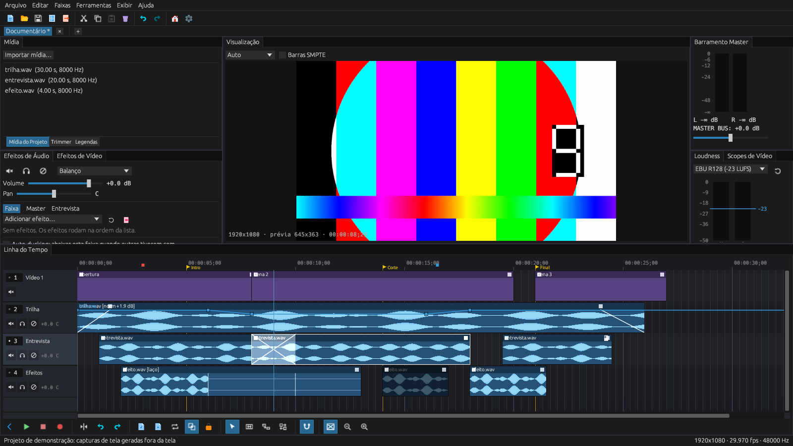
</p>

> **Em migração.** A branch `refactor/100-percent-rust` substitui a arquitetura anterior (C# / Avalonia, Rust FFI, C++ e Python) por um único workspace Rust. Os diretórios legados (`desktop-host/`, `desktop-host.Tests/`, `rust-core/`, `cpp-extensions/`, `python-backend/`) foram removidos; continuam no histórico do Git (commit `36b1d19` e anteriores).

Consulte [AGENTS.md](./AGENTS.md) para os padrões de arquitetura e codificação (Parte I) e [REQUIREMENTS.md](./REQUIREMENTS.md) para o detalhe de versões.

## Galeria visual

As imagens abaixo são geradas pelo próprio programa, **fora da tela** (sem abrir janela), com um projeto de demonstração montado em memória: `cargo test -p neoveg_ui --test headless_screenshot` com `NEOVEG_SCREENSHOTS=1` (veja [Capturas de tela](#capturas-de-tela-headless)). O áudio das mídias é sintético; o painel de visualização mostra um **quadro real decodificado** de um vídeo de amostra em 1080p (`crates/neoveg_video/tests/assets/sample_video.mp4`, gerado com o `ffmpeg`), o quadro do cursor (00:00:08;29), lido pelo programa `ffmpeg` e enviado como textura do painel; sem o `ffmpeg` no PATH ele fica preto.

### Layout geral


O espaço de trabalho acoplável (`egui_dock`): **Mídia** (Mídia do Projeto, Trimmer e Legendas) e **Efeitos de Áudio** à esquerda, **Visualização** no centro, **Barramento Master** com as abas **Loudness** e **Scopes de Vídeo** à direita, e a **Linha do Tempo** embaixo, com a barra de ferramentas logo abaixo dela.

### Linha do tempo

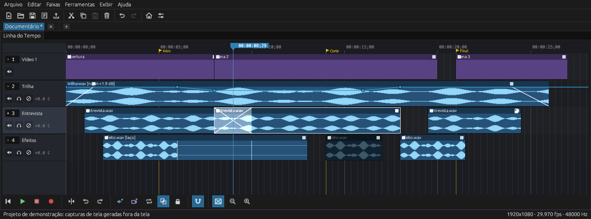

Faixas de vídeo e áudio com forma de onda real, **crossfade automático** na sobreposição de dois eventos (o X sobre a faixa *Entrevista*), **envelope de volume** na faixa *Trilha*, marcadores, régua SMPTE e o cursor de reprodução. Os eventos mostram os interruptores: **Mute** (escurecido), **Lock** (cadeado), **Loop** (`[laço]` e uma marca a cada repetição), **Normalize** (`[norm +1.9 dB]`) e **Inverter fase**.

### Vários projetos e sub-projetos

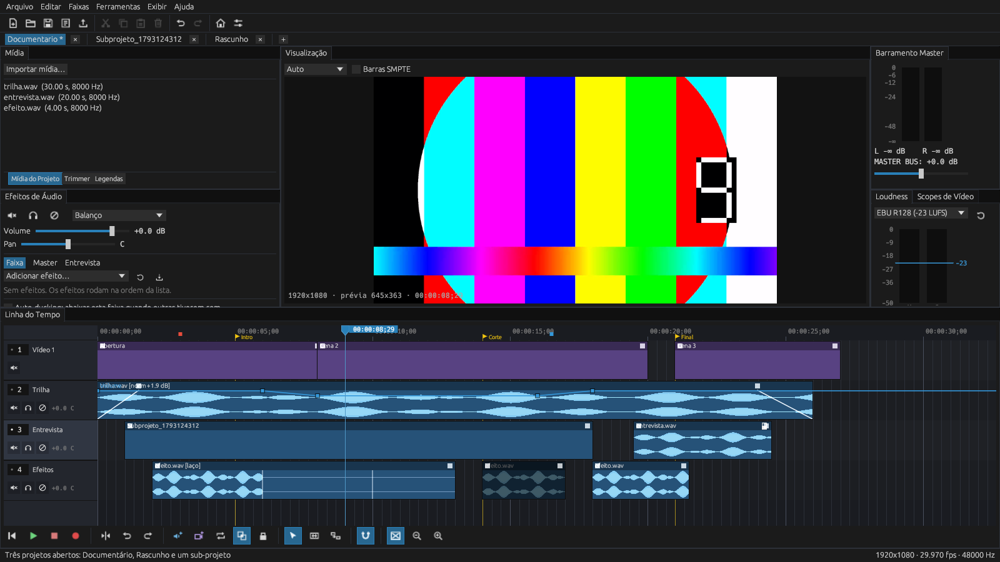

Cada projeto aberto tem sua aba (`*` marca alterações não salvas). Um conjunto de eventos pode virar um **sub-projeto** (`Ctrl+Shift+N`): ele aparece como um único evento na linha do tempo do projeto pai e abre em outra aba com um duplo clique.

### Ícones

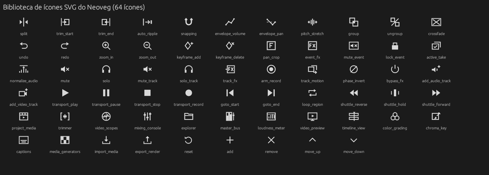

### Tela de boas-vindas

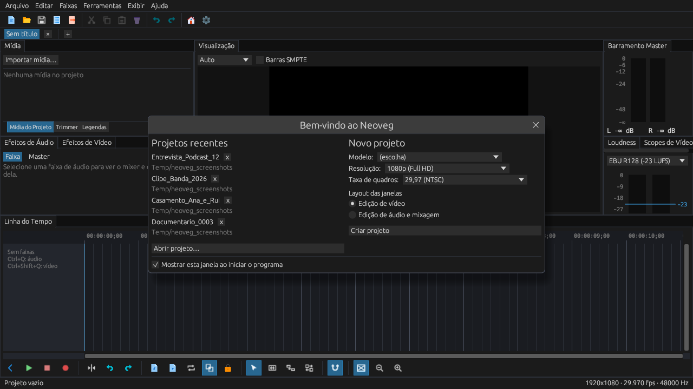

Ao iniciar, a tela de boas-vindas lista os **projetos recentes** (os arquivos que sumiram aparecem avisados), abre um arquivo e cria um **novo projeto** com modelo, resolução e taxa de quadros escolhidos nas listas, mais a escolha entre dois layouts de janela: edição de vídeo ou edição de áudio e mixagem. Ela se desliga em Editar > Preferências ou na própria caixa, e volta por Ajuda > Tela de boas-vindas. Arquivo > Projetos recentes tem a mesma lista.

### Notas e detalhes de edição

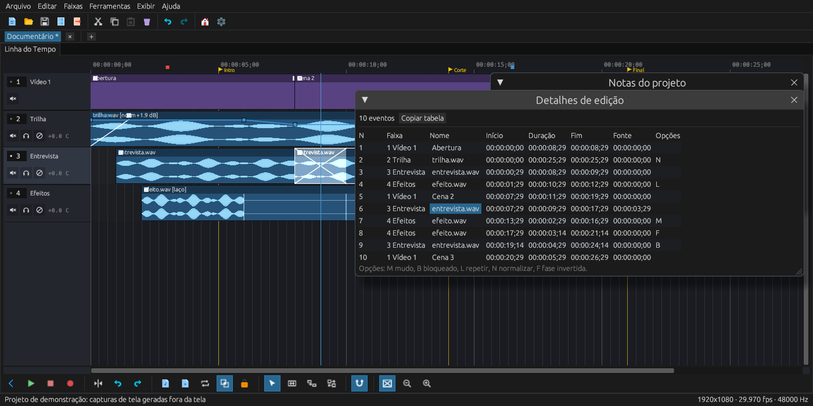

As **notas do projeto** ficam presas a um tempo da linha do tempo (quadrado colorido na régua), com cor, etiqueta e texto, e podem ser resolvidas ou ocultadas. Os **detalhes de edição** listam todos os eventos como uma lista de cortes.

### Efeitos de vídeo

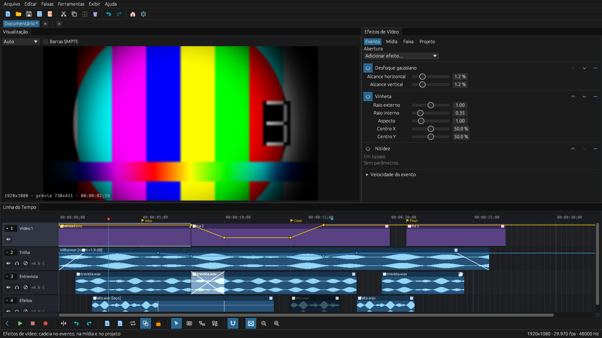

A aba **Efeitos de Vídeo** (`Ctrl+Alt+8`, ao lado de Efeitos de Áudio) edita a cadeia do **evento** selecionado, da **mídia** dele (vale para todos os eventos que a usam), da **faixa** ou do **projeto**. Na imagem, o evento *Abertura* tem desfoque gaussiano, vinheta e uma nitidez em bypass; a mídia tem uma máscara de nitidez e o projeto uma vinheta. A prévia mostra o resultado, e um controle arrastado aparece nela ao vivo antes de soltar.

### Pan/Crop do evento

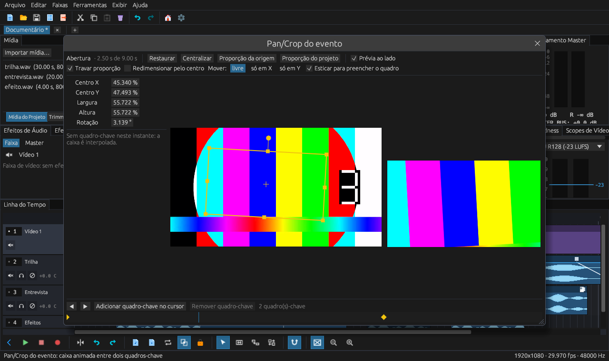

A janela **Pan/Crop do evento** mostra a imagem de origem com a caixa de seleção (alças nos cantos e nas bordas, alça redonda para girar, arrastar dentro para mover), os valores numéricos, os quadros-chave do evento e, ao lado, a prévia com o recorte. Na imagem, a caixa se move e dá zoom entre dois quadros-chave e está no meio do caminho (2,5 s).

### Movimento da trilha

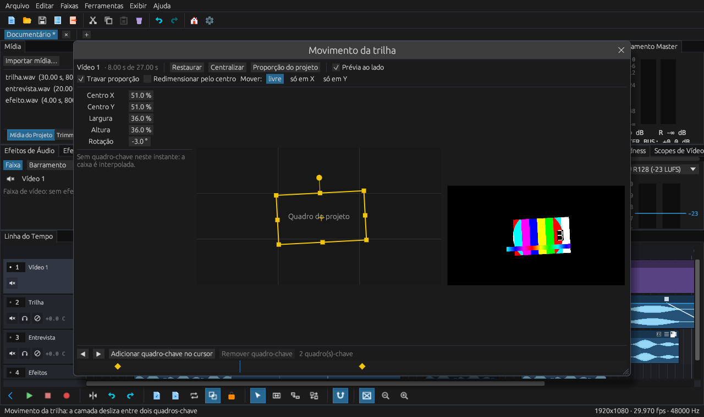

A mesma janela edita o **movimento da trilha** de vídeo: a caixa mostra onde a camada fica no quadro do projeto (menor é um picture-in-picture), com posição, tamanho e rotação, quadros-chave na linha do tempo e a prévia ao lado. Na imagem, a camada encolhe para pouco mais de um terço do quadro e desliza do canto inferior direito para o superior esquerdo; o cursor está no meio do caminho (8 s).

### Transições

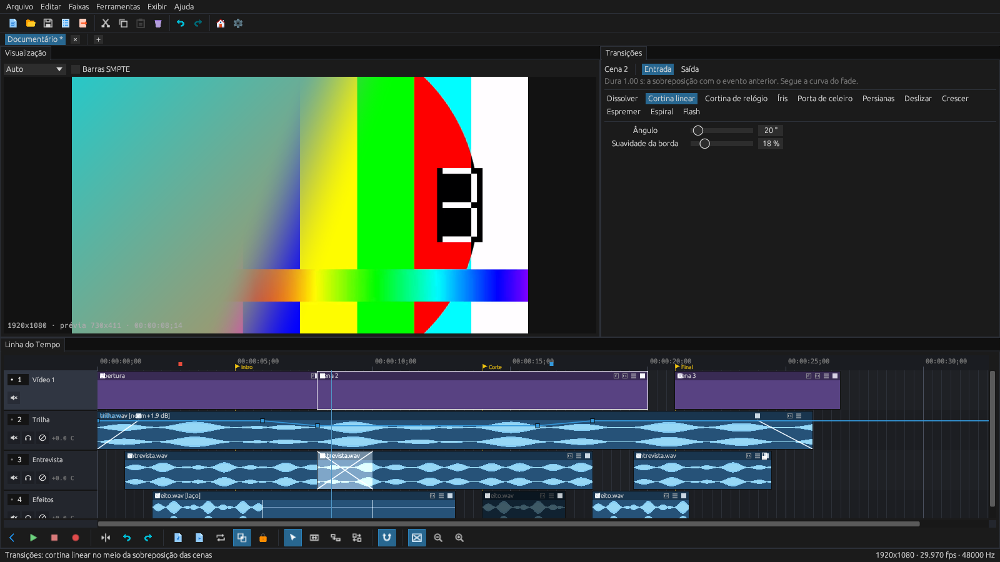

A aba **Transições** escolhe como o evento selecionado aparece (**Entrada**) ou some (**Saída**): oito transições com seus parâmetros. A transição dura o fade do evento, ou a sobreposição com o evento anterior, e segue a curva do fade. Na imagem, uma cortina linear a 20° com borda suave passa a cena 2 por cima da cena 1, a meio caminho da sobreposição de 1 s.

### Velocidade do evento

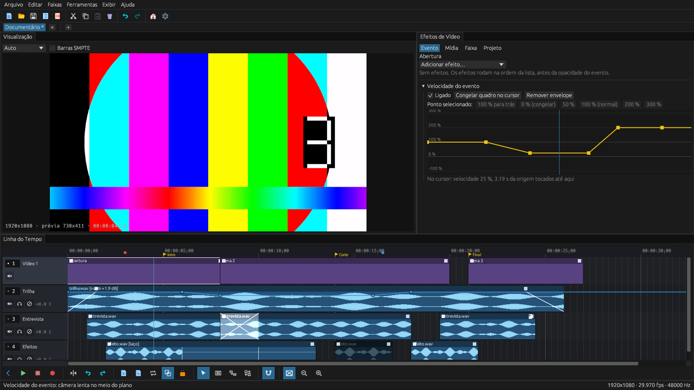

Na aba **Efeitos de Vídeo**, a seção **Velocidade do evento** desenha a velocidade ao longo do evento, de −100 % (para trás) a 300 %, com as linhas de 0 % (congelar) e 100 % (normal). Os pontos arrastam-se, ganham pré-ajustes e curvas pelo menu do botão direito, e um duplo clique cria um ponto novo. O evento mantém o comprimento: o envelope só decide quanto da mídia toca. Na imagem, o plano segue em velocidade normal, cai para 25 % no meio e termina a 200 %; no cursor, o quadro mostrado é o da posição de origem 3,19 s, e não o do tempo 4,5 s da linha do tempo.

### Propriedades do projeto

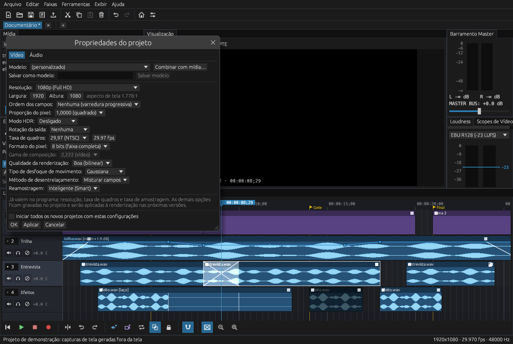

Arquivo > Propriedades do projeto: 28 modelos de formato (de SD NTSC/PAL a 8K), 27 resoluções (de 360p a 8K UHD, mais cinema, redes sociais e ultralargo), 17 taxas de quadros (de 15 a 240), proporção do pixel, ordem dos campos, formato do pixel, modo HDR, rotação da saída, qualidade da renderização, desfoque de movimento, desentrelaçamento e reamostragem; na aba de áudio, taxa de amostragem (8 a 192 kHz), profundidade de bits, barramento e nível de normalização. Dá para salvar os seus próprios modelos, copiar o formato de um arquivo de mídia e iniciar todos os novos projetos com as mesmas configurações. Resolução, taxa de quadros e taxa de amostragem já valem; as demais opções ficam gravadas no projeto.

A biblioteca de pictogramas SVG autorais (24x24, planos, `currentColor`), desenhados para seguir as cores do tema em qualquer escala e DPI.

## Desempenho por resolução

Custo, **por quadro**, do caminho de vídeo em CPU, de 480p a 8K UHD, medido com o benchmark `playback_bench` (Criterion, uma thread): `cargo bench -p neoveg_video --bench playback_bench`, depois `python scripts/bench_table.py --readme` para reescrever a tabela. Cada coluna é a **mediana** de 10 amostras:

* **Gerar quadro**: construir um quadro RGBA8 (as barras SMPTE do gerador, no lugar de um quadro decodificado);
* **Correção de cor**: a correção primária da prévia (exposição, contraste e saturação);
* **Scopes**: histograma, forma de onda e vetorscópio do quadro;
* **Crossfade (CPU)**: composição de duas camadas de quadro inteiro sobre um fundo preto. É o caminho de **CPU**; a prévia e a exportação usam a GPU quando há adaptador (o trabalho ainda não é medido).

<!-- bench:begin -->
| Resolução | Tamanho | Gerar quadro | Correção de cor | Scopes | Crossfade (CPU) | Quadro normal: cor + scopes (quadros/s) | Quadro em transição: + crossfade (quadros/s) |
| --- | --- | ---: | ---: | ---: | ---: | ---: | ---: |
| 480p | 854x480 | 2.15 ms | 1.13 ms | 7.02 ms | 11.27 ms | 8.14 ms (123) | 19.41 ms (51.5) |
| 720p | 1280x720 | 4.71 ms | 2.28 ms | 7.09 ms | 25.34 ms | 9.37 ms (107) | 34.71 ms (28.8) |
| 1080p | 1920x1080 | 10.52 ms | 4.57 ms | 9.74 ms | 57.51 ms | 14.31 ms (70) | 71.82 ms (13.9) |
| 1440p | 2560x1440 | 18.70 ms | 7.63 ms | 9.65 ms | 99.84 ms | 17.28 ms (58) | 117 ms (8.5) |
| 4K | 3840x2160 | 43.56 ms | 17.09 ms | 8.48 ms | 226 ms | 25.57 ms (39) | 251 ms (4.0) |
| 8K | 7680x4320 | 171 ms | 61.65 ms | 9.55 ms | 954 ms | 71.20 ms (14) | 1025 ms (1.0) |

Medido em: Intel(R) Core(TM) i5-7500T CPU @ 2.70GHz (4 threads), Windows 10, Rust 1.99.1. A tabela seguinte vem de uma segunda máquina (AMD Ryzen 5 5600GT, 12 threads, Windows 11 Pro); os números das duas não são comparáveis um a um fora do mesmo benchmark e da mesma versão do Rust.
<!-- bench:end -->

Segunda máquina (mesmo benchmark, 2026-10-28): AMD Ryzen 5 5600GT with Radeon Graphics (12 threads), Windows 11 Pro, Rust 1.99.1. No 8K, o crossfade teve variação alta entre as amostras (531 a 661 ms); a mediana é a da tabela.

| Resolução | Tamanho | Gerar quadro | Correção de cor | Scopes | Crossfade (CPU) | Quadro normal: cor + scopes (quadros/s) | Quadro em transição: + crossfade (quadros/s) |
| --- | --- | ---: | ---: | ---: | ---: | ---: | ---: |
| 480p | 854x480 | 0.98 ms | 0.48 ms | 2.14 ms | 6.36 ms | 2.62 ms (382) | 8.98 ms (111.4) |
| 720p | 1280x720 | 2.25 ms | 0.96 ms | 1.97 ms | 14.20 ms | 2.93 ms (341) | 17.13 ms (58.4) |
| 1080p | 1920x1080 | 5.02 ms | 2.01 ms | 2.43 ms | 31.75 ms | 4.44 ms (225) | 36.19 ms (27.6) |
| 1440p | 2560x1440 | 9.00 ms | 3.42 ms | 2.80 ms | 56.19 ms | 6.21 ms (161) | 62.40 ms (16.0) |
| 4K | 3840x2160 | 20.58 ms | 7.37 ms | 2.45 ms | 127 ms | 9.82 ms (102) | 137 ms (7.3) |
| 8K | 7680x4320 | 82.96 ms | 29.54 ms | 2.83 ms | 511 ms | 32.37 ms (31) | 544 ms (1.8) |


**O que isto não mede:** a decodificação (precisa do FFmpeg e de um arquivo de mídia), a GPU, o envio de texturas, a janela e o áudio. Os números são um **teto** de quadros por segundo para o trabalho de CPU, não uma taxa de reprodução. A qualidade da visualização reduz o custo: Draft decodifica 1/4 da largura, Preview 1/2, Good e Best a largura cheia (por exemplo, em 4K: 960, 1920 e 3840 px).

## Pré-requisitos para contribuidores

A única dependência **obrigatória** é a toolchain oficial do Rust. Não são necessários .NET, CMake, compilador C++ nem Python. Os itens opcionais só são exigidos para cobertura de código e para a decodificação de vídeo com FFmpeg.

| Componente | Versão | Obrigatório? | Para que serve | Windows (`winget` / `rustup`) |
| --- | --- | --- | --- | --- |
| Rust (`rustup`, `cargo`, `rustc`) | 1.88+ estável | **Sim** | Compilar tudo (`crates/neoveg_*`) | `winget install --id Rustlang.Rustup --exact` |
| `clippy`, `rustfmt` | da toolchain | **Sim** | Lint e formatação (`-D warnings` na QA) | `rustup component add clippy rustfmt` |
| Visual Studio com *Desktop development with C++* (linker MSVC) | 2022 ou 2026 | **Sim, no Windows** | Linker do alvo `x86_64-pc-windows-msvc` | instalador do Visual Studio / Build Tools |
| `llvm-tools-preview` | da toolchain | Opcional | Relatórios de cobertura | `rustup component add llvm-tools-preview` |
| `cargo-llvm-cov` | 0.9+ | Opcional | `cargo llvm-cov --workspace` | `cargo install cargo-llvm-cov --locked` |
| FFmpeg **compartilhado** com `include/` e `lib/` | **7.1.x** (não 8/9) | Só para `--features ffmpeg` | Decodificação de vídeo (`ffmpeg-next` 7.1) | `winget install --id BtbN.FFmpeg.LGPL.Shared.7.1 --exact` |
| LLVM / `libclang` | **19.x** (22+ quebra a `ffmpeg-sys-next` 7.1.3) | Só para `--features ffmpeg` | `bindgen` gera as ligações do FFmpeg | `winget install --id LLVM.LLVM --exact --version 19.1.7` |
| `poppler` (`pdftoppm`) | qualquer | Opcional | Ver as páginas dos manuais como imagem (figuras e diagramas): sem ele só o texto dos PDFs é lido, com `pypdf`. As páginas renderizadas ficam fora do repositório (AGENTS.md, seções 28 e 37) | `winget install --id oschwartz10612.Poppler --exact` |

Variáveis de ambiente para o build com FFmpeg (Windows, escopo do usuário; abra um terminal novo depois de defini-las):

```powershell
# pasta extraída do pacote, a que contém bin\, include\ e lib\
[Environment]::SetEnvironmentVariable('FFMPEG_DIR', "$env:LOCALAPPDATA\Microsoft\WinGet\Packages\BtbN.FFmpeg.LGPL.Shared.7.1_Microsoft.Winget.Source_8wekyb3d8bbwe\ffmpeg-n7.1.5-12-g1fdbca85aa-win64-lgpl-shared-7.1", 'User')
[Environment]::SetEnvironmentVariable('LIBCLANG_PATH', 'C:\Program Files\LLVM\bin', 'User')
```

O nome da pasta do FFmpeg muda a cada versão do pacote: confira o caminho real em `%LOCALAPPDATA%\Microsoft\WinGet\Packages`. Em tempo de execução (inclusive `cargo test --features ffmpeg`) as DLLs do FFmpeg (`bin\`) precisam estar no `PATH` do terminal; o pacote do `winget` adiciona essa pasta ao `PATH`, então abra um terminal novo depois de instalar. Os testes de decodificação geram um clipe com o executável `ffmpeg` do `PATH` e são ignorados em silêncio quando ele não existe. Sem a feature `ffmpeg` o Neoveg abre normalmente e avisa na barra de status que vídeo está desabilitado.

### Ambiente de referência (o que foi instalado na máquina de desenvolvimento)

Resumo do que o projeto usa hoje, para reproduzir o ambiente em outra máquina Windows:

- [x] Rust estável 1.99.1 (`rustup`), alvo `x86_64-pc-windows-msvc`, componentes `clippy`, `rustfmt`, `llvm-tools-preview`, `rust-src` e `rust-docs`
- [x] Visual Studio 2026 / Build Tools com *Desktop development with C++* (linker MSVC)
- [x] `cargo-llvm-cov` 0.9.1 (`cargo install cargo-llvm-cov --locked`)
- [x] FFmpeg 7.1.x compartilhado LGPL (`BtbN.FFmpeg.LGPL.Shared.7.1`) com `FFMPEG_DIR` apontando para a pasta extraída
- [x] LLVM / `libclang` 19.x com `LIBCLANG_PATH=C:\Program Files\LLVM\bin` (o LLVM 22+ quebra a `ffmpeg-sys-next`)
- [x] Git e GitHub Desktop (fluxo de branches descrito no AGENTS.md, seção 11)
- [x] Nenhum dos itens legados (.NET SDK, CMake, Python) é necessário para o workspace Rust (o Python só roda o empacotamento opcional, `build_portable.py`, e os scripts de `scripts/`)

**Linux (Debian / Ubuntu):**

```bash
sudo apt update && sudo apt install -y build-essential pkg-config \
    libasound2-dev libudev-dev libx11-dev libxcursor-dev libxrandr-dev libxi-dev \
    libxkbcommon-dev libxkbcommon-x11-dev libwayland-dev libvulkan-dev
# opcional, para --features ffmpeg:
sudo apt install -y libavcodec-dev libavformat-dev libavutil-dev libswscale-dev libclang-dev
```

**macOS:** `xcode-select --install` e, para o FFmpeg, `brew install ffmpeg@7 llvm pkg-config`.

## Compilar, testar e executar

```bash
cargo build --workspace --release
cargo test --workspace
cargo clippy --workspace --all-targets -- -D warnings
cargo fmt --all -- --check
cargo llvm-cov --workspace --summary-only           # opcional: cobertura
cargo run --release -p neoveg_ui                    # abre o Neoveg com um projeto vazio (sem vídeo)
cargo run --release -p neoveg_ui --features ffmpeg  # com decodificação de vídeo na prévia
cargo test --workspace --features neoveg_ui/ffmpeg  # inclui os testes de decodificação reais
python build_portable.py                            # QA + exe + pastas e arquivos portáteis em dist/ (só Python padrão)
python build_portable.py build --ffmpeg --targets all  # com vídeo; alvos de outros sistemas exigem o target do Rust instalado
python build_portable.py qa                         # só fmt + clippy + testes + build; grava coverage/qa/qa_report.json
```

Logs: `logs/neoveg.log` e `logs/crash.log` ao lado do executável.

### Capturas de tela (headless)

```bash
# gera docs/screenshots/*.png sem abrir janela (precisa de um adaptador wgpu: GPU ou renderizador por software)
NEOVEG_SCREENSHOTS=1 cargo test -p neoveg_ui --test headless_screenshot -- --nocapture      # Linux / macOS
$env:NEOVEG_SCREENSHOTS = "1"; cargo test -p neoveg_ui --test headless_screenshot -- --nocapture   # PowerShell
cargo run -p neoveg_ui -- --screenshots docs/screenshots                                    # o mesmo, direto pelo programa

# capturas, benchmark e conversão de ícones em segundo plano, sem travar o terminal
powershell -File scripts\run_background_agent.ps1 -Wait
```

Sem `NEOVEG_SCREENSHOTS=1` o teste é ignorado (ele reescreve arquivos versionados e precisa de adaptador gráfico), então `cargo test --workspace` não depende de GPU.

### Testar e compilar em qualquer máquina (Docker)

> **Em pausa.** Desde 28/10/2026 o foco é só o Windows; o Docker (Linux e macOS) fica para o porte, depois. O ambiente abaixo continua no repositório (inclusive as distros Debian, Ubuntu, Fedora e Arch no perfil `distros`, e o Docker-OSX no perfil `macos-native`), mas não é o fluxo de trabalho atual. Em 28/10 o Debian, o Ubuntu e o Fedora passaram `rustfmt`, `clippy` e 142 testes; o Arch e o Docker-OSX nunca rodaram.

O ambiente isolado em `docker/` roda `rustfmt`, `clippy -D warnings` e `cargo test --workspace` num container Linux (com Xvfb para a parte gráfica) e compila os binários otimizados de Linux e, opcionalmente, de macOS (Intel e Apple Silicon). Só precisa do Docker.

```bash
# um comando: sobe o Linux (testes e, se passarem, o build de release) e grava dist/linux/
docker compose -f docker/docker-compose.yml up --build        # ou: docker-compose -f docker/docker-compose.yml up --build

# o mesmo, com verificação do resultado, em Linux/macOS e no PowerShell (Windows, Linux, macOS)
scripts/test_rust_crossplatform.sh
pwsh scripts/test_rust_crossplatform.ps1                       # Windows PowerShell 5.1: powershell -File scripts\test_rust_crossplatform.ps1

# com o build cruzado de macOS (precisa do pacote do SDK em docker/sdk/, veja docker/sdk/README.md)
docker compose -f docker/docker-compose.yml --profile macos up --build
scripts/test_rust_crossplatform.sh --macos
```

| Serviço | O que faz | Saída |
| --- | --- | --- |
| `test-rust-linux` | `cargo fmt --check`, `cargo clippy --workspace --all-targets -- -D warnings`, `cargo test --workspace` sob Xvfb | `dist/reports/test-linux.txt` |
| `build-rust-linux-release` | binário otimizado, pasta portátil e `.tar.gz` (só depois dos testes) | `dist/linux/` |
| `build-rust-macos-release` (perfil `macos`) | compila os testes e o release para `x86_64-apple-darwin` e `aarch64-apple-darwin` com osxcross | `dist/macos/` |

Os testes **rodam** só no Linux; os binários de macOS são apenas compilados no container (não executam em Linux). O script verifica que nenhum teste falhou, que o `rustfmt` e o `clippy` passaram e que os artefatos existem, e imprime os SHA-256. Opções: `--ffmpeg`, `--no-cache`, `--tests-only`, `--macos`.


## Estrutura do workspace

| Crate | Responsabilidade |
| --- | --- |
| `crates/neoveg_common` | Tipos de projeto, timecode SMPTE (drop-frame), log e preferências. |
| `crates/neoveg_audio` | Decodificação (`symphonia`), mixer multifaixa, saída de áudio (`cpal`), medidores de pico reais e waveform amostra a amostra. |
| `crates/neoveg_video` | Quadros RGBA, geradores procedurais (barras SMPTE), upload para GPU (`wgpu`) e decodificação opcional (`ffmpeg-next`). |
| `crates/neoveg_engine` | Timeline, faixas, eventos, comandos com Desfazer/Refazer, projetos `.neoveg` (ZIP) e relink de mídia ausente. |
| `crates/neoveg_ui` | Aplicação `egui` com painéis acopláveis, slider de precisão, régua com grade de frames adaptativa e cabeçalhos de faixa. |

## Roteiro (o que já está pronto e o que falta)

### Feito

- [x] Workspace Cargo com as cinco crates, `clippy -D warnings`, `rustfmt` e testes passando
- [x] Janela principal (`eframe` + `wgpu`) com projeto vazio e painéis acopláveis/destacáveis
- [x] Waveform amostra a amostra (min/max/RMS por coluna; amostras individuais com pontos em zoom alto)
- [x] Grade de frames adaptativa e régua SMPTE com timecode drop-frame
- [x] Playhead de 1 pixel físico com piscar do cursor em pausa
- [x] Slider de precisão (polegar quadrado, duplo clique restaura, `Ctrl` = ajuste fino, menu de contexto)
- [x] Timeline: faixas de áudio/vídeo, dividir (`S`), mover/remover eventos, Desfazer/Refazer
- [x] Edição de eventos com o mouse: mover (inclusive entre faixas do mesmo tipo), aparar nas duas bordas (a fonte mantém o alinhamento e não passa do começo nem do fim da mídia), alinhamento a quadros, ao cursor e às bordas de outros eventos (`F8`; `Alt` ignora), rolagem automática nas bordas, `Esc` cancela e cada arrasto é um único Desfazer
- [x] As 5 curvas de fade (linear, rápida, lenta, suave, acentuada) com alças nos cantos do evento, menu do botão direito e Inspetor; crossfade automático em sobreposições parciais (ligável em Editar e na barra)
- [x] Importação de áudio (WAV, MP3, FLAC, OGG, AAC) em thread de fundo
- [x] Importação de vídeo (MP4, MOV, MKV, AVI, WebM...) com eventos de vídeo e áudio ligados e formato do projeto definido pelo primeiro clipe
- [x] Decodificação de vídeo na prévia: thread de fundo, busca por quadro exato, qualidade Draft/Preview/Good/Best/Auto (feature `ffmpeg`)
- [x] Mixer multifaixa: soma todos os eventos de áudio ativos, com fade-in/out e `trim_in`
- [x] Medidores L/R reais no Barramento Master, zerados com a reprodução parada
- [x] Projetos `.neoveg` (ZIP com `project.json`, `media_pool.json`, `history.json`): abrir, salvar, salvar como
- [x] Autosave (padrão 2 min, configurável em Editar > Preferências) e recuperação após falha: `recovery_*.neoveg` em `%LOCALAPPDATA%\Neoveg\autosave` (Linux `~/.local/share/neoveg/autosave`, macOS `~/Library/Application Support/neoveg/autosave`); aviso de alterações não salvas ao sair e `*` no título
- [x] Relink de mídia ausente ao abrir: nome exato e depois nome aproximado (passos 1 e 2)
- [x] Log central em `logs/neoveg.log` e `logs/crash.log`
- [x] Seleção de eventos e de tempo, recortar/copiar/colar/colar inserindo/repetir colar, aparar à seleção e dividir em várias faixas (Fase 1, exceto os itens abertos abaixo)
- [x] Empacotamento: `python build_portable.py` gera o exe, as pastas e os arquivos portáteis e o relatório de QA
- [x] Tabela de comandos e mapa de teclado personalizável (Editar → Personalizar teclado…), com os atalhos atuais preservados e os atalhos padrão do roteiro já reservados

### A fazer (em ordem de prioridade)

- [x] Importar imagens estáticas, sequências numeradas (`.neovegseq`) e geradores (`.neoveggen`) como mídia de vídeo (Arquivo > Importar mídia)
- [x] Cache LRU de quadros decodificados e pré-busca de 1 a 2 quadros durante a reprodução, no worker de vídeo
- [x] Composição de várias faixas de vídeo na prévia: a primeira faixa fica por cima, e a sobreposição de dois eventos da mesma faixa faz crossfade (o evento seguinte entra com fade); o mesmo pedido de quadro alimenta a exportação
- [x] Reprodução de vídeo sincronizada ao relógio de áudio: o cursor e o quadro seguem o som no alto-falante (a posição do último buffer, adiantada pelo tempo desde o callback e atrasada pela latência de saída da placa, sem degraus de um buffer e sem recuar). Se a decodificação atrasa, o quadro mais novo vence e os intermediários são descartados, como na referência. Falta compensar o tempo que o quadro leva para ser decodificado e desenhado (hoje a imagem chega um pouco depois do som) e mostrar quadros descartados. Não foi medido ouvindo e vendo um vídeo real.
- [x] Mídia ausente: ao abrir um projeto, a busca por nome igual e por nome parecido roda em segundo plano e confere cada candidato com o que o projeto guardou (duração com tolerância de 1 % ou 0,25 s, canais e quadros por segundo); um candidato com outra duração é recusado e aparece com o motivo na janela **Mídia ausente** (Arquivo > Mídia ausente…), que também tem *Localizar…* (relink manual de uma mídia, o arquivo escolhido vale e a duração é conferida ao carregar) e *Buscar em uma pasta…*. Os eventos da mídia ausente ficam marcados com *MÍDIA OFFLINE*. *Ignorar e deixar offline* (uma ou todas) tira a mídia da fila sem apagá-la da lista; *Buscar em todos os lugares* varre todos os discos numa thread, com contador de pastas e botão *Parar*, pulando pastas do sistema; a janela **Erro de arquivo de mídia** pergunta, para um arquivo do projeto que existe mas não abre, se quer escolher outro arquivo, ignorar ou ignorar todos os erros seguintes. Quando a mídia é achada fora da pasta do projeto, a janela **Mídia encontrada** oferece *Copiar para a pasta do projeto* (o original fica; o projeto passa a apontar para a cópia).
- [x] Ferramentas de edição Slip e Slide (`D` / `Shift+D` / `Ctrl+D`, Editar > Ferramenta de edição e botões na barra): Slip desliza a mídia dentro do evento, Slide move o evento e a mídia fica no lugar; os dois param no início e no fim da mídia, em quadros inteiros, um passo de desfazer
- [x] Stretch por ferramenta, Shuffle, Split Trim e Slide com ajuste dos vizinhos; ripple (seleção múltipla, agrupar e desagrupar já feitos)
- [x] Aparar com o mouse em eventos de mídia gerada (hoje o limite de fonte só vale para mídia importada)
- [x] Marcadores (`M`), regiões e loop
- [x] Volume, pan, mute e solo por faixa
- [x] Barramentos de áudio e sends (manual v21 p.869-873): até 26 barramentos além do master (Faixas > Inserir barramento de áudio, `Ctrl+Alt+B`), cada um com nome, volume, pan, mudo, fase, cadeia de efeitos e saída para o master ou outro barramento (um laço é recusado); a faixa escolhe a saída e tem sends por barramento, antes do fader (padrão, independente dele) ou depois, com ou sem o pan da faixa; apagar um barramento passa o que ia para ele ao barramento anterior. Tudo em passos de desfazer, no formato do projeto com `#[serde(default)]`, e o mixer compensa a latência dos efeitos do barramento. Faltam as faixas de barramento na linha do tempo, envelopes de barramento, saída para dispositivos e as tiras na janela do mixer.
- [x] Plug-ins de áudio VST3 (`.vst3`) como efeitos das faixas e do master, pelo crate `vst3` (bindings das especificações públicas, `MIT OR Apache-2.0`, sem SDK para compilar): busca nas pastas do sistema e em `VST3_PATH`, carregar um arquivo, parâmetros normalizados com envelopes de automação, compensação de latência (PDC) e a mesma lista de efeitos do CLAP. Testado com o plug-in de ganho de exemplo do crate. Faltam a janela do editor do plug-in, eventos MIDI, salvar e restaurar o estado, mensagens entre componente e controlador, macOS e o processo isolado (linha abaixo).
- [x] Transições na GPU (`wgpu`): as dezesseis (dissolver, wipe linear, wipe de relógio, íris, porta, persiana, deslizar, crescer, espremer, espiral, flash, dividir, empurrar, rolar página, descolar página e cortina de gradiente) rodam em compute shader conferido por teste contra a referência da CPU, que continua como reserva.
- [x] Mais efeitos de vídeo e transições novas na GPU (`wgpu`), cada um com a referência na CPU conferida por teste: trinta e dois efeitos (incluindo Equilíbrio de cor e Ajuste de saturação por faixa de matiz) e dezesseis transições. **Rolar página, Descolar página e Empurrar** (com borda de tamanho, suavidade e cor) enxergam o clipe anterior da faixa; a **Cortina de gradiente** usa sete padrões embutidos; o **Flash** ganhou a difusão horizontal e vertical. Faltam a imagem de gradiente do usuário, as bordas das outras transições, o Page Roll e o Page Peel com sombra e curvatura em 3D de verdade e o Limitador de vídeo.
- [x] Geradores de mídia (cor sólida, padrões de teste, gradientes e títulos com contorno, sombra e animação) pela janela Faixas > Inserir mídia gerada
- [x] Cabeçalho de evento (manual v21 p.242): o nome à esquerda e, à direita, botões de ícone com dica: *Editar mídia gerada* (só mídia gerada), *Pan/Crop* (eventos de vídeo), *Efeitos* (abre a aba de efeitos do evento, ou da faixa no áudio) e o menu (☰) com as ferramentas do evento, o mesmo do botão direito. Eventos estreitos perdem os botões da esquerda para a direita. O **Inspetor** (Ferramentas) ganhou nome, início e duração editáveis, interruptores (mudo, travado, laço, fase, normalizar), reamostragem, dados da mídia e atalhos para Pan/Crop, efeitos e mídia gerada. Falta o conjunto de botões configurável (*Edit visible button set*, o comprimento e o congelar quadro no cabeçalho).
- [x] **Renderização sem FFmpeg** (adaptada do FilmCraft): MP4 com vídeo H.264 e áudio AAC escritos em Rust puro (`neoveg_h264`, `neoveg_aac` e `neoveg_media`), com qualidade CRF, `moov` na frente (reprodução em fluxo) e o som intercalado com o vídeo; é o codificador padrão do MP4 H.264, e o FFmpeg continua opcional (escolha **Codificador** no diálogo: Automático, Interno ou FFmpeg). HEVC, ProRes e WebM ainda pedem o FFmpeg.
- [x] Renderização/exportação (Make Movie) com FFmpeg em segundo plano (Arquivo > Renderizar como…): MP4 H.264 / HEVC, MOV ProRes, WebM VP9 ou só áudio WAV; mixagem offline com os efeitos das faixas e do master, relatório de loudness BS.1770-4 ao lado do arquivo, progresso e cancelamento
- [x] Importação e exportação de listas de edição CMX 3600 (`.edl`): exporta os cortes da faixa selecionada com os comentários de nome do clipe e arquivo, importa cortes (transições lidas como corte, com aviso) para as mídias que já estão no projeto, em um passo de desfazer
- [x] Importação e exportação de XML do Final Cut Pro 7 (`xmeml` v5): todas as faixas e clipes (posição, entrada e saída da fonte, nomes e caminhos), importando para as mídias do projeto em um passo de desfazer
- [x] Importação e exportação de FCPXML do Final Cut Pro (`<fcpxml version="1.10">`): tempos racionais exatos por quadro (`1001/30000s`, `1/25s`), faixas conectadas de vídeo e áudio, marcadores e regiões, em um passo de desfazer
- [x] Importação e exportação de OpenTimelineIO (`.otio` JSON em Rust puro: `Timeline.1`, `Stack.1`, `Track.1`, `Clip.1`/`Clip.2`, `Gap.1`, `Transition.1` para crossfades, `LinearTimeWarp.1` para time-stretch e `Marker.2` para marcadores e regiões, em um passo de desfazer)
- [x] Transcrição automática de fala para legendas com Whisper em Rust puro (`neoveg_audio::whisper` sobre `candle-transformers`, pesos `.safetensors` e `.gguf`, 9 idiomas + detecção automática, em thread própria e como um passo de desfazer na aba **Legendas**)
- [x] Chaveamento de croma (Chroma Key em Rust puro: `neoveg_common::chroma` + `neoveg_video::chroma`, recorte YCbCr Rec. 709 para tela verde/azul, suavidade de borda, supressão de *spill* preservando luminância e visualização da máscara P&B em **Ferramentas → Chaveamento de croma…**, em um passo de desfazer)
- [ ] Scripting para o usuário em Rust (substituir Roslyn/Python) (Em decisão: os scripts e extensões feitos para o VEGAS são código .NET (C#, VB.NET, JScript) e não rodam no Neoveg; falta escolher entre só Rhai com um guia de migração, um conversor Python que traduz esses scripts para Rhai, ou um host .NET opcional e isolado, e como espelhar o modelo de objetos sem copiar nomes de outro produto)
- [x] Vários projetos em abas e sub-projetos aninhados: `ProjectManager` (abrir, fechar, trocar), `MediaSource::SubProject`, validação de dependência circular, `Ctrl+Shift+N` cria um sub-projeto a partir da seleção, duplo clique no evento abre a aba, reprodução de áudio e vídeo expandindo o sub-projeto
- [x] Scrub com `J` / `K` / `L`: reprodução para frente e para trás em 1x, 2x, 4x, 8x e 16x (cada toque acelera, a outra tecla inverte, `K` pausa), com a velocidade aplicada no callback de áudio
- [x] Janelas: `Alt+0/2/3/4/5`, `Ctrl+Alt+2/7/9` mostram, trazem para a frente ou fecham cada janela acoplável; Exibir → Layouts salva e restaura até 9 layouts e o layout padrão
- [x] Preferências: aplicar o idioma (`pt-BR` padrão + 7 idiomas) em toda a interface: `neoveg_common::i18n` (`tr`, `tr_args`, `tr_text`, catálogos em `assets/i18n/strings/`) com 724 textos em en-US, de-DE, es-ES, fr-FR, ru-RU, ja-JP e zh-CN — menus, comandos, diálogos, painéis, janelas, mensagens da barra de status e valores das taxas, trocando na hora. O japonês e o chinês usam a fonte do sistema (`neoveg_ui::fonts`: Yu Gothic e Microsoft YaHei no Windows; carregada em segundo plano). Os catálogos de ja-JP e zh-CN foram escritos sem revisão de falantes nativos. Faltam: a legenda de Opções dos Detalhes de edição (as letras vêm do código), alguns textos soltos ("1,00×" do Inspetor, "prévia NxM") e a revisão das traduções
- [x] Ícones vetoriais próprios na barra da timeline (`neoveg_ui/src/icons.rs`, 16 pictogramas planos, no lugar dos emojis); falta levá-los aos demais painéis e ao menu
- [x] Tela de carregamento nova (`neoveg_ui/src/splash.rs`): formas 3D flutuando (projeção e sombreamento por software, com paralaxe do mouse), o nome NEOVEG animado em 3D, arte original animada de um carretel de filme desenrolando quadros sob o playhead (licença MIT) e barra de progresso que acompanha as etapas reais de inicialização (preferências, placa de vídeo, saída de áudio, efeitos, decodificador de vídeo e recuperação de projetos); qualquer tecla ou clique pula a espera
- [x] Sete temas (Classic Foundry, Classic Silver, Classic Gray, Charcoal Lilac, Modern Carbon Dark, Contemporary Electric Dark e High Contrast, este com contraste AAA) e temas personalizados em `.json` (`Editar → Preferências → Temas`)
- [x] Barra de ferramentas principal sob o menu (novo, abrir, salvar, propriedades, renderizar, recortar, copiar, colar, excluir, desfazer, refazer, boas-vindas e preferências), com 99 ícones SVG autorais na biblioteca
- [ ] Abas no rodapé em todos os painéis (hoje só o painel de Mídia; o `egui_dock` não posiciona a barra embaixo)
- [x] Visualizador de logs na interface (Ajuda > Visualizador de logs): filtro por nível, busca e cópia com confirmação `Copiado!`
- [ ] Empacotamento portátil (Windows, Linux, macOS x64/arm64) e CI com `cargo build/test/clippy/llvm-cov`
- [x] Remover os diretórios legados (`desktop-host/`, `rust-core/`, `cpp-extensions/`, `python-backend/`), o `Dockerfile` e o `docker-compose.yml` da raiz (o ambiente Docker atual está em `docker/`)

### Próximos passos (registrados em 27/10/2026)

O que ficou em aberto depois da rodada de edição (Fases 2 e 3), do pacote do Windows e da correção da timeline. Cada item vem de algo observado ao construir, testar ou abrir o programa; os de verificação dependem de olhar o programa em uso.

**Vídeo e saída**
- [x] **Renderização com o encoder disponível** (feito: `neoveg_video::render::encoder_for` sonda `ffmpeg -encoders` uma vez, em segundo plano, e escolhe `libx264`/`libopenh264`/`h264_mf`, `libx265`/`hevc_mf`, `prores_ks`/`prores_aw`; os que não aceitam CRF recebem bitrate; a janela de renderização mostra o codificador; ProRes e VP9 continuam sem opção em um FFmpeg LGPL, e a janela avisa): o render só sabe `libx264`, `libx265` e `prores_ks`; um FFmpeg LGPL (como o instalado por `winget`) traz `libopenh264`, `h264_mf`, `hevc_mf` e `libvpx-vp9` e **nenhum** dos três, então MP4 H.264, HEVC e ProRes falham. Sondar `ffmpeg -encoders` uma vez, escolher o primeiro disponível por formato (com os argumentos de cada um, que mudam: sem `-crf` no `h264_mf`) e dizer na janela de renderização qual foi usado. Enquanto isso o teste `a_video_render_encodes_the_composited_frames_when_ffmpeg_is_installed` se pula sem `libx264`, o que esconde o problema.
- [ ] **Conferir o som do vídeo importado em uso:** a faixa de áudio própria é criada e decodificada (corrigido: a faixa padrão de um MP4 é a imagem), mas o teste só confere o evento e o carregamento; abrir um vídeo real e ouvir.
- [ ] **Conferir a qualidade da prévia:** Draft e Preview agora mostram a resolução reduzida em pixels (amostragem vizinho mais próximo) em vez de um desfoque; confirmar que é o que se espera e, se o desfoque aparece também no Auto, investigar o tamanho pedido ao decodificador.
- [ ] Decodificação por GPU e HEIC/HEIF (já listados abaixo) seguem pendentes.

**Linha do tempo**
- [ ] **Régua:** a causa do piso de zoom foi corrigida (abaixo de 20 px/s a grade parava antes da borda). Se ainda quebrar em outro zoom ou posição, registrar o caso (zoom, rolagem, taxa de quadros) e reproduzir com um teste de `frame_grid`.
- [ ] Rolagem vertical: levar a faixa selecionada ou o cursor de volta à vista ao inserir faixas ou mudar de seleção, e rolar as faixas pelo teclado.
- [ ] Modo de edição expandida (A/B, quadros não usados dos dois lados, saída por `Esc`), passo de 1 pixel e roda do mouse com `Ctrl+Shift` no aparo por teclado, ripple ao mover e ao colar, e quadros ilegíveis em vermelho (Fase 2).
- [ ] Flag de deslocamento de snap por evento (Fase 3).
- [ ] Menus e janelas: conferir em uso o menu Arquivo reorganizado (Importar e Exportar) e a nova posição dos diálogos e das janelas de ferramenta; as janelas que já abrem ancoradas no centro (Inserir tempo, Ir para o tempo, Recuperar projetos, Alterações não salvas) ainda não seguem `dialogs.rs`.

**Build, pacote e ambiente**
- [ ] O `.ico` do programa não é versionado (`*.ico` está no `.gitignore`); o `build_portable.py` o gera, mas um `cargo build` direto sai sem ícone. Decidir entre uma exceção no `.gitignore` só para `assets/app_icon/app_icon.ico` ou gerar o ícone no `build.rs`.
- [ ] O vídeo exige LLVM 19.x para compilar (`ffmpeg-sys-next` 7.1.x quebra com 22 ou mais novo). Avaliar subir a crate `ffmpeg-next` (a 9.x existe, mas anuncia compatibilidade com o FFmpeg 4) em um teste isolado, ou fixar o LLVM 19 no fluxo de contribuição; o `build_portable.py` já recusa LLVM 22+ antes de compilar.
- [ ] CI com `cargo build/test/clippy/llvm-cov` e empacotamento nos três sistemas (já listado acima), incluindo FFmpeg com `libx264` quando houver.
- [ ] Reduzir o tamanho do cache de build local (`target/` passa de 9 GB em depuração e release): avaliar `[profile.dev] debug = "line-tables-only"` e rodar com `CARGO_INCREMENTAL=0` em manutenção.
- [ ] Falha intermitente de linkagem no Windows (`LNK1201`/`LNK1104`, um `.pdb` ou `.exe` de teste que não abre) depois de rebuilds seguidos: investigar antivírus e `mspdbsrv`; hoje basta apagar o `.pdb` do teste e repetir.

**Pesquisa e documentação**
- [ ] Registrar em `docs/research/nle_features_research.txt` os quatro itens da análise de lacunas sem registro (importar projeto de outro editor, envelope de vídeo "esmaecer para cor", conexão com serviço online de clipes, sobreposição de quadros de borda de edição) antes de virarem tarefa; ver `docs_obsidian/04 - Pesquisas e Benchmarks/lacunas_funcionais.md`.
- [ ] Conferir e atualizar as caixas do roteiro que parecem pendentes mas já têm código. Feito em 28/10: velocidade do evento, Track Motion, Pan/Crop e a composição de vídeo em várias faixas. O idioma da interface continua pendente: `Assets/i18n` tem oito arquivos, mas nenhum código os carrega.

### Próximos passos da referência funcional (registrados em 28/10/2026)

- [x] **Matriz de paridade** (`scripts/parity_matrix.py`, `docs_obsidian/ui_references/matriz_de_paridade.md`): os 872 comandos da referência agrupados por função, com estado e prioridade P1/P2/P3; é a lista de trabalho para chegar à paridade funcional.

Vêm das notas de `docs_obsidian/05 - Referencia Funcional/` (resumo em palavras próprias da varredura local do editor de referência). O comportamento exato de cada item continua vindo dos manuais (AGENTS.md §33).

**Vídeo, efeitos e geradores**
- [x] Velocidade do evento: o envelope de velocidade (de −100 %, para trás, a 300 %, com 0 % congelando) decide quanto da mídia toca sem mudar o comprimento do evento; pontos arrastáveis com curvas, pré-ajustes, *Congelar quadro no cursor* e prévia ao vivo na seção *Velocidade do evento* da aba Efeitos de Vídeo e no menu do evento. Aparar a borda esquerda, deslizar e cortar mantêm o quadro no lugar. *Congelar quadro no cursor* vale para todos os eventos de vídeo selecionados sob o cursor, de uma vez. Faltam desenhá-lo sobre o evento na linha do tempo, o áudio vinculado acompanhar e a velocidade nas exportações (EDL, FCP XML, OpenTimelineIO); tocar para trás busca a cada quadro e não é em tempo real em mídia de GOP longo.
- [x] Transições de vídeo: dezesseis transições (dissolver, cortina linear, cortina de relógio, íris, porta de celeiro, persianas, deslizar, crescer, espremer, espiral, flash, dividir, empurrar, rolar página, descolar página, cortina de gradiente); **empurrar, rolar página e descolar página enxergam o clipe anterior** da faixa (a camada de saída) quando ele se sobrepõe ao evento na entrada e na saída do evento e na sobreposição com o anterior, com a duração e a curva do fade, parâmetros e prévia na renderização (aba Transições, `Ctrl+Alt+6`). Faltam miniaturas e pré-ajustes, o envelope livre de progresso e as transições 3D.
- [x] Movimento da trilha: a camada de uma faixa de vídeo muda de posição, escala e rotação no quadro do projeto, com quadros-chave e suavidade (picture-in-picture, deslizes, camadas inclinadas), na mesma janela do Pan/Crop (Faixas ou Ferramentas > Movimento da trilha). Faltam 3D, sombra, brilho e o movimento do pai de um grupo.
- [x] Pan/Crop do evento: janela com a caixa de seleção sobre a origem (alças, rotação, mover, travar proporção, tamanho pelo centro, esticar para preencher), campos numéricos, quadros-chave com suavidade e prévia ao lado, valendo na prévia e na renderização (Ferramentas > Pan/Crop do evento). Faltam máscaras, centro de rotação, inverter e o botão no cabeçalho do evento.
- [x] Envelopes de faixa de vídeo: nível da faixa, esmaecer para cor (com paleta de cores) e mudo, editados na linha do tempo como os de áudio; valem na prévia e na renderização (Faixas > Envelopes de vídeo, `V` na faixa de vídeo).
- [ ] Envelopes de evento de vídeo: a velocidade está pronta; falta o envelope livre de progresso de transição (hoje o progresso é o ganho do fade).
- [x] **Cadeia de efeitos de vídeo na GPU** (`wgpu`) por evento e por faixa (até 32 efeitos, bypass, parâmetros, desfazer): painel **Efeitos de Vídeo** (`Ctrl+Alt+8`), versão de referência na CPU e versão em compute shader conferidas por teste, usada também na renderização. Também por mídia (vale para todos os eventos dela) e por projeto, e a prévia mostra o valor ao vivo durante o arraste de um controle.
- [x] Primeiros efeitos: desfoque gaussiano, nitidez, máscara de nitidez, vinheta, preto e branco, inverter, brilho e contraste, pixelizar, espelho, sépia, redemoinho, desfoque radial, mediana, ajuste HSL, desfoque linear e, adaptados do FilmCraft, equilíbrio de cor, níveis, correção de gama, posterizar, extrair, matiz, misturador de canais, ASC CDL, manter cor, trocar por cor, passar cor, ajuste de alfa, espelhar na horizontal e na vertical e deslocar (cada um na GPU e na referência da CPU, conferidos por teste). Faltam curvas de cor, recorte e o restante da lista abaixo.
- [ ] Mais efeitos, pelo maior valor: desfoques linear e radial, curvas de cor e recorte.
- [ ] Geradores que faltam: tabuleiro (xadrez) e textura de ruído (só pixels, baixo custo).
- [ ] Modelo de transição no engine antes da GPU: duração, curva, eixo A/B e envelope de progresso (nota `catalogo_transicoes_e_geradores`).
- [ ] Medir a GPU com o benchmark de reprodução antes de escolher a primeira família de efeitos (`desempenho_resolucoes`).
- [ ] Protótipo mínimo de host OFX em processo isolado.

**Edição**
- [x] Eventos de ajuste (`Ctrl+Alt+J`, menu Faixas): um evento vazio numa faixa de vídeo, com cadeia de até 32 efeitos, fades e opacidade, que age sobre as faixas abaixo dele enquanto dura; cortar, copiar, colar, Mudo e Travar valem. Velocidade e Pan/Crop não se aplicam a ele.
- [ ] Faixas de ajuste e redimensionar o evento de ajuste ao projeto.
- [x] Interruptor de reamostragem do evento de vídeo (menu Editar > Interruptores e menu do evento > Reamostragem): *Usar configuração do projeto* (sem reamostrar), *Mistura de quadros* (entre dois quadros da fonte, como na câmera lenta pela velocidade, mistura os dois em proporção) e *Desativar reamostragem*.
- [ ] Interruptores de vídeo que faltam: fluxo óptico, manter proporção, reduzir cintilação do entrelaçamento e a configuração de reamostragem do projeto.
- [x] Colar atributos do evento, completo (`Ctrl+Alt+V`) e seletivo (`Ctrl+Alt+Shift+V`, janela com uma caixa por atributo): interruptores, tom do áudio, velocidade de reprodução, efeitos de vídeo, Pan/Crop, envelope de velocidade e transições, num só passo de desfazer, no menu Editar e no menu do evento.
- [x] Mídia incompatível: quando a importação falha, uma janela oferece converter uma cópia (som para WAV, vídeo para MP4 H.264 + AAC, com o `ffmpeg`) e importá-la; o original não muda. O seletor de arquivos tem o filtro de todos os arquivos. Testado com 12 formatos de áudio e 6 de imagem; os de vídeo só rodam numa compilação com `--features ffmpeg`.
- [ ] Fechar lacunas e divisão inteligente (o manual a descreve com a transição de fluxo de deformação, que ainda não existe).
- [ ] Exportar e importar preferências (o `preferences.json` já é serializável).

**Áudio**
- [ ] VST3 em processo isolado, reaproveitando o modelo de latência do `BlockMixer`, e gerenciador de plug-ins.
- [ ] Predefinições (presets) de cada efeito de áudio e importação de presets.

**Janelas e projeto**
- [x] Layouts de janela nomeados e salvos em disco (`.neoveglayout`, pasta de dados do usuário): Exibir > Layouts lista os salvos com marca no atual, *Salvar layout como…* (nome e atalho de 1 a 9), *Salvar layout atual*, *Recarregar layout selecionado* e *Organizar layouts…* (trocar o atalho, carregar, excluir). `Alt+D` e depois um número carrega, `Ctrl+Alt+D` e depois um número salva.
- [ ] Layouts: guardar também as janelas destacadas e a pasta de layouts à escolha.
- [ ] Painel de compositores (modos de mistura), junto do modelo de composição.
- [ ] Diálogo de propriedades da mídia: timecode do arquivo ou personalizado, taxa de quadros substituta, ordem dos campos, proporção do pixel, canal alfa e cor de fundo.
- [ ] Esticar o tempo de evento de áudio com preservação de formantes.

**Interoperabilidade**
- [x] Importar e exportar **AAF** (Arquivo > Importar e Exportar > AAF), pelos crates `neoveg_aaf` e `neoveg_cfb` adaptados do FilmCraft (escritos a partir das especificações públicas da AMWA e do formato de arquivo composto da Microsoft): uma composição com uma trilha por faixa de vídeo e de áudio, preenchimentos e clipes com entrada na fonte, a sobreposição de dois eventos como transição, nomes, caminhos das mídias (com acentos e espaços), marcadores e o timecode; a importação põe os clipes cujas mídias já estão no projeto, em um passo de desfazer. **Ainda não conferido** com o Avid, o Premiere ou o Resolve (não há nenhum aqui): a conferência é a ida e volta pelos próprios leitor e escritor.
- [ ] Formatos de câmera (MXF, RAW): decidir quais valem o custo; AAF com velocidade, fades, volume e efeitos, com mídia embutida e com composições aninhadas
- [ ] Rever o menu Faixas contra os comandos de "Inserir" da referência quando os manuais cobrirem o assunto.

### A fazer a partir da pesquisa dos manuais e do `results.md` (inventário local, fora do repositório)

Fontes de referência (paridade funcional de NLE clássico; registrar achados em `docs/research/nle_features_research.txt`): manuais VEGAS Pro 10 (fundamentos e DSP de áudio), 11 (Titler, GPU, geradores), 12 (fluxos de edição expandidos), 13 (docking, correção de cor, pipelines de FX), 18 (UI escura moderna, rastreamento de movimento) e 21 (ferramentas de IA), além do inventário `results.md` (menus, diálogos, comandos e atalhos). Os PDFs ficam em `manuais/` (ignorada pelo Git por causa do tamanho); a lista abaixo já incorpora a leitura deles.

**Edição e timeline**
- [x] Excluir com ripple (`Ctrl+Delete`) e *Auto Ripple* (`Ctrl+L`) para a exclusão de eventos
- [ ] Modos de edição de ripple por faixa/tudo ao arrastar e aparar (aparar e esticar bordas já seguem o escopo com o Auto Ripple ligado; falta mover e colar)
- [x] *Velocity* (envelope de velocidade) de eventos (slip e slide já existem)
- [x] Seleção múltipla, agrupar (`G`) e desagrupar (`U`)
- [ ] Travar faixa/evento
- [x] Marcadores (`M`), regiões e loop
- [ ] Marcadores de comando e réguas adicionais
- [x] Trimmer com marcação de entrada/saída e inserção na timeline (três/quatro pontos)
- [x] Aninhar projetos (*nesting*) em abas, com validação de ciclos
- [ ] Faixas de composição pai/filho
- [ ] Envelopes e keyframes (volume, pan, opacidade, FX) com interpolação e automação
- [ ] Personalizar teclado, barras de ferramentas e layouts de janela (salvar/restaurar)

**Áudio**
- [ ] Mixing Console com barramentos, sends e inserts (volume, pan, mute e solo por faixa já existem)
- [x] Efeitos de áudio nativos por faixa e no master (adaptados do FilmCraft): equalizador paramétrico e de 3 bandas, compressor, expansor/gate, limitador (só no master, por ter latência), delay e reverb; cadeia de até 8 efeitos com bypass, ordem e parâmetros, salva no projeto, um passo de desfazer por ação; painel **Efeitos de Áudio**; ao mudar a cadeia durante a reprodução o áudio recomeça no cursor
- [x] Filtros (equalizadores gráficos de 10/20/30 bandas, paramétrico completo, notch, filtros clássicos Butterworth/Chebyshev/Bessel/Elíptico, filtro FFT), DeHum e DeNoise do `audio-dsp`, disponíveis em qualquer faixa e no master
- [x] Compensação de latência: efeitos com latência (limitador, DeNoise, filtro FFT) não deslocam a faixa em relação às outras nem ao vídeo; o mixer atrasa as faixas mais rápidas e adianta a mixagem pelo atraso total
- [x] Auto-ducking por faixa (a música desce quando as faixas de controle têm som): sensibilidade, redução em dB e transição; a análise roda ao iniciar a reprodução e a curva começa a descer antes do som entrar
- [x] Mais 19 efeitos do `audio-dsp`: mudança de tom (pitch), chorus/flanger, flanger, phaser, delay analógico e de várias batidas, compressor multibanda, rack de dinâmica, compressor valvulado, DeEsser, DeReverb, realce de fala, removedor de cliques, largura estéreo e ganho, volume por canal, balanço e inverter fase (28 efeitos no registro, com o RNNoise)
- [x] Redução de ruído por IA: efeito **RNNoise** (crate `nnnoiseless`, BSD-3-Clause), com mix e ganho de saída, compensação de latência e conversão de taxa para dispositivos de 44,1, 96 e 32 kHz
- [x] Nomes e rótulos dos parâmetros dos efeitos em pt-BR
- [x] Desfazer e refazer com a reprodução em andamento (o áudio recomeça no cursor com a cadeia restaurada)
- [x] Automação de parâmetros por envelopes editáveis na timeline (`V` volume, `P` pan, `Ctrl+Shift+E` mostrar/ocultar e parâmetros de efeitos), ducking em tempo real por sidechain pós-FX/pós-fader e hospedagem de plug-ins de áudio CLAP (`.clap`) via `clack-host` com compensação automática de latência (PDC)
- [x] Hospedagem de plug-ins VST3 (efeitos, no processo do editor; veja o item de áudio acima)
- [x] Metrônomo: clique por tempo com acento no primeiro tempo do compasso (andamento e compasso fazem parte do projeto), em Ferramentas → Metrônomo
- [x] Navegação do cursor: `Ctrl+Home` / `Ctrl+End`, `Home` / `End`, `Ctrl+Alt+←/→` (bordas de eventos e de fades), `\` (centralizar) e `Ctrl+G` (ir para o tempo, em timecode, minutos:segundos, segundos ou quadros)
- [x] Gravação de áudio do dispositivo de entrada padrão (`Ctrl+R` ou o botão vermelho da barra): callback sem alocação nem bloqueio, escrita em WAV float por thread própria, nível de entrada real na barra de status, e a tomada entra na linha do tempo no ponto onde a gravação começou
- [ ] Escolha do dispositivo de entrada, armar faixas e gravação com monitoramento

**Vídeo e composição**
- [ ] Composição multicamada na prévia e modos de composição (mistura)
- [x] Track Motion, Pan/Crop de evento com caixa de seleção e keyframes (faltam máscaras, centro de rotação próprio e o botão no cabeçalho do evento)
- [ ] Transições: as oito básicas estão prontas; faltam categorias, presets, miniaturas e transições 3D. Faltam também os efeitos de vídeo na GPU e o OFX
- [x] LUT de cor do projeto (`.cube` 1D e 3D, interpolação trilinear) aplicada ao quadro decodificado na thread de vídeo; Ferramentas → LUT de cor do vídeo (incluídas em `assets/luts` ou arquivo próprio), um passo de desfazer
- [x] Scopes de vídeo (aba **Scopes de Vídeo** ao lado do Loudness): forma de onda de luma, parada RGB, histograma (com aviso de estouro) e vectorscópio com os alvos das barras 75 % (Rec. 709), calculados do quadro no cursor ou das barras SMPTE
- [x] Correção de cor primária (Ferramentas → Correção de cor…): exposição, temperatura, matiz, pretos (lift), contraste, gama e saturação, aplicada na thread de vídeo antes da LUT e nas barras SMPTE, ao vivo durante o arraste e como um passo de desfazer
- [x] Biblioteca de ícones SVG (`crates/neoveg_ui/assets/icons`): pan/crop, FX do evento, ímã de alinhamento, auto ripple, dividir e reproduzir / pausar / parar, com `currentColor` e estilo plano e quadrado
- [ ] Gradação de cor por evento, rodas de cor e OCIO
- [x] Legendas SRT e WebVTT: aba **Legendas** no painel de mídia (editar texto e tempos, adicionar no cursor, apagar, ir para a legenda), texto sobre a prévia do vídeo, importar e exportar pelo menu Arquivo; leitura tolerante (BOM, UTF-16, Windows-1252, índices errados), adaptada do FilmCraft
- [x] Títulos com o motor de texto do FilmCraft (`neoveg_text`, `MIT OR Apache-2.0`): fontes de verdade (Inter, JetBrains Mono e Noto Serif embutidas, mais as instaladas no sistema), composição com HarfBuzz (`harfrust`: kerning, ligaduras, acentos e escritas complexas), texto bidirecional, quebra de linha, bordas suaves, contorno e sombra, nas animações já existentes; o diálogo ganhou **Fonte** e **Estilo**. Manifestos antigos continuam abrindo.
- [x] **Queima das legendas na exportação**: a caixa *Queimar as legendas do projeto no vídeo* do diálogo de renderização desenha, quadro a quadro, as legendas que estão no ar (texto composto pelo motor `neoveg_text`, Inter Negrito a 5,5 % da altura, branco com contorno preto, centralizado perto da base, quebrando linhas dentro de 86 % da largura); vale para o codificador interno e para o FFmpeg.
- [ ] Estilo editável das legendas (fonte, tamanho, cores, posição), mais parágrafos com largura fixa, estilos por trecho e alinhamento no título
- [ ] Rastreamento de movimento, máscaras e *Smart Mask*

**Projeto, mídia e saída**
- [ ] Projeto: propriedades (resolução, FPS, aspecto, espaço de cor), templates e perfis de mídia
- [ ] Janela de Mídia do Projeto (listas/miniaturas, filtros, busca, propriedades) e Explorer
- [ ] Renderização (*Make Movie*) com predefinições e pré-renderização/cache (régua verde/amarela/vermelha)
- [x] Intercâmbio FCP7 XML, FCPXML, OpenTimelineIO (`.otio`) e EDL
- [ ] IA: edição por texto, fala para texto, *upscale*, *auto reframe*
- [ ] Alertas e diálogos padronizados (mídia ausente, codec, disco, GPU, plug-in) conforme o catálogo do `results.md` §10

**Itens extras vindos dos manuais (VP10–VP21), por versão de origem**
- [ ] Modo de edição expandido e *rolling edit* pelo teclado numérico, com visão 2-up do ponto de edição (VP12)
- [ ] Proxies inteligentes: troca automática entre original e proxy conforme a qualidade da prévia; o render usa o original (VP12)
- [ ] Cadeias de efeitos de até 32 efeitos aplicáveis ao evento, faixa, mídia ou projeto; mascaramento de FX e formas (retângulo, elipse, Bézier) (VP12)
- [ ] Correspondência de cor entre clipes (*Color Match*) e fluxo S-Log/ACES com OpenColorIO por mídia e projeto (VP12)
- [ ] Edições em L-cut e J-cut, fades simultâneos de áudio e vídeo e sincronismo de eventos (*sync links*) (VP12/VP13)
- [ ] Edição multicâmera (sincronizar, criar evento multicâmera, alternar câmeras) e *takes* como versões alternativas do evento (VP13)
- [x] Salvar versão incremental (`Ctrl+Alt+S`: `nome_0001`, `nome_0002`…, continua no arquivo novo)
- [ ] Exportar/importar preferências e trocar arquivos de mídia por pasta (VP18)
- [ ] Painel de rastreamento de movimento e Black Bar Fill, Denoiser, Flicker Control (VP18)
- [ ] Eventos de ajuste (*adjustment events*): o efeito vale para os eventos de vídeo abaixo dele (VP21)
- [ ] Decodificação AV1/HEVC/AVC com aceleração de GPU e suporte a HEIC/HEIF (VP21)
- [ ] Opções para ocultar ou não criar arquivos de picos de áudio (`.sfk` no VEGAS; equivalente no Neoveg) (VP21)

### Plano de implementação detalhado (entradas 7 a 16 da pesquisa)

Cada tarefa cita a entrada de [`docs/research/nle_features_research.txt`](./docs/research/nle_features_research.txt) que descreve o comportamento esperado. Regras de edição ficam como funções puras em `neoveg_engine` com testes; a UI só traduz o ponteiro em chamadas (AGENTS.md 2.3). Todo campo novo de arquivo usa `#[serde(default)]` e tem teste com arquivo antigo.

**Fase 1 — Seleção e comandos de edição básicos (entrada 7)**
- [x] `Selection` no engine (`neoveg_engine::selection`: conjunto de eventos, evento primário, intervalo de tempo): clique, `Ctrl`+clique alterna, `Shift`+clique seleciona o retângulo entre dois eventos, `Ctrl+A`, "Selecionar eventos até o fim" (menu de contexto); seleção de tempo arrastando no espaço vazio das faixas ou com `I` / `O`
- [x] Seleção retangular (`Shift` + arrastar no espaço vazio das faixas; `Ctrl` mantém a seleção atual) e mover vários eventos selecionados juntos (só no tempo, sem passar de zero, um passo de desfazer)
- [ ] Caixas de início/fim/duração da seleção que aceitam valor absoluto ou relativo (`+10`, `-5` na unidade da régua)
- [x] Cortar, copiar, colar e excluir com seleção de tempo (divide eventos nas bordas, todas as faixas) e com eventos selecionados (só os selecionados); cada ação é um único Desfazer (`EditCommand::ReplaceEvents`); itens sem faixa do mesmo tipo são ignorados com aviso
- [x] Colar por inserção (`Ctrl+Shift+V`, divide o evento sob o cursor e empurra os seguintes nas faixas afetadas) e colar repetido (`Ctrl+B`: janela com número de cópias, uma após a outra ou a cada X segundos)
- [ ] Arrastar com `Ctrl` copia; arrastar com o botão direito abre "Mover aqui / Copiar aqui / Embaralhar"
- [x] Aparar à seleção (`Ctrl+T`) e aparar início/fim ao cursor (`Alt+[` / `Alt+]`)
- [ ] `[` e `]` selecionam a borda do evento (modo de aparo por teclado, Fase 2)
- [x] `S` divide sem seleção em todas as faixas sob o cursor, com eventos selecionados só neles e, com seleção de tempo, nas duas bordas
- [x] Inserir tempo (`Ctrl+Alt+T`): abre espaço vazio no cursor nas faixas dos eventos selecionados ou em todas
- [ ] Inserir evento vazio

**Fase 2 — Ripple, aparar e edição expandida (entrada 8)**
- [ ] `RippleScope` (faixas afetadas / + marcadores e regiões / tudo) e `ripple_after(edição, escopo)` — **engine pronto** (`ripple_after`, `ripple_delete_scoped`) e escopo ligado a `F`, `Ctrl+F`, `Ctrl+Shift+F`, ao Auto Ripple e à exclusão com ripple; o Auto Ripple também vale ao aparar e esticar bordas (`ripple_resize`); `F` / `Ctrl+F` / `Ctrl+Shift+F` também fazem o ripple da última edição (exclusão simples ou aparo/esticar de uma borda) enquanto ela for a última mudança do histórico; falta o ripple ao mover/colar e o ripple manual de outras edições; teclas `F`, `Ctrl+F`, `Ctrl+Shift+F`; modo Auto Ripple (`Ctrl+L`) com lista de escopos
- [ ] `TrimMode` {Normal, Slip, Slide, Stretch, Roll}; slip e slide por mouse e por teclado; resolver o conflito `Alt` (hoje ignora o snap) antes de adotar `Alt` = slip
- [ ] Aparar por teclado: **feito** `[` / `]` escolhem a borda e `←` / `→` movem um quadro (a ferramenta de edição ativa escolhe aparar, slip ou slide; `Esc` sai; regras em `neoveg_engine::keytrim`); `Shift+←/→` estica e `Ctrl+Shift+←/→` faz o aparo adjacente; falta o passo de 1 pixel e a roda do mouse com `Ctrl+Shift`
- [ ] Aparo adjacente (rolling) arrastando a borda entre dois eventos (`Ctrl`+`Alt`+arrastar a borda entre dois eventos que se tocam já funciona, com regra `edit::roll` testada; falta o aparo por teclado e o corte em J/L); aparar a borda de um evento agrupado também apara os membros do grupo que têm a mesma borda e `Shift`+arrastar (ou Ignorar agrupamento) apara só aquele evento, os cortes em J e L (não vale com o Ripple automático ligado)
- [ ] Embaralhar eventos (shuffle) por menu e por ferramenta (regra `ripple::shuffle_events` e ferramenta Embaralhar na barra e no ciclo `D` prontas; falta o arrastar com o botão direito e o item de menu)
- [ ] Modo de edição expandida: visão A/B, quadros não usados dos dois lados, pré-visualização dividida, saída por `Esc`
- [ ] Evento em repetição (switch Loop) ao esticar além da mídia; quadros ilegíveis em vermelho

**Fase 3 — Snap e quantização (entrada 9)**
- [x] `SnapSources` (`neoveg_engine::snapping`): origem, cursor, bordas da seleção de tempo e eventos da própria faixa sempre valem; grade (`Ctrl+F8`), marcadores e regiões (`Shift+F8`) e eventos de outras faixas (`Ctrl+Shift+F8`) são chaves próprias, no menu Editar e por atalho, além de `F8`; **Quantizar para quadros** (`Alt+F8`) liga e desliga o arredondamento ao arrastar (as chaves ficam gravadas nas preferências)
- [x] `Shift` inverte o snap temporariamente ao mover eventos (nas bordas `Shift` ignora o grupo; `Alt` continua ignorando o snap e vence o `Shift`)
- [x] Indicador de snap: linha amarela na altura das faixas no ponto alinhado, tracejada quando só a quantização arredonda para um quadro (a linha na altura só da faixa, para eventos, ainda não distingue do resto)
- [ ] Flag de deslocamento de snap por evento (triângulo no canto inferior esquerdo)
- [x] Preferência `quantize_audio_edits` (Editar > Preferências > Geral): desligada, as edições só de áudio ficam entre quadros; as chaves de snap e a quantização também são gravadas nas preferências, com valores padrão para arquivos antigos

**Fase 4 — Envelopes, chaves e propriedades do evento (entrada 10)**
- [ ] Tipo genérico `Envelope` em `neoveg_common` (pontos tempo/valor/curva, com a curva `Hold` extra) avaliado no mixer e no compositor
- [ ] Envelopes de evento: a velocidade (negativa = reverso, de -100 % a 300 %) está pronta; faltam volume (dB), fade, opacidade e progresso de transição
- [x] Switches por evento: mudo, travar e inverter fase (Editar > Interruptores, `Ctrl+Alt+M` / `Ctrl+Alt+L` / `Ctrl+Alt+I`, botão de cadeado na barra); um evento travado não se move, apara, divide, agrupa, corta nem apaga
- [x] Switch Loop (`Ctrl+Alt+O`): estender o evento além do fim da mídia repete a fonte, do ponto de entrada até o fim, com marcas a cada repetição; só em velocidade normal
- [x] Switch Normalize (`Ctrl+Alt+N`) e Recalcular normalização (`Ctrl+Alt+Shift+N`): o ganho leva o pico da parte tocada ao nível `normalize_peak_db` do projeto (0 dBFS por padrão)
- [ ] Switches por evento que faltam: manter proporção, reduzir cintilação, reamostragem Smart/Force/Disable; campo na interface para o nível de pico da normalização
- [x] Seleção não destrutiva de canais de áudio por evento (Editar > Canais de áudio): ambos, somente esquerdo, somente direito, combinar (mono, amplitude pela metade) e trocar
- [ ] Seleção de canal x / canais x/y em mídia multicanal e de stream de áudio
- [ ] Esticar no tempo e mudar o tom (teclas `=` e `-`), taxa de reprodução e subamostragem de vídeo
- [ ] Takes por evento (adicionar como take, `T` / `Shift+T`, escolher/apagar ativo, "slip em todos os takes")
- [x] Grupos (`G`, `U`, `Ctrl+Shift+U` ignora o agrupamento): `group` no evento (`#[serde(default)]`), clicar, `Ctrl`+clicar ou selecionar com retângulo pega o grupo inteiro, o grupo se move junto, dividir parte o grupo em dois e colar cria um grupo próprio; canto laranja no evento e botão 🔗 na barra
- [ ] Vínculos de sincronização de um sentido; reparo de dessincronia A/V (mover ou deslizar)
- [ ] Reverter evento (cria subclipe revertido)

**Fase 5 — Marcadores, regiões e laço (entrada 11)**
- [x] `markers` e `regions` na timeline (`#[serde(default)]`, um passo de desfazer cada), marcadores e regiões desenhados na régua, `M` insere, `R` cria região da seleção de tempo, `Ctrl+←` / `Ctrl+→` saltam entre marcadores e bordas de região, menu de contexto da régua (remover, apagar)
- [x] Nome inline: `M` e `R` abrem uma caixa de nome na régua (Enter ou perder o foco confirma, Esc cancela, nome em branco mantém o padrão); duplo clique ou "Renomear" no menu da régua renomeia; arrastar marcadores, regiões e bordas de região na faixa inferior da régua (quadro a quadro, uma ação de desfazer por arrasto, Esc cancela)
- [x] Teclas `1`–`9` e `0` (o décimo) levam o cursor ao n-ésimo marcador por tempo (comandos `cursor.marker_one` … `cursor.marker_ten`, regraváveis)
- [ ] Mover/redimensionar etiquetas e ferramenta de marcador com seleção múltipla (inserir região e apagar tudo / na seleção já feitos)
- [ ] Marcadores de comando (comando, parâmetro, comentário, modelos) e marcadores de mídia mostrados nos eventos (snap opcional)
- [x] Região de laço (`Shift+Q`: seleção de tempo ou região sob o cursor; sem nenhuma, limpa) e reprodução em laço (`Q`, botão 🔁) sem emenda no callback de áudio; o laço usa a região de laço, senão a seleção, senão o projeto inteiro
- [x] "Renderizar só a região de laço" (opção do diálogo de renderização)

**Fase 6 — Trimmer (entrada 12)**
- [x] `TrimmerState` (mídia, entrada, saída, cursor) com histórico das marcações (`neoveg_engine::trimmer`); entrada/saída por botões do painel (os atalhos `I` / `O` ainda marcam a seleção de tempo da linha do tempo)
- [x] Edição em três pontos (adicionar a partir de / até o cursor, por botões; atalhos `A` / `Shift+A` pendentes) e em quatro pontos (ajustar para preencher)
- [ ] Subclipes (com opção de reverso), abrir mídia-mãe, copiar/salvar quadro atual
- [ ] Importar estéreo como mono duplo (o modo sobrescrever linha do tempo já existe)

**Fase 7 — Faixas, mixer e barramentos (entrada 13)**
- [x] Volume, pan (leis Balanço, Potência constante e Linear −6 dB), mudo (`Z` / `Shift+Z` exclusivo), solo (`X` / `Shift+X` exclusivo, `Ctrl`+clique) e inverter fase por faixa (`neoveg_common::pan`, `neoveg_engine::mix`, `neoveg_ui/src/mixer_panel.rs` e botões nos cabeçalhos de faixa); desfazer/refazer reaplicam ao vivo durante a reprodução
- [ ] Grupos de faixas (recolher, nomear, mudo/solo de grupo), duplicar faixa, cor e altura de faixa, minimizar/maximizar
- [ ] Faixa de áudio: ajuste (trim) somado ao envelope; botão de automação e modos Off/Read/Touch/Latch
- [ ] Barramentos (até 26 + Master), roteamento sem laços, sends pré/pós-fader, "vincular ao pan da faixa"
- [ ] Cadeias de FX atribuíveis (envio/retorno) e FX de barramento
- [x] Medidores de loudness (M, S, I, LRA, pico verdadeiro) em painel próprio **Loudness**, com alvos EBU R128, ATSC A/85, streaming e podcast: medidor BS.1770-4 adaptado do FilmCraft (`neoveg_audio::dsp`), alimentado no callback de áudio com as amostras que vão para a placa; créditos em **Ajuda → Créditos e licenças…**
- [ ] Registro `_loud.txt` e medição offline do projeto inteiro (sem reproduzir)

**Fase 8 — Automação e keyframes (entrada 14)**
- [ ] Edição de envelopes: pontos, `Ctrl` fino, `Alt` só tempo, pincel livre, afinar pontos, inverter, tipo de curva por segmento
- [ ] Gravação de automação (Touch e Latch) e "travar envelopes aos eventos"
- [ ] Editor de keyframes (anterior/próximo, adicionar/remover, suavidade) para Track Motion, Pan/Crop e FX

**Fase 9 — Movimento, máscaras e composição (entrada 15)**
- [x] Editor de Track Motion / Pan/Crop (retângulo com alças, rotação, painel numérico e menu de contexto; faltam sombra e brilho)
- [ ] Máscaras (âncoras, positivo/negativo, pena, formas retângulo/elipse) e máscara de FX
- [ ] `parent: Option<TrackId>`, `composite_mode` e `level` por faixa; árvore pai/filho no engine
- [ ] Modos de composição na GPU (`wgpu`) com teste contra referência na CPU: Source Alpha, Add, Subtract, Multiply, Screen, Overlay, Hard Light, Dodge, Burn, Darken, Lighten, Difference, Difference Squared, Cut; modo personalizado (Displacement/Height/Bump)

**Fase 10 — Fluxos de trabalho (entrada 16)**
- [ ] Salvamento incremental (`Ctrl+Alt+S`), exportar/importar preferências, trocar mídia por pasta (reusar o relink)
- [ ] Proxies inteligentes (troca automática conforme a qualidade da prévia; render usa o original)
- [ ] Cadeias de até 32 efeitos por evento, faixa, mídia e projeto, com marcadores Pan/Crop e Composite
- [ ] Color Match, LUTs/OpenColorIO, scopes (vectorscope, forma de onda, histograma, parada RGB)
- [ ] Projetos aninhados e eventos de ajuste; painel de rastreamento de movimento; ferramentas de IA (transcrição, edição por texto, máscara, upscale)

**Fase 11 — Menus, comandos e preferências (entradas 26 a 29)**
- [ ] (núcleo pronto na Fase 13; falta ligar os menus de contexto, a barra de ferramentas e os tooltips) Tabela única de ações (`Command`: id pontuado, rótulo i18n, atalho, predicado de habilitação) usada pelo menu principal, menus de contexto, tooltips e pela janela "Personalizar teclado"; overrides em `preferences.json` (`keymap`)
- [ ] Comandos baratos que cabem no motor atual: Fechar espaços (Close Gaps), Reunir evento (Event Heal), Divisão inteligente (Smart Split), Selecionar tudo após o cursor, Zoom na seleção, Desfazer tudo e Limpar histórico, Colar atributos (inteiro e seletivo)
- [ ] Menus de contexto de evento, faixa, superfície de vídeo e arrastar com o botão direito (Mover aqui / Copiar aqui / Embaralhar; Adicionar em sequência / em faixas / como takes)
- [ ] Detectar cenas e dividir (filtro de cena do FFmpeg), Congelar quadro no cursor (envelope de velocidade), detecção de batidas e de andamento
- [ ] Novas chaves de preferência (todas com `#[serde(default)]`): `quantize_audio_edits`, `quick_fade_ms`, `still_image_seconds`, `cut_to_overlap`, `envelope_fade`, `preserve_pitch_on_stretch`, `interface_theme`, `thumbnails_mode`, `import_stereo_as_dual_mono`, `create_fx_undos`, suavidade padrão de keyframes, áreas seguras e divisões da grade
- [ ] Faixas e eventos especiais: faixa de pasta, faixa e evento de ajuste, aninhar/abrir linha do tempo aninhada, auto-ducking por keyframes de volume (o por faixa já existe), inserir legendas de arquivo `.txt`/`.csv` ou de regiões

**Fase 12 — Propriedades, régua e espaço de trabalho (entradas 30 a 35)**
- [ ] Propriedades do projeto: formato de pixel, ordem de campos, taxa de amostragem e profundidade de bits, início da régua, BPM e compasso, pastas de gravação e pré-renderização, espaço de cor (ACES/OCIO) — tudo com valor padrão para abrir projetos antigos
- [ ] Propriedades de mídia: tipo de canal alfa (indefinido, nenhum, direto, pré-multiplicado, pré-multiplicado sujo), espaço e faixa de cor, rotação, timecode do arquivo ou personalizado, edição de várias mídias com "(valores diferentes)"
- [x] Janela de mídia ausente com as quatro opções (pesquisar, nova localização, ignorar, ignorar todas) e janela de erro de arquivo de mídia (commits `ddebc1d` e `974d213`)
- [ ] Formatos de régua (`RulerFormat`): amostras, tempo, segundos, tempo e quadros, quadros absolutos, compassos e tempos, pés e quadros 16/35 mm, SMPTE 23,976 / 24 / 25 / 29,97 sem e com drop-frame / 30, tempo de CD; espaçamento da grade (minutos a quadros, notas musicais) e deslocamento da régua
- [ ] Layouts de janela nomeados (salvar, carregar, 10 atalhos, organizar) além de painéis flutuantes; janela Edit Details (tabela sobre eventos, marcadores, regiões e comandos, com colunas ordenáveis e predefinições); histórico de desfazer com lista e rótulo por comando
- [ ] Gravação de áudio (armar faixa, takes em laço, punch-in com pré/pós-roll, monitoração Off/On/Auto, metrônomo) com entrada `cpal`
- [ ] Cache de picos por mídia em disco (equivalente aos arquivos `.sfk`), com reconstrução manual e opção para desligar; proxies de vídeo (`Draft`/`Preview` usam o proxy, `Good`/`Best` o original; automático acima de 4K)
- [ ] Biblioteca de mídia com tags hierárquicas, paleta de tags e tags automáticas a partir do caminho da pasta

**Fase 13 — Atalhos de teclado (entrada 17 e AGENTS.md 4.5)**

Os atalhos abaixo vêm do mapa padrão do manual do VP13 (páginas 639–653, relido com as colunas alinhadas). Cada item só entra no AGENTS.md como "implemented" quando a função existir; todos devem ser regraváveis em `keymap` (`preferences.json`).
- [x] Infraestrutura: tabela de comandos (`neoveg_common::commands`), mapa padrão e `keymap` do usuário em `preferences.json` (`neoveg_common::keymap`, só as diferenças), despacho pelos atalhos na UI e janela **Editar → Personalizar teclado…** (filtro, captura de tecla, remover, restaurar um comando ou tudo, aviso de conflito)
- [ ] Personalizar teclado, próximos passos: mapas nomeados (salvar como, importar, excluir), atalhos em sequência (`Alt+D`, `0`–`9`), teclas do teclado numérico (o egui não as distingue), dicas de atalho em todos os menus e nos tooltips, tradução dos rótulos dos comandos para os outros idiomas
- [ ] Projeto e janelas: `Ctrl+N`, `Ctrl+Shift+N` (sem diálogo), `Ctrl+F4` fechar, `Alt+Enter` propriedades; `Alt+0` foco na timeline, `Alt+1`…`Alt+9` e `Ctrl+Alt+1`…`8` abrem/ocultam painéis; `F6`/`Ctrl+Tab` próxima janela; `Alt+D`+`0`–`9` carrega layout, `Ctrl+Alt+D`+`0`–`9` salva, `Alt+D`+`D`/`A`/`C` layouts padrão, áudio e cor
- [ ] Visualização: `Ctrl+Shift+I` info do take, `Ctrl+Shift+W` ondas, `Ctrl+Shift+C` botões do evento, `Ctrl+Shift+T` comprimento dos fades, `Ctrl+Shift+E` envelopes, `B` barramentos de áudio, `Ctrl+Shift+B` barramento de vídeo, `Ctrl+Shift+K` marcadores de mídia, `Tab` alterna foco entre lista de faixas e timeline, `Alt+Shift+↑/↓` troca de faixa, `` ` `` minimiza faixas, `Ctrl+Shift+↑/↓` altura das faixas, `F11`/`Ctrl+F11`/`Shift+F11` maximizar áreas, `↑/↓` zoom horizontal, `Ctrl+↑/↓` zoom grande ou na seleção, `Alt+↑` um quadro por miniatura, `Shift+↑/↓` zoom vertical das ondas
- [ ] Cursor e seleção: `\` centraliza, `Ctrl+G` ir para, `Ctrl+Shift+G` fim da seleção, `Home`/`End`, `Ctrl+Home`/`W` e `Ctrl+End`, `Shift+Q` região de laço, `Backspace` últimas 5 seleções, `Page Up/Down` marcas da grade, `Alt+←/→` um quadro (decidir convivência com `←`/`→`), `Ctrl+←/→` marcador anterior/próximo, `Ctrl+Alt+←/→` pontos de edição, `F3`/`F9` jog, `Alt+↓` cursor para o playhead, `0`–`9` marcadores/regiões, `I`/`O` pontos de entrada e saída, `Ctrl+Shift+arrastar` seleção de tempo sobre evento
- [ ] Edição: `Ctrl+X/C/V` (e `Shift+Delete`, `Ctrl+Insert`, `Shift+Insert`), `Ctrl+Shift+V`, `Ctrl+B`, `Ctrl+T`, `Ctrl+M`, `Alt+Backspace` desfazer, `Shift+F5` reconstruir picos, `Ctrl+D`/`D`/`Shift+D` ferramentas, `Ctrl+A`/`Ctrl+Shift+A`, `Ctrl+[`/`]`, `Alt+[`/`]`, `Ctrl+Shift+[`/`]`
- [ ] Aparar e mover no teclado numérico: `7`/`9`, `5`, `1`/`3`, `4`/`6`, `8`/`2` (mover entre faixas) e os modificadores `Ctrl` (esticar), `Alt` (slip), `Shift` (corte em J/L), `Ctrl+Alt` (slide/aparo adjacente), `Ctrl+Alt+Shift`; modificadores de mouse (`Alt`+arrastar slip, `Shift`+borda, `Ctrl+Alt`+borda, `Ctrl+Alt+Shift`+clique divide, `Ctrl`+borda estica, `Alt+Shift`+evento)
- [ ] Altura/tom e takes: `=`/`-` (semitom), `Ctrl` (centésimo), `Shift` (oitava), `Ctrl+Shift` zera; `T`/`Shift+T` takes; `Num /`, `Num *`, `Num -` corte para transição; `Ctrl+Num /` transição para corte; `Ctrl+E` editor de áudio
- [ ] Reprodução e gravação: `Ctrl+R`, `Ctrl+Alt+R`, `Ctrl+Alt+Shift+R`, `Q`/`Ctrl+Shift+L`, `Shift+Space`/`Shift+F12`, `Ctrl+Space`/`F12`, `Enter`/`Ctrl+F12`, `Esc`, `Alt+←/→`, `Ctrl+Shift+F12` (atenuar master), `Num 0` prévia do cursor, `J`/`K`/`L`, `Shift+M` pré-renderizar, `Shift+B` prévia em RAM, `Alt+Shift+4` monitor externo, `Ctrl+Shift+D` multicâmera, `1`–`9` e `Ctrl+1`–`9` escolher take
- [ ] Faixas: `Z`/`Shift+Z`, `X`/`Shift+X`, `Ctrl+Alt+Z/X` (grupos), `Ctrl+←/→` volume, `Ctrl+Shift+←/→` pan, `V`/`Shift+V`, `P`/`Shift+P`, `E`/`Shift+E`, `Ctrl+U`, `Shift+G`, `Ctrl+Shift+U`, `C` comando, `R` região, `N` / `Shift+N` faixa e índice de CD
- [ ] Trimmer, Track Motion, Surround Panner, Mixing Console e roda do mouse: tabelas da entrada 17 (conferir a roda e o Mixing Console no aplicativo)

**Fase 14 — Funcionalidades que o Neoveg ainda não tem (inventário a partir dos manuais e do `results.md`)**
- [ ] Legendas e closed caption: importar/exportar SRT, SCC, MCC, SMI, RT; comandos 608CC1–CC4 com `[BR]`; sincronizar legendas com `Ctrl+K`; sobreposição CC1–CC4 na prévia; legendas a partir de regiões ou de `.txt`/`.csv`
- [ ] Gerenciamento de cor: formato de pixel float de 32 bits, espaço de cor por mídia, transformações de visualização (ACES/OCIO), LUTs `.cube`, painel de gradação de cor, scopes
- [ ] Áudio avançado: surround 5.1 com painel Surround Panner, leis de pan, buses/sends/inserts, FX atribuíveis, compensação de atraso de plug-ins, VST3, gravação com monitoração, normalização, esticar sem mudar o tom, formantes
- [ ] 3D estereoscópico (modos lado a lado, anaglífico, linha alternada), plug-in de ajuste 3D e pareamento de subclipes
- [ ] Formatos e fluxos profissionais: HDV/XDCAM/RED/AVCHD/P2, proxy-first com relink por pasta, renderização inteligente (sem recompressão), saída multicanal com mapeamento de canais
- [ ] Linha de comando (`neoveg --open`, `--run-script`), scripting e extensões em Rust, comandos reutilizados por um controle remoto local
- [ ] Controle externo: superfícies MIDI, joystick para pan, remoto pela rede; sincronismo por MIDI timecode e MIDI clock
- [ ] Saída para disco (CD/DVD/Blu-ray) e upload direto para sites de vídeo (baixa prioridade)
- [ ] Modelos de projeto (cerca de 30 predefinições de saída), "iniciar novos projetos com estas configurações", predefinições de renderização por finalidade
- [ ] Efeitos padrão ao importar áudio (Noise Gate, EQ e Compressor na faixa), Chroma Key, Pitch Shift e Reverb nativos

**Fase 15 — Lacunas encontradas no índice dos manuais v18 a v21 (o que o Neoveg ainda não tem)**

- [x] Notas do projeto (Exibir > Notas do projeto): notas presas a um tempo da linha do tempo, com cor, etiqueta, texto, timecode editável, ir para a nota, usar o tempo do cursor, resolver e ocultar as resolvidas; quadrados coloridos na régua; salvas no `.neoveg`
- [x] Detalhes de edição (Exibir > Detalhes de edição): tabela de todos os eventos em ordem de tempo (faixa, nome, início, duração, fim, entrada na fonte e opções ligadas); um clique seleciona o evento e leva o cursor até ele; *Copiar tabela* como texto para planilha
- [x] Apresentação de slides (Faixas > Inserir apresentação de slides): escolher imagens, mover -1/+1, remover, ordenar de A a Z, de Z a A, do novo ao antigo, do antigo ao novo ou embaralhar, começar no cursor ou em um tempo exato, duração por imagem ou total, sobreposição que vira crossfade; um passo de desfazer
- [x] O primeiro arquivo importado só define o formato do projeto se o usuário ainda não escolheu um (propriedades, boas-vindas ou projeto aberto)
- [ ] Storyboards: montar a sequência numa grade e enviar para a linha do tempo, com sincronismo entre os dois
- [ ] Arquivar projetos (copiar projeto e mídia para uma pasta) e referências do projeto nos arquivos renderizados
- [ ] Estabilização de clipes de vídeo, congelar quadro no cursor e reverter evento
- [ ] Corrigir deslocamentos de sincronismo A/V (adicionar fluxos ausentes, mover ou deslizar)
- [ ] Exibição do comprimento do evento ao aparar e propriedades de áudio e de vídeo da mídia (arquivo único e vários)
- [ ] Arquivos PSD em camadas, Broadcast Wave, Blackmagic RAW, P2 e AVCHD; importar mídia de outro projeto
- [ ] Captura de tela e câmeras (dispositivos, DVD, HDV) e Hub de mídia
- [ ] Pastas de mídia (*bins*) e *smart bins* com busca automática dos arquivos gravados ou capturados
- [ ] Efeitos de terceiros em eventos (cadeia de efeitos com plug-ins externos) e eventos de ajuste
- [ ] Edição multicâmera: alternar a visão, sincronizar por áudio e criar evento multicâmera
- [ ] Projetos aninhados com visão da linha do tempo pai e `Esc` para voltar (hoje o sub-projeto abre em outra aba)
- [ ] Máscaras de Bézier com animação por ponto, *Smart Mask*, rastreamento de movimento e Z-Depth
- [ ] Curvas de cor (matiz x saturação, saturação x saturação), correspondência de cor e fluxos S-Log/ACES
- [ ] Opções de interface dos manuais: janela de explorador unificado, botão de alternar o comportamento da barra de espaço, ocultar arquivos de picos
- [ ] Modos de visualização reais da prévia (desentrelaçamento, rotação, HDR) e das propriedades que hoje só ficam gravadas no projeto: formato de pixel, gama de composição, qualidade da renderização, desfoque de movimento

## Créditos e licenciamento

O código do projeto é distribuído sob a licença [MIT](./LICENSE). Consulte [AUTHORS.md](./AUTHORS.md) e [third_party/README.md](./third_party/README.md) para atribuições e licenças das dependências. O FFmpeg usado nos builds de desenvolvimento é a variante **LGPL** compartilhada; preserve esses arquivos ao redistribuir pacotes.
