<h1 align="center">Neoveg</h1>

<p align="center">
  Editor não linear de vídeo e áudio multiplataforma, escrito em <b>Rust puro</b><br>
  (Cargo workspace com <code>egui</code>/<code>eframe</code>, <code>wgpu</code>, <code>cpal</code>, <code>symphonia</code>)
</p>

<p align="center">
  <a href="https://github.com/blackghoust9/neoveg/actions/workflows/rust.yml"></a>
  
  
  
</p>

<p align="center">
  
</p>

> **Em migração.** A branch `refactor/100-percent-rust` substitui a arquitetura anterior (C# / Avalonia, Rust FFI, C++ e Python) por um único workspace Rust. Os diretórios legados (`desktop-host/`, `desktop-host.Tests/`, `rust-core/`, `cpp-extensions/`, `python-backend/`) foram removidos; continuam no histórico do Git (commit `36b1d19` e anteriores).

Consulte [AGENTS.md](./AGENTS.md) para os padrões de arquitetura e codificação (Parte I) e [REQUIREMENTS.md](./REQUIREMENTS.md) para o detalhe de versões.

## Galeria visual

As imagens abaixo são geradas pelo próprio programa, **fora da tela** (sem abrir janela), com um projeto de demonstração montado em memória: `cargo test -p neoveg_ui --test headless_screenshot` com `NEOVEG_SCREENSHOTS=1` (veja [Capturas de tela](#capturas-de-tela-headless)). O áudio das mídias é sintético; o painel de visualização mostra um **quadro real decodificado** de um vídeo de amostra em 1080p (`crates/neoveg_video/tests/assets/sample_video.mp4`, gerado com o `ffmpeg`), o quadro do cursor (00:00:08;29), lido pelo programa `ffmpeg` e enviado como textura do painel; sem o `ffmpeg` no PATH ele fica preto.

### Layout geral


O espaço de trabalho acoplável (`egui_dock`): **Mídia** (Mídia do Projeto, Trimmer e Legendas) e **Efeitos de Áudio** à esquerda, **Visualização** no centro, **Barramento Master** com as abas **Loudness** e **Scopes de Vídeo** à direita, e a **Linha do Tempo** embaixo, com a barra de ferramentas logo abaixo dela.

### Linha do tempo

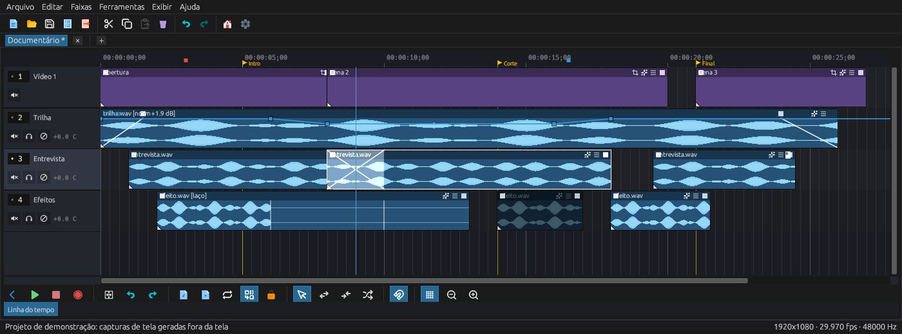

Faixas de vídeo e áudio com forma de onda real, **crossfade automático** na sobreposição de dois eventos (o X sobre a faixa *Entrevista*), **envelope de volume** na faixa *Trilha*, marcadores, régua SMPTE e o cursor de reprodução. Os eventos mostram os interruptores: **Mute** (escurecido), **Lock** (cadeado), **Loop** (`[laço]` e uma marca a cada repetição), **Normalize** (`[norm +1.9 dB]`) e **Inverter fase**.

### Vários projetos e sub-projetos

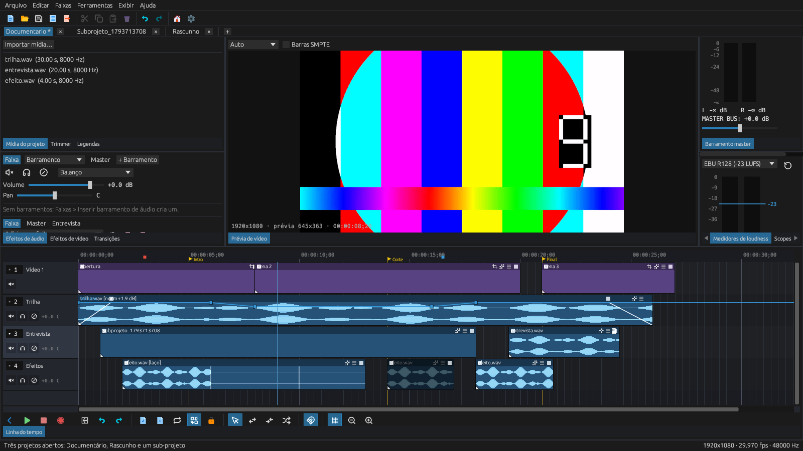

Cada projeto aberto tem sua aba (`*` marca alterações não salvas). Um conjunto de eventos pode virar um **sub-projeto** (`Alt+C`, *Create Nested Timeline* do VEGAS): ele aparece como um único evento na linha do tempo do projeto pai e abre em outra aba com um duplo clique.

### Ícones

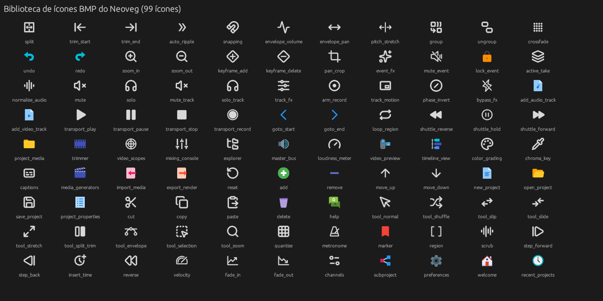

### Tela de boas-vindas

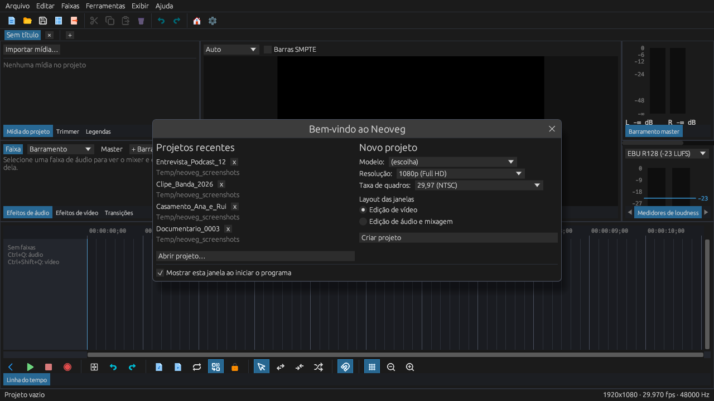

Ao iniciar, a tela de boas-vindas segue o desenho do programa (cabeçalho preto com o nome, a versão e a saudação; coluna de configurações e projetos recentes à esquerda, novo projeto e Aprender à direita; versão escura e pequena sem projetos recentes). Ela lista os **projetos recentes** (os arquivos que sumiram aparecem avisados), abre um arquivo e cria um **novo projeto** com modelo, resolução e taxa de quadros escolhidos nas listas, mais a escolha entre dois layouts de janela: edição de vídeo ou edição de áudio e mixagem. O topo traz a saudação por período do dia (bom dia, boa tarde, boa noite) com o nome da conta do sistema ou o escolhido em Preferências, a versão e a data da última atualização. Sob as duas colunas há **Abrir pasta de projetos…**, **Configurações do Usuário** (abre as preferências), **Configurar presets de resolução** (lista e exclui os modelos salvos), **Verificar atualizações** (diz a versão em uso e abre a página das versões, sem consultar a rede) e os links **Aprender** (Como usar, Atualizações, O que há de novo?, que abrem páginas do projeto no navegador). Sem projetos recentes, aparece primeiro a versão pequena e escura, com Novo Projeto, Abrir Projeto, Como Usar? e Sair; **Criar novo projeto…** e **Novo Projeto** abrem o formulário na mesma janela. A tela de abertura (splash) também segue o desenho: cartão arredondado em degradê azul, com versão, data, sistema, processador, vídeo, memória e usuário, e a barra de progresso. Ela se desliga em Editar > Preferências ou na própria caixa, e volta por Ajuda > Tela de boas-vindas. Arquivo > Projetos recentes tem a mesma lista.

### Notas e detalhes de edição

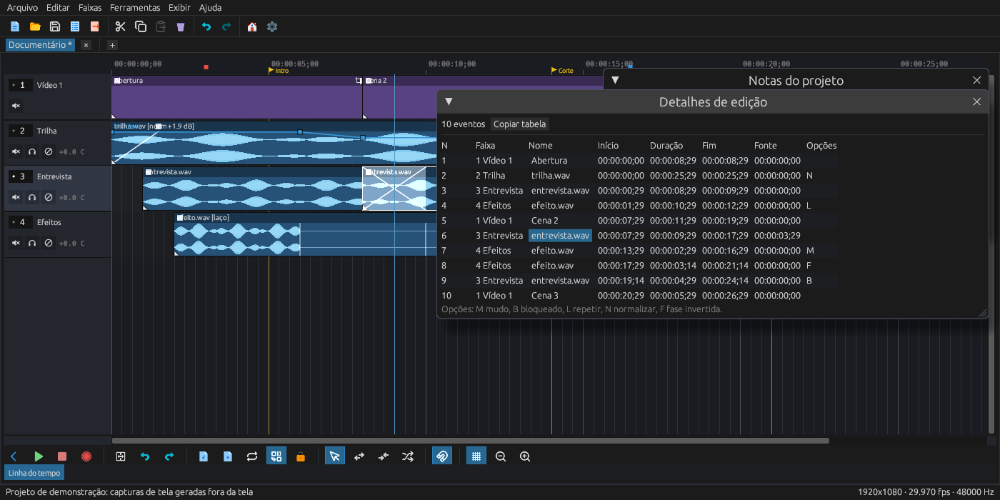

As **notas do projeto** ficam presas a um tempo da linha do tempo (quadrado colorido na régua), com cor, etiqueta e texto, e podem ser resolvidas ou ocultadas. Os **detalhes de edição** listam todos os eventos como uma lista de cortes.

### Efeitos de vídeo

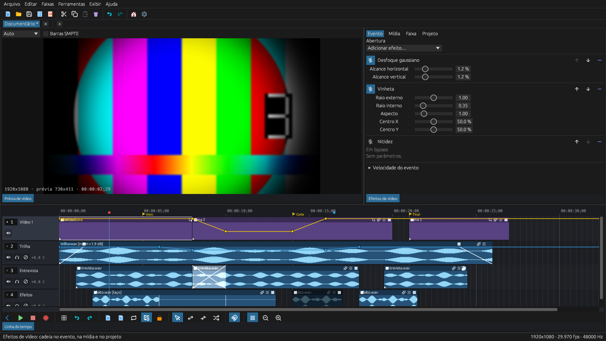

A aba **Efeitos de Vídeo** (`Ctrl+Alt+8`, ao lado de Efeitos de Áudio) edita a cadeia do **evento** selecionado, da **mídia** dele (vale para todos os eventos que a usam), da **faixa** ou do **projeto**. Na imagem, o evento *Abertura* tem desfoque gaussiano, vinheta e uma nitidez em bypass; a mídia tem uma máscara de nitidez e o projeto uma vinheta. A prévia mostra o resultado, e um controle arrastado aparece nela ao vivo antes de soltar.

### Pan/Crop do evento

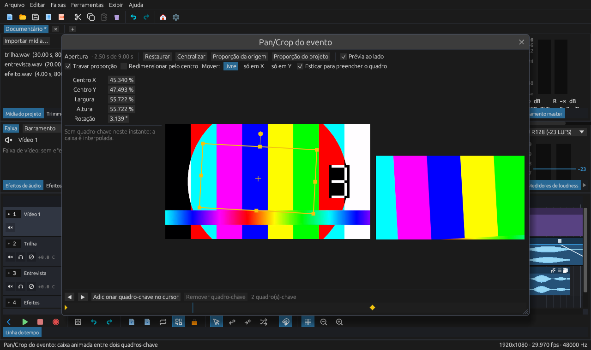

A janela **Pan/Crop do evento** mostra a imagem de origem com a caixa de seleção (alças nos cantos e nas bordas, alça redonda para girar, arrastar dentro para mover), os valores numéricos, os quadros-chave do evento e, ao lado, a prévia com o recorte. Na imagem, a caixa se move e dá zoom entre dois quadros-chave e está no meio do caminho (2,5 s).

### Movimento da trilha

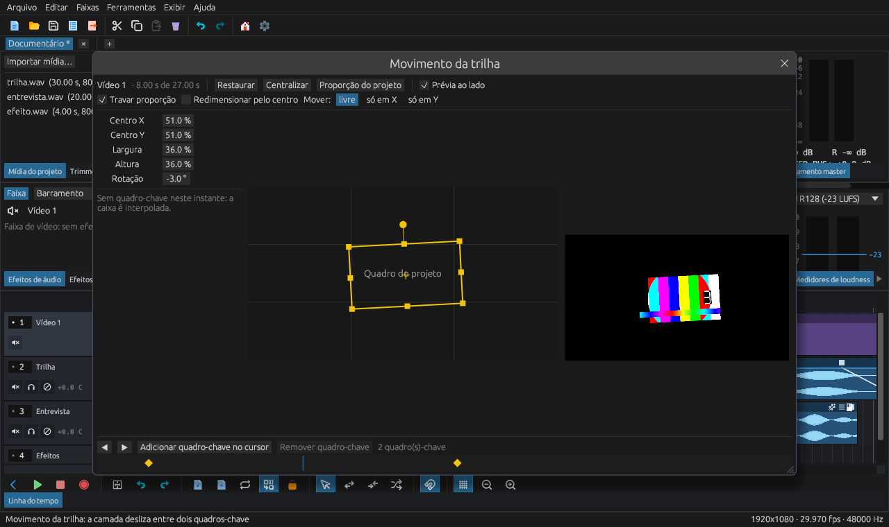

A mesma janela edita o **movimento da trilha** de vídeo: a caixa mostra onde a camada fica no quadro do projeto (menor é um picture-in-picture), com posição, tamanho e rotação, quadros-chave na linha do tempo e a prévia ao lado. Na imagem, a camada encolhe para pouco mais de um terço do quadro e desliza do canto inferior direito para o superior esquerdo; o cursor está no meio do caminho (8 s).

### Transições

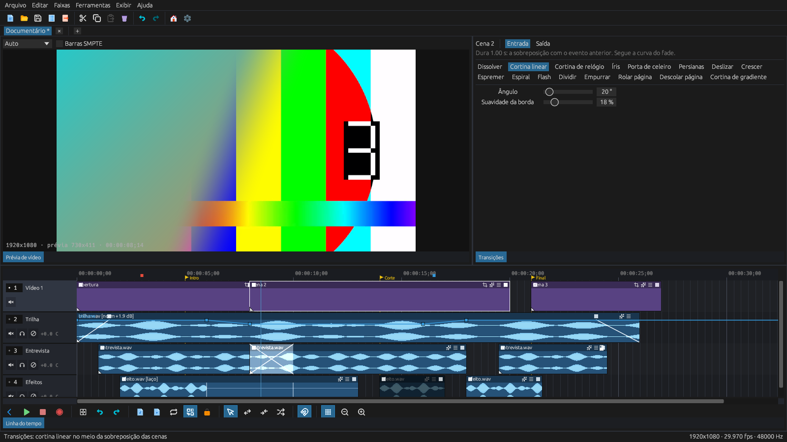

A aba **Transições** escolhe como o evento selecionado aparece (**Entrada**) ou some (**Saída**): oito transições com seus parâmetros. A transição dura o fade do evento, ou a sobreposição com o evento anterior, e segue a curva do fade. Na imagem, uma cortina linear a 20° com borda suave passa a cena 2 por cima da cena 1, a meio caminho da sobreposição de 1 s.

### Velocidade do evento

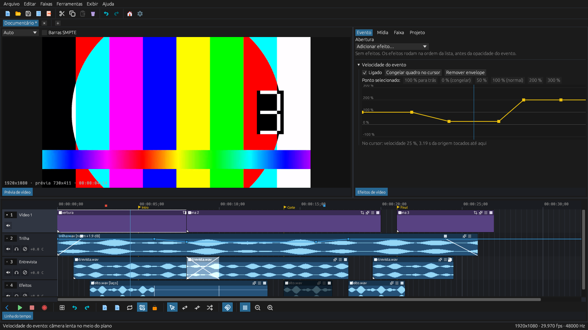

Na aba **Efeitos de Vídeo**, a seção **Velocidade do evento** desenha a velocidade ao longo do evento, de −100 % (para trás) a 300 %, com as linhas de 0 % (congelar) e 100 % (normal). Os pontos arrastam-se, ganham pré-ajustes e curvas pelo menu do botão direito, e um duplo clique cria um ponto novo. O evento mantém o comprimento: o envelope só decide quanto da mídia toca. Na imagem, o plano segue em velocidade normal, cai para 25 % no meio e termina a 200 %; no cursor, o quadro mostrado é o da posição de origem 3,19 s, e não o do tempo 4,5 s da linha do tempo.

### Propriedades do projeto

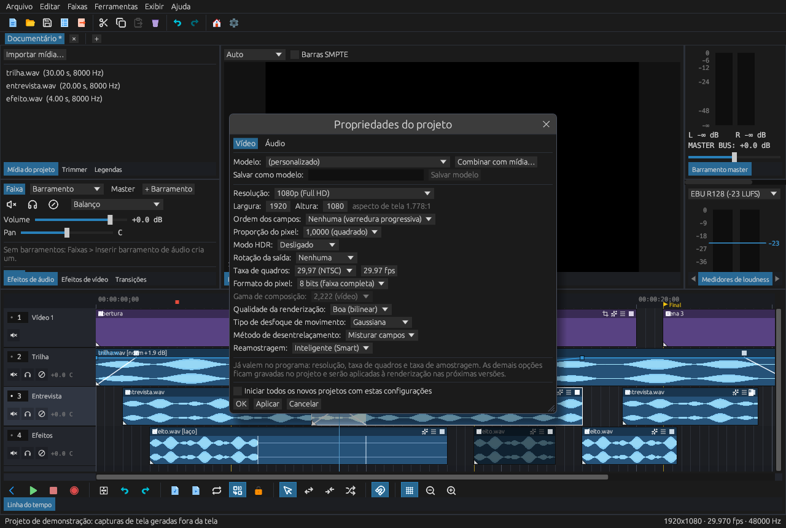

Arquivo > Propriedades do projeto: 28 modelos de formato (de SD NTSC/PAL a 8K), 27 resoluções (de 360p a 8K UHD, mais cinema, redes sociais e ultralargo), 17 taxas de quadros (de 15 a 240), proporção do pixel, ordem dos campos, formato do pixel, modo HDR, rotação da saída, qualidade da renderização, desfoque de movimento, desentrelaçamento e reamostragem; na aba de áudio, taxa de amostragem (8 a 192 kHz), profundidade de bits, barramento e nível de normalização. Dá para salvar os seus próprios modelos, copiar o formato de um arquivo de mídia e iniciar todos os novos projetos com as mesmas configurações. Resolução, taxa de quadros e taxa de amostragem já valem; as demais opções ficam gravadas no projeto.

A biblioteca de pictogramas SVG autorais (24x24, planos, `currentColor`), desenhados para seguir as cores do tema em qualquer escala e DPI.

## Desempenho por resolução

Custo, **por quadro**, do caminho de vídeo em CPU, de 480p a 8K UHD, medido com o benchmark `playback_bench` (Criterion, uma thread): `cargo bench -p neoveg_video --bench playback_bench`, depois `python scripts/bench_table.py --readme` para reescrever a tabela. Cada coluna é a **mediana** de 10 amostras:

* **Gerar quadro**: construir um quadro RGBA8 (as barras SMPTE do gerador, no lugar de um quadro decodificado);
* **Correção de cor**: a correção primária da prévia (exposição, contraste e saturação);
* **Scopes**: histograma, forma de onda e vetorscópio do quadro;
* **Crossfade (CPU)**: composição de duas camadas de quadro inteiro sobre um fundo preto. É o caminho de **CPU**; a prévia e a exportação usam a GPU quando há adaptador (o trabalho ainda não é medido).

<!-- bench:begin -->
| Resolução | Tamanho | Gerar quadro | Correção de cor | Scopes | Crossfade (CPU) | Quadro normal: cor + scopes (quadros/s) | Quadro em transição: + crossfade (quadros/s) |
| --- | --- | ---: | ---: | ---: | ---: | ---: | ---: |
| 480p | 854x480 | 2.15 ms | 1.13 ms | 7.02 ms | 11.27 ms | 8.14 ms (123) | 19.41 ms (51.5) |
| 720p | 1280x720 | 4.71 ms | 2.28 ms | 7.09 ms | 25.34 ms | 9.37 ms (107) | 34.71 ms (28.8) |
| 1080p | 1920x1080 | 10.52 ms | 4.57 ms | 9.74 ms | 57.51 ms | 14.31 ms (70) | 71.82 ms (13.9) |
| 1440p | 2560x1440 | 18.70 ms | 7.63 ms | 9.65 ms | 99.84 ms | 17.28 ms (58) | 117 ms (8.5) |
| 4K | 3840x2160 | 43.56 ms | 17.09 ms | 8.48 ms | 226 ms | 25.57 ms (39) | 251 ms (4.0) |
| 8K | 7680x4320 | 171 ms | 61.65 ms | 9.55 ms | 954 ms | 71.20 ms (14) | 1025 ms (1.0) |

Medido em: Intel(R) Core(TM) i5-7500T CPU @ 2.70GHz (4 threads), Windows 10, Rust 1.99.1. A tabela seguinte vem de uma segunda máquina (AMD Ryzen 5 5600GT, 12 threads, Windows 11 Pro); os números das duas não são comparáveis um a um fora do mesmo benchmark e da mesma versão do Rust.
<!-- bench:end -->

Segunda máquina (mesmo benchmark, 2026-10-28): AMD Ryzen 5 5600GT with Radeon Graphics (12 threads), Windows 11 Pro, Rust 1.99.1. No 8K, o crossfade teve variação alta entre as amostras (531 a 661 ms); a mediana é a da tabela.

| Resolução | Tamanho | Gerar quadro | Correção de cor | Scopes | Crossfade (CPU) | Quadro normal: cor + scopes (quadros/s) | Quadro em transição: + crossfade (quadros/s) |
| --- | --- | ---: | ---: | ---: | ---: | ---: | ---: |
| 480p | 854x480 | 0.98 ms | 0.48 ms | 2.14 ms | 6.36 ms | 2.62 ms (382) | 8.98 ms (111.4) |
| 720p | 1280x720 | 2.25 ms | 0.96 ms | 1.97 ms | 14.20 ms | 2.93 ms (341) | 17.13 ms (58.4) |
| 1080p | 1920x1080 | 5.02 ms | 2.01 ms | 2.43 ms | 31.75 ms | 4.44 ms (225) | 36.19 ms (27.6) |
| 1440p | 2560x1440 | 9.00 ms | 3.42 ms | 2.80 ms | 56.19 ms | 6.21 ms (161) | 62.40 ms (16.0) |
| 4K | 3840x2160 | 20.58 ms | 7.37 ms | 2.45 ms | 127 ms | 9.82 ms (102) | 137 ms (7.3) |
| 8K | 7680x4320 | 82.96 ms | 29.54 ms | 2.83 ms | 511 ms | 32.37 ms (31) | 544 ms (1.8) |


**O que isto não mede:** a decodificação (precisa do FFmpeg e de um arquivo de mídia), a GPU, o envio de texturas, a janela e o áudio. Os números são um **teto** de quadros por segundo para o trabalho de CPU, não uma taxa de reprodução. A qualidade da visualização reduz o custo: Draft decodifica 1/4 da largura, Preview 1/2, Good e Best a largura cheia (por exemplo, em 4K: 960, 1920 e 3840 px).

## Pré-requisitos para contribuidores

A única dependência **obrigatória** é a toolchain oficial do Rust. Não são necessários .NET, CMake, compilador C++ nem Python. Os itens opcionais só são exigidos para cobertura de código e para a decodificação de vídeo com FFmpeg.

| Componente | Versão | Obrigatório? | Para que serve | Windows (`winget` / `rustup`) |
| --- | --- | --- | --- | --- |
| Rust (`rustup`, `cargo`, `rustc`) | 1.88+ estável | **Sim** | Compilar tudo (`crates/neoveg_*`) | `winget install --id Rustlang.Rustup --exact` |
| `clippy`, `rustfmt` | da toolchain | **Sim** | Lint e formatação (`-D warnings` na QA) | `rustup component add clippy rustfmt` |
| Visual Studio com *Desktop development with C++* (linker MSVC) | 2022 ou 2026 | **Sim, no Windows** | Linker do alvo `x86_64-pc-windows-msvc` | instalador do Visual Studio / Build Tools |
| `llvm-tools-preview` | da toolchain | Opcional | Relatórios de cobertura | `rustup component add llvm-tools-preview` |
| `cargo-llvm-cov` | 0.9+ | Opcional | `cargo llvm-cov --workspace` | `cargo install cargo-llvm-cov --locked` |
| FFmpeg **compartilhado** com `include/` e `lib/` | **7.1.x** (suportado pela `ffmpeg-next` 9.x) | Só para `--features ffmpeg` | Decodificação de vídeo (`ffmpeg-next` 9.x) | `winget install --id BtbN.FFmpeg.LGPL.Shared.7.1 --exact` |
| LLVM / `libclang` | **19+** (19 a 22+ funcionam com `ffmpeg-sys-next` 9.0.1 / `bindgen` 0.73) | Só para `--features ffmpeg` | `bindgen` gera as ligações do FFmpeg | `winget install --id LLVM.LLVM --exact` |
| `poppler` (`pdftoppm`) | qualquer | Opcional | Ver as páginas dos manuais como imagem (figuras e diagramas): sem ele só o texto dos PDFs é lido, com `pypdf`. As páginas renderizadas ficam fora do repositório (AGENTS.md, seções 28 e 37) | `winget install --id oschwartz10612.Poppler --exact` |

Variáveis de ambiente para o build com FFmpeg (Windows, escopo do usuário; abra um terminal novo depois de defini-las):

```powershell
# pasta extraída do pacote, a que contém bin\, include\ e lib\
[Environment]::SetEnvironmentVariable('FFMPEG_DIR', "$env:LOCALAPPDATA\Microsoft\WinGet\Packages\BtbN.FFmpeg.LGPL.Shared.7.1_Microsoft.Winget.Source_8wekyb3d8bbwe\ffmpeg-n7.1.5-12-g1fdbca85aa-win64-lgpl-shared-7.1", 'User')
[Environment]::SetEnvironmentVariable('LIBCLANG_PATH', 'C:\Program Files\LLVM\bin', 'User')
```

O nome da pasta do FFmpeg muda a cada versão do pacote: confira o caminho real em `%LOCALAPPDATA%\Microsoft\WinGet\Packages`. Em tempo de execução (inclusive `cargo test --features ffmpeg`) as DLLs do FFmpeg (`bin\`) precisam estar no `PATH` do terminal; o pacote do `winget` adiciona essa pasta ao `PATH`, então abra um terminal novo depois de instalar. Os testes de decodificação geram um clipe com o executável `ffmpeg` do `PATH` e são ignorados em silêncio quando ele não existe. Sem a feature `ffmpeg` o Neoveg abre normalmente e avisa na barra de status que vídeo está desabilitado.

### Ambiente de referência (o que foi instalado na máquina de desenvolvimento)

Resumo do que o projeto usa hoje, para reproduzir o ambiente em outra máquina Windows:

- [x] Rust estável 1.99.1 (`rustup`), alvo `x86_64-pc-windows-msvc`, componentes `clippy`, `rustfmt`, `llvm-tools-preview`, `rust-src` e `rust-docs`
- [x] Visual Studio 2026 / Build Tools com *Desktop development with C++* (linker MSVC)
- [x] `cargo-llvm-cov` 0.9.1 (`cargo install cargo-llvm-cov --locked`)
- [x] FFmpeg 7.1.x compartilhado LGPL (`BtbN.FFmpeg.LGPL.Shared.7.1`) com `FFMPEG_DIR` apontando para a pasta extraída
- [x] LLVM / `libclang` 19+ com `LIBCLANG_PATH=C:\Program Files\LLVM\bin` (a `ffmpeg-next` 9.x / `bindgen` 0.73 aceita LLVM 19 até 22+)
- [x] Scripts de ambiente para a feature `ffmpeg` (Windows): `scripts/install_llvm_ffmpeg.ps1` (como administrador: baixa e confere o SHA256 do LLVM 19.1.7 e do FFmpeg 7.1.5 LGPL, instala e define `FFMPEG_DIR` e `LIBCLANG_PATH`) e `scripts/cargo-ffmpeg.ps1` (roda o cargo com o clang 19 na frente do PATH, o `INCLUDE` do Visual Studio e as DLLs do FFmpeg; lê as variáveis da sessão, do usuário ou da máquina). Ex.: `.\scripts\cargo-ffmpeg.ps1 test -p neoveg_ui --features ffmpeg -j 2 -- --test-threads=1`. Vieram da pasta do Drive «Neoveg - instaladores e pacotes»; o instalador ainda não foi executado
- [x] Git e GitHub Desktop (fluxo de branches descrito no AGENTS.md, seção 11)
- [x] Nenhum dos itens legados (.NET SDK, CMake, Python) é necessário para o workspace Rust (o Python só roda o empacotamento opcional, `build_portable.py`, e os scripts de `scripts/`)

**Linux (Debian / Ubuntu):**

```bash
sudo apt update && sudo apt install -y build-essential pkg-config \
    libasound2-dev libudev-dev libx11-dev libxcursor-dev libxrandr-dev libxi-dev \
    libxkbcommon-dev libxkbcommon-x11-dev libwayland-dev libvulkan-dev
# opcional, para --features ffmpeg:
sudo apt install -y libavcodec-dev libavformat-dev libavutil-dev libswscale-dev libclang-dev
```

**macOS:** `xcode-select --install` e, para o FFmpeg, `brew install ffmpeg@7 llvm pkg-config`.

## Compilar, testar e executar

```bash
cargo build --workspace --release
cargo test --workspace
cargo clippy --workspace --all-targets -- -D warnings
cargo fmt --all -- --check
cargo llvm-cov --workspace --summary-only           # opcional: cobertura
cargo run --release -p neoveg_ui                    # abre o Neoveg com um projeto vazio (sem vídeo)
cargo run --release -p neoveg_ui --features ffmpeg  # com decodificação de vídeo na prévia
cargo test --workspace --features neoveg_ui/ffmpeg  # inclui os testes de decodificação reais
python build_portable.py                            # QA + exe + pastas e arquivos portáteis em dist/ (só Python padrão)
python build_portable.py build --ffmpeg --targets all  # com vídeo; alvos de outros sistemas exigem o target do Rust instalado
python build_portable.py qa                         # só fmt + clippy + testes + build; grava coverage/qa/qa_report.json
python build_portable.py build --jobs 1             # máquina com pouca memória: `cargo -j 1` e um teste por vez (o rustc chegou a cair com STATUS_STACK_BUFFER_OVERRUN sob carga)
python scripts/test_build_portable.py             # testes do empacotamento (monta um pacote com um executável falso, sem compilar)
```

Logs: `logs/neoveg.log` e `logs/crash.log` ao lado do executável.

### Capturas de tela (headless)

```bash
# gera docs/screenshots/*.png sem abrir janela (precisa de um adaptador wgpu: GPU ou renderizador por software)
NEOVEG_SCREENSHOTS=1 cargo test -p neoveg_ui --test headless_screenshot -- --nocapture      # Linux / macOS
$env:NEOVEG_SCREENSHOTS = "1"; cargo test -p neoveg_ui --test headless_screenshot -- --nocapture   # PowerShell
cargo run -p neoveg_ui -- --screenshots docs/screenshots                                    # o mesmo, direto pelo programa

# capturas, benchmark e conversão de ícones em segundo plano, sem travar o terminal
powershell -File scripts\run_background_agent.ps1 -Wait
```

Sem `NEOVEG_SCREENSHOTS=1` o teste é ignorado (ele reescreve arquivos versionados e precisa de adaptador gráfico), então `cargo test --workspace` não depende de GPU.

### Testar e compilar em qualquer máquina (Docker)

> **Em pausa.** Desde 28/10/2026 o foco é só o Windows; o Docker (Linux e macOS) fica para o porte, depois. O ambiente abaixo continua no repositório (inclusive as distros Debian, Ubuntu, Fedora e Arch no perfil `distros`, e o Docker-OSX no perfil `macos-native`), mas não é o fluxo de trabalho atual. Em 28/10 o Debian, o Ubuntu e o Fedora passaram `rustfmt`, `clippy` e 142 testes; o Arch e o Docker-OSX nunca rodaram.

O ambiente isolado em `docker/` roda `rustfmt`, `clippy -D warnings` e `cargo test --workspace` num container Linux (com Xvfb para a parte gráfica) e compila os binários otimizados de Linux e, opcionalmente, de macOS (Intel e Apple Silicon). Só precisa do Docker.

```bash
# um comando: sobe o Linux (testes e, se passarem, o build de release) e grava dist/linux/
docker compose -f docker/docker-compose.yml up --build        # ou: docker-compose -f docker/docker-compose.yml up --build

# o mesmo, com verificação do resultado, em Linux/macOS e no PowerShell (Windows, Linux, macOS)
scripts/test_rust_crossplatform.sh
pwsh scripts/test_rust_crossplatform.ps1                       # Windows PowerShell 5.1: powershell -File scripts\test_rust_crossplatform.ps1

# com o build cruzado de macOS (precisa do pacote do SDK em docker/sdk/, veja docker/sdk/README.md)
docker compose -f docker/docker-compose.yml --profile macos up --build
scripts/test_rust_crossplatform.sh --macos
```

| Serviço | O que faz | Saída |
| --- | --- | --- |
| `test-rust-linux` | `cargo fmt --check`, `cargo clippy --workspace --all-targets -- -D warnings`, `cargo test --workspace` sob Xvfb | `dist/reports/test-linux.txt` |
| `build-rust-linux-release` | binário otimizado, pasta portátil e `.tar.gz` (só depois dos testes) | `dist/linux/` |
| `build-rust-macos-release` (perfil `macos`) | compila os testes e o release para `x86_64-apple-darwin` e `aarch64-apple-darwin` com osxcross | `dist/macos/` |

Os testes **rodam** só no Linux; os binários de macOS são apenas compilados no container (não executam em Linux). O script verifica que nenhum teste falhou, que o `rustfmt` e o `clippy` passaram e que os artefatos existem, e imprime os SHA-256. Opções: `--ffmpeg`, `--no-cache`, `--tests-only`, `--macos`.


## Estrutura do workspace

| Crate | Responsabilidade |
| --- | --- |
| `crates/neoveg_common` | Tipos de projeto, timecode SMPTE (drop-frame), log e preferências. |
| `crates/neoveg_audio` | Decodificação (`symphonia`), mixer multifaixa, saída de áudio (`cpal`), medidores de pico reais e waveform amostra a amostra. |
| `crates/neoveg_video` | Quadros RGBA, geradores procedurais (barras SMPTE), upload para GPU (`wgpu`) e decodificação opcional (`ffmpeg-next`). |
| `crates/neoveg_engine` | Timeline, faixas, eventos, comandos com Desfazer/Refazer, projetos `.neoveg` (ZIP) e relink de mídia ausente. |
| `crates/neoveg_ui` | Aplicação `egui` com painéis acopláveis, slider de precisão, régua com grade de frames adaptativa e cabeçalhos de faixa. |

## Roteiro (o que já está pronto e o que falta)

### Decisões
Aqui é onde o filho chora e a mãe não vê, não há como simplesmente empurrar tudo do VEGAS pra cá, quem deve decidir isso não é só eu, e sim os outros usuários desse programa.
- [ ] Scripting para o usuário em Rust (substituir Roslyn/Python) (Em decisão: os scripts e extensões feitos para o VEGAS são código .NET 2 e 3.5 (C#, VB.NET, JScript) e não rodam no Neoveg; falta escolher entre só Rhai com um guia de migração, um conversor Python que traduz esses scripts para Rhai, ou um host .NET 2 e 3.5 opcional e isolado, e como espelhar o modelo de objetos sem copiar nomes de outro produto).
- [ ] Empacotamento portátil (Windows, Linux, macOS x64/arm64) e CI com `cargo build/test/clippy/llvm-cov` (Em decisão: o foco agora é o Windows 10/11; o pacote portátil e a CI do Windows seguem obrigatórios, e Linux e macOS x64/arm64 rodam na CI em modo experimental até a fase do porte, com o ambiente Docker já pronto mas pausado. Pacote do Windows conferido em 31/10/2026: `python build_portable.py build --ffmpeg` gera o `.zip` e o `.exe`, que abre com um PATH mínimo, com as DLLs do FFmpeg, as tabelas de cor e as licenças dentro; CI configurada em `.github/workflows/rust.yml` nos três sistemas) (para Linux é até que "fácil", para macOS vai precisar de uma máquina real)


### Feito

- [x] Workspace Cargo com as cinco crates, `clippy -D warnings`, `rustfmt` e testes passando
- [x] Janela principal (`eframe` + `wgpu`) com projeto vazio e painéis acopláveis/destacáveis
- [x] Waveform amostra a amostra (min/max/RMS por coluna; amostras individuais com pontos em zoom alto)
- [x] Grade de frames adaptativa e régua SMPTE com timecode drop-frame
- [x] Playhead de 1 pixel físico com piscar do cursor em pausa
- [x] Slider de precisão (polegar quadrado, duplo clique restaura, `Ctrl` = ajuste fino, menu de contexto)
- [x] Timeline: faixas de áudio/vídeo, dividir (`S`), mover/remover eventos, Desfazer/Refazer
- [x] Edição de eventos com o mouse: mover (inclusive entre faixas do mesmo tipo), aparar nas duas bordas (a fonte mantém o alinhamento e não passa do começo nem do fim da mídia), alinhamento a quadros, ao cursor e às bordas de outros eventos (`F8`; `Alt` ignora), rolagem automática nas bordas, `Esc` cancela e cada arrasto é um único Desfazer
- [x] As 5 curvas de fade (linear, rápida, lenta, suave, acentuada) com alças nos cantos do evento, menu do botão direito e Inspetor; crossfade automático em sobreposições parciais (ligável em Editar e na barra)
- [x] Importação de áudio (WAV, MP3, FLAC, OGG, AAC) em thread de fundo
- [x] Importação de vídeo (MP4, MOV, MKV, AVI, WebM...) com eventos de vídeo e áudio ligados e formato do projeto definido pelo primeiro clipe
- [x] Decodificação de vídeo na prévia: thread de fundo, busca por quadro exato, qualidade Draft/Preview/Good/Best/Auto (feature `ffmpeg`)
- [x] Mixer multifaixa: soma todos os eventos de áudio ativos, com fade-in/out e `trim_in`
- [x] Medidores L/R reais no Barramento Master, zerados com a reprodução parada
- [x] Projetos `.neoveg` (ZIP com `project.json`, `media_pool.json`, `history.json`): abrir, salvar, salvar como
- [x] Autosave (padrão 2 min, configurável em Editar > Preferências) e recuperação após falha: `recovery_*.neoveg` em `%LOCALAPPDATA%\Neoveg\autosave` (Linux `~/.local/share/neoveg/autosave`, macOS `~/Library/Application Support/neoveg/autosave`); aviso de alterações não salvas ao sair e `*` no título
- [x] Relink de mídia ausente ao abrir: nome exato e depois nome aproximado (passos 1 e 2)
- [x] Log central em `logs/neoveg.log` e `logs/crash.log`
- [x] Seleção de eventos e de tempo, recortar/copiar/colar/colar inserindo/repetir colar, aparar à seleção e dividir em várias faixas (Fase 1, exceto os itens abertos abaixo)
- [x] Empacotamento: `python build_portable.py` gera o exe, as pastas e os arquivos portáteis e o relatório de QA
- [x] Tabela de comandos e mapa de teclado personalizável (Editar → Personalizar teclado…), com os atalhos atuais preservados e os atalhos padrão do roteiro já reservados

### A fazer (em ordem de prioridade)

> O que dá e o que não dá para fazer no PC de desenvolvimento atual (Intel Core i5-7500T, 7,9 GB de RAM, gráfico integrado Intel HD 630, SSD de 224 GB com 38 GB livres, Windows 10), com o motivo de cada caso: `docs_obsidian/04 - Pesquisas e Benchmarks/pendencias_por_maquina.md`.

- [x] Importar imagens estáticas, sequências numeradas (`.neovegseq`) e geradores (`.neoveggen`) como mídia de vídeo (Arquivo > Importar mídia)
- [x] Cache LRU de quadros decodificados e pré-busca de 1 a 2 quadros durante a reprodução, no worker de vídeo
- [x] Composição de várias faixas de vídeo na prévia: a primeira faixa fica por cima, e a sobreposição de dois eventos da mesma faixa faz crossfade (o evento seguinte entra com fade); o mesmo pedido de quadro alimenta a exportação
- [x] Reprodução de vídeo sincronizada ao relógio de áudio: o cursor e o quadro seguem o som no alto-falante (a posição do último buffer, adiantada pelo tempo desde o callback e atrasada pela latência de saída da placa, sem degraus de um buffer e sem recuar). Se a decodificação atrasa, o quadro mais novo vence e os intermediários são descartados, como na referência. Falta compensar o tempo que o quadro leva para ser decodificado e desenhado (hoje a imagem chega um pouco depois do som) e mostrar quadros descartados. Não foi medido ouvindo e vendo um vídeo real.
- [x] Mídia ausente: ao abrir um projeto, a busca por nome igual e por nome parecido roda em segundo plano e confere cada candidato com o que o projeto guardou (duração com tolerância de 1 % ou 0,25 s, canais e quadros por segundo); um candidato com outra duração é recusado e aparece com o motivo na janela **Mídia ausente** (Arquivo > Mídia ausente…), que também tem *Localizar…* (relink manual de uma mídia, o arquivo escolhido vale e a duração é conferida ao carregar) e *Buscar em uma pasta…*. Os eventos da mídia ausente ficam marcados com *MÍDIA OFFLINE*. *Ignorar e deixar offline* (uma ou todas) tira a mídia da fila sem apagá-la da lista; *Buscar em todos os lugares* varre todos os discos numa thread, com contador de pastas e botão *Parar*, pulando pastas do sistema; a janela **Erro de arquivo de mídia** pergunta, para um arquivo do projeto que existe mas não abre, se quer escolher outro arquivo, ignorar ou ignorar todos os erros seguintes. Quando a mídia é achada fora da pasta do projeto, a janela **Mídia encontrada** oferece *Copiar para a pasta do projeto* (o original fica; o projeto passa a apontar para a cópia).
- [x] Ferramentas de edição Slip e Slide (`D` / `Shift+D` / `Ctrl+D`, Editar > Ferramenta de edição e botões na barra): Slip desliza a mídia dentro do evento, Slide move o evento e a mídia fica no lugar; os dois param no início e no fim da mídia, em quadros inteiros, um passo de desfazer
- [x] Stretch por ferramenta, Shuffle, Split Trim e Slide com ajuste dos vizinhos; ripple (seleção múltipla, agrupar e desagrupar já feitos)
- [x] Aparar com o mouse em eventos de mídia gerada (hoje o limite de fonte só vale para mídia importada)
- [x] Marcadores (`M`), regiões e loop
- [x] Volume, pan, mute e solo por faixa
- [x] Barramentos de áudio e sends (manual v21 p.869-873): até 26 barramentos além do master (Faixas > Inserir barramento de áudio, `Ctrl+Alt+B`), cada um com nome, volume, pan, mudo, fase, cadeia de efeitos e saída para o master ou outro barramento (um laço é recusado); a faixa escolhe a saída e tem sends por barramento, antes do fader (padrão, independente dele) ou depois, com ou sem o pan da faixa; apagar um barramento passa o que ia para ele ao barramento anterior. Tudo em passos de desfazer, no formato do projeto com `#[serde(default)]`, e o mixer compensa a latência dos efeitos do barramento. Faltam as faixas de barramento na linha do tempo, envelopes de barramento, saída para dispositivos e as tiras na janela do mixer.
- [x] Plug-ins de áudio VST3 (`.vst3`) como efeitos das faixas e do master, pelo crate `vst3` (bindings das especificações públicas, `MIT OR Apache-2.0`, sem SDK para compilar): busca nas pastas do sistema e em `VST3_PATH`, carregar um arquivo, parâmetros normalizados com envelopes de automação, compensação de latência (PDC) e a mesma lista de efeitos do CLAP. Testado com o plug-in de ganho de exemplo do crate. Faltam a janela do editor do plug-in, eventos MIDI, salvar e restaurar o estado, mensagens entre componente e controlador, macOS e o processo isolado (linha abaixo).
- [x] Transições na GPU (`wgpu`): as dezesseis (dissolver, wipe linear, wipe de relógio, íris, porta, persiana, deslizar, crescer, espremer, espiral, flash, dividir, empurrar, rolar página, descolar página e cortina de gradiente) rodam em compute shader conferido por teste contra a referência da CPU, que continua como reserva.
- [x] Mais efeitos de vídeo e transições novas na GPU (`wgpu`), cada um com a referência na CPU conferida por teste: trinta e seis efeitos (incluindo Curvas de cor, Equilíbrio de cor, Ajuste de saturação por faixa de matiz, Limitador de vídeo, Substituir cor, Amplificador de processamento e Corretor de cor de três vias) e dezesseis transições. **Rolar página, Descolar página e Empurrar** (com borda de tamanho, suavidade e cor) enxergam o clipe anterior da faixa; a **Cortina de gradiente** usa sete padrões embutidos; o **Flash** ganhou a difusão horizontal e vertical. Faltam a imagem de gradiente do usuário, as bordas das outras transições e o Page Roll e o Page Peel com sombra e curvatura em 3D de verdade.
- [x] Geradores de mídia (cor sólida, padrões de teste, gradientes e títulos com contorno, sombra e animação) pela janela Faixas > Inserir mídia gerada
- [x] Cabeçalho de evento (manual v21 p.242): o nome à esquerda e, à direita, botões de ícone com dica: *Editar mídia gerada* (só mídia gerada), *Pan/Crop* (eventos de vídeo), *Efeitos* (abre a aba de efeitos do evento, ou da faixa no áudio) e o menu (☰) com as ferramentas do evento, o mesmo do botão direito. Eventos estreitos perdem os botões da esquerda para a direita. O **Inspetor** (Ferramentas) ganhou nome, início e duração editáveis, interruptores (mudo, travado, laço, fase, normalizar), reamostragem, dados da mídia e atalhos para Pan/Crop, efeitos e mídia gerada. Falta o conjunto de botões configurável (*Edit visible button set*, o comprimento e o congelar quadro no cabeçalho).
- [x] **Renderização sem FFmpeg** (adaptada do FilmCraft): MP4 com vídeo H.264 e áudio AAC escritos em Rust puro (`neoveg_h264`, `neoveg_aac` e `neoveg_media`), com qualidade CRF, `moov` na frente (reprodução em fluxo) e o som intercalado com o vídeo; é o codificador padrão do MP4 H.264, e o FFmpeg continua opcional (escolha **Codificador** no diálogo: Automático, Interno ou FFmpeg). HEVC, ProRes e WebM ainda pedem o FFmpeg.
- [x] Renderização/exportação (Make Movie) com FFmpeg em segundo plano (Arquivo > Renderizar como…): MP4 H.264 / HEVC, MOV ProRes, WebM VP9 ou só áudio WAV; mixagem offline com os efeitos das faixas e do master, relatório de loudness BS.1770-4 ao lado do arquivo, progresso e cancelamento
- [x] Importação e exportação de listas de edição CMX 3600 (`.edl`): exporta os cortes da faixa selecionada com os comentários de nome do clipe e arquivo, importa cortes (transições lidas como corte, com aviso) para as mídias que já estão no projeto, em um passo de desfazer
- [x] Importação e exportação de XML do Final Cut Pro 7 (`xmeml` v5): todas as faixas e clipes (posição, entrada e saída da fonte, nomes e caminhos), importando para as mídias do projeto em um passo de desfazer
- [x] Importação e exportação de FCPXML do Final Cut Pro (`<fcpxml version="1.10">`): tempos racionais exatos por quadro (`1001/30000s`, `1/25s`), faixas conectadas de vídeo e áudio, marcadores e regiões, em um passo de desfazer
- [x] Importação e exportação de OpenTimelineIO (`.otio` JSON em Rust puro: `Timeline.1`, `Stack.1`, `Track.1`, `Clip.1`/`Clip.2`, `Gap.1`, `Transition.1` para crossfades, `LinearTimeWarp.1` para time-stretch e `Marker.2` para marcadores e regiões, em um passo de desfazer)
- [x] Transcrição automática de fala para legendas com Whisper em Rust puro (`neoveg_audio::whisper` sobre `candle-transformers`, pesos `.safetensors` e `.gguf`, 9 idiomas + detecção automática, em thread própria e como um passo de desfazer na aba **Legendas**)
- [x] Chaveamento de croma (Chroma Key em Rust puro: `neoveg_common::chroma` + `neoveg_video::chroma`, recorte YCbCr Rec. 709 para tela verde/azul, suavidade de borda, supressão de *spill* preservando luminância e visualização da máscara P&B em **Ferramentas → Chaveamento de croma…**, em um passo de desfazer)
- [x] Vários projetos em abas e sub-projetos aninhados: `ProjectManager` (abrir, fechar, trocar), `MediaSource::SubProject`, validação de dependência circular, `Alt+C` cria um sub-projeto a partir da seleção, duplo clique no evento abre a aba, reprodução de áudio e vídeo expandindo o sub-projeto
- [x] Scrub com `J` / `K` / `L`: reprodução para frente e para trás em 1x, 2x, 4x, 8x e 16x (cada toque acelera, a outra tecla inverte, `K` pausa), com a velocidade aplicada no callback de áudio
- [x] Janelas: `Alt+0/2/3/4/5`, `Ctrl+Alt+2/7/9` mostram, trazem para a frente ou fecham cada janela acoplável; Exibir → Layouts salva e restaura até 9 layouts e o layout padrão
- [x] Preferências: aplicar o idioma (`pt-BR` padrão + 7 idiomas) em toda a interface: `neoveg_common::i18n` (`tr`, `tr_args`, `tr_text`, catálogos em `assets/i18n/strings/`) com 724 textos em en-US, de-DE, es-ES, fr-FR, ru-RU, ja-JP e zh-CN — menus, comandos, diálogos, painéis, janelas, mensagens da barra de status e valores das taxas, trocando na hora. O japonês e o chinês usam a fonte do sistema (`neoveg_ui::fonts`: Yu Gothic e Microsoft YaHei no Windows; carregada em segundo plano). Os catálogos de ja-JP e zh-CN foram escritos sem revisão de falantes nativos. Faltam: a legenda de Opções dos Detalhes de edição (as letras vêm do código), alguns textos soltos ("1,00×" do Inspetor, "prévia NxM") e a revisão das traduções
- [x] Ícones vetoriais próprios na barra da timeline (`neoveg_ui/src/icons.rs`, 16 pictogramas planos, no lugar dos emojis); falta levá-los aos demais painéis e ao menu
- [x] Tela de carregamento nova (`neoveg_ui/src/splash.rs`): formas 3D flutuando (projeção e sombreamento por software, com paralaxe do mouse), o nome NEOVEG animado em 3D, arte original animada de um carretel de filme desenrolando quadros sob o playhead (licença MIT) e barra de progresso que acompanha as etapas reais de inicialização (preferências, placa de vídeo, saída de áudio, efeitos, decodificador de vídeo e recuperação de projetos); qualquer tecla ou clique pula a espera
- [x] Sete temas (Classic Foundry, Classic Silver, Classic Gray, Charcoal Lilac, Modern Carbon Dark, Contemporary Electric Dark e High Contrast, este com contraste AAA) e temas personalizados em `.json` (`Editar → Preferências → Temas`)
- [x] Barra de ferramentas principal sob o menu (novo, abrir, salvar, propriedades, renderizar, recortar, copiar, colar, excluir, desfazer, refazer, boas-vindas e preferências), com 99 ícones SVG autorais na biblioteca
- [x] Varredura da interface em todos os idiomas (`neoveg_ui/src/app/audit.rs`, teste `--ignored`) mais teste com a janela real e o mouse. Corrigido: o menu Editar era mais alto que a janela e os primeiros itens (Desfazer, Copiar, Colar…) ficavam fora da tela (agora os menus rolam); o programa **fechava com erro ao abrir em japonês ou chinês quando havia uma janela solta em monitor de outra escala** (a fonte do sistema chega no meio do quadro e o egui apagava as fontes da escala da janela principal; agora ela é aplicada no fim do quadro); no japonês as letras latinas ficavam acima do texto japonês (ajuste vertical da fonte); o rótulo de tempo da régua cortado na borda direita; `⋯` sem glifo na janela de teclado. Textos que nunca passavam pelo `tr` agora estão nos 7 catálogos (+500 entradas por idioma): nomes de transições, de efeitos de vídeo e de áudio e de seus parâmetros, modos de mesclagem, curvas de fade, formatos de saída, rótulos de Pan/Crop e do Loudness, dicas de botões, créditos. **Rótulos cortados em janela de 1024×640 (feito em 03/11):** o medidor de loudness encolhe as barras até caber (a escala e o alvo `-23` saíam do painel), os sliders e o fader do mixer usam só o que sobra da linha (o valor em dB saía no japonês), a linha Faixa/Barramento/Master/+ Barramento quebra em duas e o nome de uma aba de rodapé mais larga que o grupo termina em `…`; o que a varredura ainda marca são abas que rolam na faixa de abas (por desenho). Ainda aberto: lista de idiomas mostrando só os códigos (`pt-BR`…), mensagens de status que não retraduzem ao trocar de idioma e uma checagem automática de dicas (`on_hover_text`) sem `tr`
- [x] Janelas que tremiam ao passar de um monitor para outro de escala diferente (100% e 125%): o `winit` redimensionava a janela a cada mudança de escala e ela voltava ao monitor anterior, em ciclo. Corrigido numa cópia do `winit` em `third_party/winit/` (`NEOVEG_PATCH.md`): durante o arraste o tamanho fica fixo e ao soltar a janela recebe o tamanho lógico de antes. Testado com o mouse nos dois sentidos, na janela principal e nas soltas; falta conferir com o mouse de verdade
- [x] Abas no rodapé em todos os painéis: o `egui_dock` só põe a barra em cima (nenhuma versão dele posiciona embaixo), então ela fica escondida (altura 0) e cada grupo de janelas desenha a sua faixa de 22 px embaixo (`neoveg_ui::footer_tabs` e `app/dock_footer.rs`): fonte 11, setas e rolagem quando as abas não cabem (também pela roda do mouse), aba selecionada sempre à vista. Arrastar uma aba da faixa reordena, junta com outro grupo ou, soltando fora da área do dock, abre em janela própria; o clique direito tem "Abrir em janela própria". Falta: dividir a tela soltando a aba na borda de outro grupo (o `egui_dock` não deixa disparar esse arraste de fora) e conferir o arraste com o mouse em uso
- [x] Visualizador de logs na interface (Ajuda > Visualizador de logs): filtro por nível, busca e cópia com confirmação `Copiado!`
- [x] Remover os diretórios legados (`desktop-host/`, `rust-core/`, `cpp-extensions/`, `python-backend/`), o `Dockerfile` e o `docker-compose.yml` da raiz (o ambiente Docker atual está em `docker/`)

### Próximos passos (registrados em 27/10/2026)

O que ficou em aberto depois da rodada de edição (Fases 2 e 3), do pacote do Windows e da correção da timeline. Cada item vem de algo observado ao construir, testar ou abrir o programa; os de verificação dependem de olhar o programa em uso.

**Vídeo e saída**
- [x] **Renderização com o encoder disponível** (feito: `neoveg_video::render::encoder_for` sonda `ffmpeg -encoders` uma vez, em segundo plano, e escolhe `libx264`/`libopenh264`/`h264_mf`, `libx265`/`hevc_mf`, `prores_ks`/`prores_aw`; os que não aceitam CRF recebem bitrate; a janela de renderização mostra o codificador; ProRes e VP9 continuam sem opção em um FFmpeg LGPL, e a janela avisa): o render só sabe `libx264`, `libx265` e `prores_ks`; um FFmpeg LGPL (como o instalado por `winget`) traz `libopenh264`, `h264_mf`, `hevc_mf` e `libvpx-vp9` e **nenhum** dos três, então MP4 H.264, HEVC e ProRes falham. Sondar `ffmpeg -encoders` uma vez, escolher o primeiro disponível por formato (com os argumentos de cada um, que mudam: sem `-crf` no `h264_mf`) e dizer na janela de renderização qual foi usado. Enquanto isso o teste `a_video_render_encodes_the_composited_frames_when_ffmpeg_is_installed` se pula sem `libx264`, o que esconde o problema.
- [x] **Codificadores da placa de vídeo na renderização** (feito em 30/10): os candidatos agora incluem NVENC, QuickSync, AMF, VAAPI e VideoToolbox, depois do software (`libx264`, `libx265`, `libopenh264`) e antes do Media Foundation; cada um de hardware é testado uma vez com quadros pretos (`render::test_encode`) e só é usado se funcionar nesta máquina. Achado numa comparação com outro editor: o HEVC do Media Foundation recusava o quadro e a renderização falhava; agora cai no `hevc_amf`. Medido (release, 52 s de 1080p a 24 fps, Ryzen 5 5600GT): H.264 interno 78 s (16 quadros/s), H.264 pelo FFmpeg 43 s (29), HEVC pela placa 38,5 s (33). O teto de cerca de 30 quadros/s vinha de decodificar e compor o quadro, não do codificador. **Melhoria feita em 03/11:** (1) `render::encode_video` codifica numa thread própria, ligada à produção por um canal limitado de 3 quadros, então produzir o próximo quadro e codificar o anterior se sobrepõem (o codificador interno é quem mais ganha, porque o FFmpeg já roda em outro processo); (2) `composite::blend_source_alpha` copia direto o pixel opaco com opacidade total, em vez de refazer a mistura em ponto flutuante (a decodificação pura gasta só 9,8 ms por quadro; o resto era a composição). Medido de novo, com o mesmo filme: H.264 interno 50,6 s (25 quadros/s), H.264 pelo FFmpeg 29,5 s (43), HEVC pelo FFmpeg 24,8 s (51). O interno agora é limitado pela própria codificação. Com `NEOVEG_RENDER_PROFILE=1` a renderização imprime quanto tempo foi de produção dos quadros. Falta: decodificar o quadro seguinte numa thread à parte e pular a composição de um clipe único sem efeitos Benchmark: `cargo test --release -p neoveg_ui --features ffmpeg benchmark_the_render_of_a_real_movie -- --ignored --nocapture` (precisa de `test_media/`)
- [x] **Som do vídeo e de cada formato de áudio, medido:** o teste `every_format_with_sound_plays_the_tone_that_was_put_in_it` (`neoveg_ui`, precisa do `ffmpeg`; com `--features ffmpeg` inclui os vídeos) escreve um tom de 440 Hz em 38 formatos (WAV de 8 a 64 bits, ADPCM, 22 e 96 kHz, MP3, MP2, FLAC, OGG, OPUS, M4A, AAC, WMA, AIFF, AC3, EAC3, MKA, AU, CAF, W64, AMR, MP4, M4V, MOV, MKV, AVI, WebM, WMV, FLV, MPG, TS, 3GP), importa como o comando Importar mídia (convertendo quando o formato não abre direto) e mede frequência, nível e duração do que chega ao mixer: todos passam. Achou e corrigiu dois erros: MP2, EAC3, AU, W64, CAF, WV e outros eram convertidos para MP4 em vez de WAV e falhavam, e vídeos AVI, WebM, WMV, FLV, MPG e TS entravam mudos quando o som era um codec que o decodificador não tem (agora o som é extraído com o `ffmpeg` para um WAV em cache; sem o `ffmpeg` o clipe continua mudo). Falta só ouvir no dispositivo de saída (`cpal`); o AMR sai com nível menor por ser um codec de voz
- [x] **Conferir a qualidade da prévia** (feito em 30/10, pesquisa 55): o tamanho pedido ao decodificador no Auto está certo (os pixels físicos da área da imagem, nunca acima da fonte); o manual não diz como mostrar um quadro reduzido, então Draft e Preview em pixels (vizinho mais próximo) é escolha do Neoveg; o aspecto macio no Auto vinha de a imagem cair entre pixels da tela, e agora ela é desenhada 1:1 sobre a grade de pixels (`pixel_aligned_rect`). Fica aberto: Good e Best pedem o mesmo tamanho (o manual não diz o que os separa) e a imagem maior que a área ainda pode cintilar em detalhe fino. O teste novo ainda não rodou
- [x] **HEIC/HEIF/AVIF e rotação de exibição** (feito em 30/10): `.heic`, `.heif`, `.hif` e `.avif` importam como imagem estática pelo FFmpeg (`neoveg_video::still`, com a feature `ffmpeg`), inclusive foto em grade de blocos; sem a feature a importação falha e a janela de converter gera um PNG (`convert::Target::Image`). O decodificador passou a aplicar a rotação guardada no arquivo (vídeo de celular em pé, `irot` do HEIF), conferida contra o que a linha de comando do FFmpeg mostra a 90°, 180° e 270°. Fixtures sintéticas em `crates/neoveg_video/tests/fixtures`. Falta: HEIC de iPhone real (HDR, mapa de profundidade, foto ao vivo)
- [x] **Decodificação por GPU** (feito em 30/10; D3D11VA no Windows, VideoToolbox no macOS e VAAPI no Linux ainda sem teste): `neoveg_video::decode::HardwareMode`. Medido num Ryzen 5 5600GT com a placa integrada, em 150 quadros e 20 saltos: H.264 1080p é mais rápido no processador (220 contra 117 quadros/s; salto de 41 contra 301 ms), HEVC 1080p é melhor na placa (salto de 68 contra 132 ms) e HEVC 4K também (214 contra 319 ms). Por isso, no modo normal só HEVC, AV1 e VP9 vão para a placa e o H.264 fica no processador; a preferência *Decodificar HEVC, AV1 e VP9 com a placa de vídeo* (Preferências > Geral, ligada) desliga tudo. Se a placa falhar no meio do vídeo, o decodificador reabre no processador. O benchmark é o teste `benchmark_card_against_processor` (`--ignored`). Falta: medir em outras placas (NVIDIA, Intel, AMD dedicada), AV1 e 10 bits, e a decodificação na GPU sem copiar o quadro de volta (hoje o quadro é copiado para a memória para o resto do pipeline)

**Linha do tempo**
- [x] **Régua** (conferida em 30/10 com uma varredura de 170.400 combinações de zoom, rolagem, taxa de quadros e largura da régua, compilada à parte com o `rustc`): a correção do piso de zoom se confirmou, mas a varredura achou **dois defeitos mais**, ambos já corrigidos e fixados em testes do `frame_grid`. (1) A régua parava antes da borda direita bem adiante no projeto: com 15 px/s, rolagem de 10 h e janela de 1000 px, a 29,97 e 59,94 fps as linhas de segundo ficavam 3,6 s para trás a cada hora, porque o cálculo usava a razão do timecode sem *drop-frame* (fps/nominal), errada onde o *drop-frame* acompanha o relógio. (2) `is_drop_frame_rate` tratava **30 e 60 fps como *drop-frame*** (a tolerância de 0,06 em volta de 29,97 e 59,94 engolia os dois): um projeto de 30 fps mostrava `;` e pulava quadros no timecode, e a exportação EDL e o FCPXML marcavam `DF`; a tolerância agora é de 0,01. Casos registrados: 29,97 / 30 / 59,94 / 60 fps, 15 px/s, rolagem de 3600, 36000,5 e 86399,9 s. Os 3 testes novos falham no código antigo (692 falhas na versão reduzida) e passam no corrigido; rodaram à parte (11 do `frame_grid` e 6 do `timecode`), e o `cargo test` do crate inteiro ainda não rodou. Efeito esperado, não é defeito: num minuto com quadros pulados duas linhas de segundo vizinhas ficam até 4 quadros mais perto (2 a 29,97)
- [x] Rolagem vertical (30/10): a faixa selecionada, ou a do evento escolhido, volta à vista com o mínimo de rolagem ao inserir uma faixa, mover o foco entre faixas ou mudar a seleção (`AppState::reveal_selected_track`; a mesma seleção não briga com uma rolagem feita de propósito); e as faixas rolam pelo teclado: `Ctrl+Alt+↑` e `Ctrl+Alt+↓` uma faixa, `Ctrl+Alt+PageUp` e `Ctrl+Alt+PageDown` uma página (a altura visível menos uma faixa), em `Exibir > Rolar as faixas`, com os limites do início e do fim. As regras puras (`reveal_row`, `scrolled`, `page_delta`) têm testes que rodaram à parte (6 passaram); o teste do comportamento no app e a conferência na janela ainda faltam
- [x] **Aparo por teclado e ripple completos** (feito em 30/10): com uma borda escolhida, `1`/`3` movem um quadro e `4`/`6` um pixel (com `Ctrl` estica, com `Alt` desliza a mídia, com `Ctrl+Alt` move o corte adjacente), `7`/`9` escolhem a borda e `5` sai; a roda com `Ctrl+Shift` move um pixel e com `Ctrl+Shift+Alt` um quadro (com *Quantizar para quadros* ligado o pixel vira o número inteiro de quadros mais próximo); o ripple vale ao **mover** um evento (fecha o buraco que ele deixa e abre espaço onde cai) e ao **colar** (abre espaço sem dividir ninguém), automático com `Ctrl+L` ou depois, com `F`/`Ctrl+F`/`Ctrl+Shift+F`; o quadro que não decodifica aparece **vermelho com uma cruz** na prévia em vez de sumir. Ainda sem teste com o mouse real: o arraste com ripple (`ripple_move` está testado no motor)
- [x] Modo de edição expandida (A/B, quadros não usados dos dois lados, prévia dividida, saída por `Esc`): feito, ver a Fase 2
- [x] Flag de deslocamento de snap por evento (Fase 3): feito, ver a Fase 3.
- [x] **Menus e janelas** (feito: conferidos o menu **Arquivo** com os submenus **Importar** e **Exportar** e a cascata de ferramentas; as seis janelas que ainda usavam `egui::Window` direto ancorado no centro — *Inserir tempo*, *Ir para o tempo*, *Recuperar projetos*, *Alterações não salvas*, *Fechar projeto* e *Bem-vindo ao Neoveg* — agora seguem `dialogs::dialog`, abrem centralizadas e continuam arrastáveis; corrigido o *Inspetor* fechado que ocupava a posição 0 da cascata de ferramentas; `dialogs.rs` testado à parte com `rustc --test`, 7/7): conferir em uso o menu Arquivo reorganizado (Importar e Exportar) e a nova posição dos diálogos e das janelas de ferramenta; as janelas que já abrem ancoradas no centro (Inserir tempo, Ir para o tempo, Recuperar projetos, Alterações não salvas) ainda não seguem `dialogs.rs`.

**Build, pacote e ambiente**
- [x] **Ícone `.ico` do executável no `build.rs`** (feito: `crates/neoveg_ui/build.rs` agora desenha a marca `"Nv"` em Rust `std` puro nas sete resoluções de `16` a `256` px, grava `$OUT_DIR/app_icon.ico` e o embute via `winres`, mantendo `*.ico` ignorado no `.gitignore` sem exigir Python/Pillow nem o `build_portable.py` antes de um `cargo build` direto; testado à parte com `rustc --test` e conferido no recurso PE `.rsrc` de `neoveg.exe`): o `.ico` do programa não era versionado (`*.ico` está no `.gitignore`); o `build_portable.py` o gerava, mas um `cargo build` direto saía sem ícone.
- [x] **Subir `ffmpeg-next` para 9.x e liberar LLVM 22+** (feito: validado em crate isolado e na suíte de `neoveg_video --features ffmpeg`; a descrição histórica `"FFmpeg 4 compatible fork"` no `Cargo.toml` da crate vem de 2020, enquanto a `ffmpeg-next` 9.0.0 detecta automaticamente o FFmpeg de 3.4 a 8.0+ — incluindo o FFmpeg 7.1.5 LGPL compartilhado do projeto —, corrige o `Send` não atômico em `Context` (`Rc` → `Arc`) e atualiza `ffmpeg-sys-next` para 9.0.1 com `bindgen` 0.73.2, eliminando a falha `attempt to compute 1_usize - N_usize` no LLVM 20/22+; removido o bloqueio a `LLVM >= 22` em `build_portable.py`): o vídeo exigia LLVM 19.x para compilar (`ffmpeg-sys-next` 7.1.x quebrava com 22 ou mais novo).
- [x] **CI nos três sistemas com FFmpeg e empacotamento** (feito: `.github/workflows/rust.yml` e `.github/actions/setup-ffmpeg/action.yml` rodam `cargo fmt`, `cargo deny`, `cargo clippy` sem e com `--features neoveg_ui/ffmpeg`, `cargo build`, `cargo test` com `ffmpeg` e `libx264` no `PATH` quando disponível — shim isolado no Windows, `ffmpeg` sob `xvfb-run` no Linux e `ffmpeg@7` no macOS —, cobertura `cargo llvm-cov` com artefato `lcov.info` e empacotamento portátil `build_portable.py build --ffmpeg` para `win-x64`, `linux-x64`, `osx-arm64` e `osx-x64` preservando redistribuição estritamente LGPL v2.1+; corrigidos `ffmpeg_environment` e `libclang_major` em `build_portable.py` para `pkg-config` e `llvm/lib` no Linux e macOS): CI com `cargo build/test/clippy/llvm-cov` e empacotamento nos três sistemas (já listado acima), incluindo FFmpeg com `libx264` quando houver.
- [x] Reduzir o tamanho e a memória do build local: `[profile.dev] debug = 0` (a ligação do binário de teste da UI estourava a memória de máquinas de 8 GB); o `target/` de depuração ficou em 2 a 3 GB. `CARGO_INCREMENTAL=0` em manutenção continua a critério de quem compila.
- [x] **Falha intermitente de linkagem no Windows (`LNK1201`/`LNK1104`)** (feito: investigados `mspdbsrv` e antivírus residente; o `rustc` e o `cc` compilam objetos com símbolos embutidos `/Z7` sem abrir `mspdbsrv.exe`, mas mesmo com `debug = 0` o `rustc` passa `/DEBUG` ao linker — gerando `.pdb`s de 31–54 MB em hardlink duplo `target/debug/` e `deps/` — e o `link.exe` da Microsoft reabre o `.pdb` existente no lugar com `GENERIC_WRITE`; quando o antivírus residente — Kaspersky Endpoint Security ativo nesta máquina ou Windows Defender — ou `dbghelp.dll` do teste recém-encerrado ainda segura `FILE_SHARE_READ | FILE_SHARE_DELETE`, o `link.exe` falha 100 % das vezes com `LNK1201` em teste reproduzido, o que explica por que apagar o `.pdb` destravava; adotado `linker = "rust-lld.exe"` em `.cargo/config.toml`, que grava em arquivo temporário e substitui atomicamente sem `mspdbsrv`, adicionado `[profile.dev.build-override] debug = 0` em `Cargo.toml` e incluída limpeza/retentativa automática para bloqueios transitórios em `build_portable.py` e `scripts/cargo-ffmpeg.ps1`): depois de rebuilds seguidos um `.pdb` ou `.exe` de teste não abria; antes bastava apagar o `.pdb` do teste e repetir.

**Pesquisa e documentação**
- [x] Registrar em `docs/research/nle_features_research.txt` os quatro itens da análise de lacunas sem registro (feito em 30/10: entradas 50 a 53 — importar projeto de outro editor: só os formatos abertos, e a janela com o relatório do que ficou de fora numa importação já existe; esmaecer para cor: já existe em parte, falta a segunda cor; serviço online de clipes: fora do escopo; quadros de borda: prévia dividida durante slip/slide, tarefa pequena) (importar projeto de outro editor, envelope de vídeo "esmaecer para cor", conexão com serviço online de clipes, sobreposição de quadros de borda de edição) antes de virarem tarefa; ver `docs_obsidian/04 - Pesquisas e Benchmarks/lacunas_funcionais.md`.
- [x] Conferir e atualizar as caixas do roteiro que parecem pendentes mas já têm código. Feito em 28/10: velocidade do evento, Track Motion, Pan/Crop e a composição de vídeo em várias faixas; o idioma da interface também já está pronto (`neoveg_common::i18n`, ver a caixa de Preferências acima). Falta repetir a conferência na seção do plano detalhado, caixa a caixa.

### Próximos passos da referência funcional (registrados em 28/10/2026)

- [x] **Matriz de paridade** (`scripts/parity_matrix.py`, `docs_obsidian/ui_references/matriz_de_paridade.md`): os 872 comandos da referência agrupados por função, com estado e prioridade P1/P2/P3; é a lista de trabalho para chegar à paridade funcional.

Vêm das notas de `docs_obsidian/05 - Referencia Funcional/` (resumo em palavras próprias da varredura local do editor de referência). O comportamento exato de cada item continua vindo dos manuais (AGENTS.md §33).

**Vídeo, efeitos e geradores**
- [x] Velocidade do evento: o envelope de velocidade (de −100 %, para trás, a 300 %, com 0 % congelando) decide quanto da mídia toca sem mudar o comprimento do evento; pontos arrastáveis com curvas, pré-ajustes, *Congelar quadro no cursor* e prévia ao vivo na seção *Velocidade do evento* da aba Efeitos de Vídeo e no menu do evento. Aparar a borda esquerda, deslizar e cortar mantêm o quadro no lugar. *Congelar quadro no cursor* vale para todos os eventos de vídeo selecionados sob o cursor, de uma vez. Faltam desenhá-lo sobre o evento na linha do tempo, o áudio vinculado acompanhar e a velocidade nas exportações (EDL, FCP XML, OpenTimelineIO); tocar para trás busca a cada quadro e não é em tempo real em mídia de GOP longo.
- [x] Transições de vídeo: dezesseis transições (dissolver, cortina linear, cortina de relógio, íris, porta de celeiro, persianas, deslizar, crescer, espremer, espiral, flash, dividir, empurrar, rolar página, descolar página, cortina de gradiente); **empurrar, rolar página e descolar página enxergam o clipe anterior** da faixa (a camada de saída) quando ele se sobrepõe ao evento na entrada e na saída do evento e na sobreposição com o anterior, com a duração e a curva do fade, parâmetros e prévia na renderização (aba Transições, `Alt+7`). Faltam miniaturas e pré-ajustes, o envelope livre de progresso e as transições 3D.
- [x] Movimento da trilha: a camada de uma faixa de vídeo muda de posição, escala e rotação no quadro do projeto, com quadros-chave e suavidade (picture-in-picture, deslizes, camadas inclinadas), na mesma janela do Pan/Crop (Faixas ou Ferramentas > Movimento da trilha). Faltam 3D, sombra, brilho e o movimento do pai de um grupo.
- [x] Pan/Crop do evento: janela com a caixa de seleção sobre a origem (alças, rotação, mover, travar proporção, tamanho pelo centro, esticar para preencher), campos numéricos, quadros-chave com suavidade e prévia ao lado, valendo na prévia e na renderização (Ferramentas > Pan/Crop do evento). Faltam máscaras, centro de rotação, inverter e o botão no cabeçalho do evento.
- [x] Envelopes de faixa de vídeo: nível da faixa, esmaecer para cor (com paleta de cores; **duas cores** por faixa, a de cima para valores positivos e a de baixo para negativos, envelope de -100 % a +100 %; as cores padrão das faixas novas estão em Preferências > Geral; os testes novos ainda não rodaram) e mudo, editados na linha do tempo como os de áudio; valem na prévia e na renderização (Faixas > Envelopes de vídeo, `V` na faixa de vídeo).
- [x] Envelopes de evento de vídeo: a velocidade está pronta e agora também o **envelope livre de progresso da transição** (Inspetor > Progresso da transição, em eventos com transição: pontos com formas, segurar, voltar e repetir; vale na prévia e na renderização, com desfazer, corte, aparo e colar atributos; a curva começa como o fade que ela substitui; falta o editor em gráfico e a prévia ao vivo durante o arrasto; os testes novos ainda não rodaram)
- [x] **Cadeia de efeitos de vídeo na GPU** (`wgpu`) por evento e por faixa (até 32 efeitos, bypass, parâmetros, desfazer): painel **Efeitos de Vídeo** (`Alt+8`), versão de referência na CPU e versão em compute shader conferidas por teste, usada também na renderização. Também por mídia (vale para todos os eventos dela) e por projeto, e a prévia mostra o valor ao vivo durante o arraste de um controle.
- [x] Primeiros efeitos: desfoque gaussiano, nitidez, máscara de nitidez, vinheta, preto e branco, inverter, brilho e contraste, pixelizar, espelho, sépia, redemoinho, desfoque radial, mediana, ajuste HSL, desfoque linear, ajuste de saturação (faixa de matiz) e, adaptados do FilmCraft, equilíbrio de cor, níveis, correção de gama, posterizar, extrair, matiz, misturador de canais, ASC CDL, manter cor, trocar por cor, passar cor, ajuste de alfa, espelhar na horizontal e na vertical, deslocar, limitador de vídeo, substituir cor, amplificador de processamento e corretor de cor (três vias) (cada um na GPU e na referência da CPU, conferidos por teste). Faltam curvas de cor, recorte e o restante da lista abaixo.
- [x] Mais efeitos, pelo maior valor: **Curvas de cor** (os desfoques linear e radial já existem na GPU, e o recorte é o Pan/Crop). A curva mestre e as de vermelho, verde e azul têm cinco pontos de controle cada, ligados por uma curva suave que não ultrapassa os pontos nem volta atrás; o editor do Inspetor arrasta cada ponto (um passo de desfazer por arrasto, com a prévia ao vivo), o duplo clique restaura um ponto e o botão restaura a curva. A CPU e a GPU usam a mesma tabela de 256 entradas por canal. Faltam curvas por canal de luma e croma e mais de cinco pontos por curva.
- [ ] Geradores que faltam: textura de ruído (só pixels, baixo custo); o tabuleiro já existe entre os padrões de teste.
- [ ] Modelo de transição no engine antes da GPU: duração, curva, eixo A/B e envelope de progresso (nota `catalogo_transicoes_e_geradores`).
- [ ] Medir a GPU com o benchmark de reprodução antes de escolher a primeira família de efeitos (`desempenho_resolucoes`).
- [ ] Protótipo mínimo de host OFX em processo isolado.

**Edição**
- [x] Eventos de ajuste (`Ctrl+Alt+J`, menu Faixas): um evento vazio numa faixa de vídeo, com cadeia de até 32 efeitos, fades e opacidade, que age sobre as faixas abaixo dele enquanto dura; cortar, copiar, colar, Mudo e Travar valem. Velocidade e Pan/Crop não se aplicam a ele.
- [x] Faixas de ajuste (`Ctrl+Alt+Shift+Q`, `Faixas > Inserir faixa de ajuste` e menu de contexto do cabeçalho de faixa) e redimensionar o evento de ajuste ao projeto (`Ctrl+Alt+Shift+J`, `Editar > Redimensionar eventos de ajuste ao projeto`, menu do evento e Inspetor): a faixa de ajuste nasce acima da faixa de vídeo selecionada (ou no topo), com envelope de nível de composição (`VideoLevel`) ativo, botão Track FX no cabeçalho e pilha cumulativa sobre as faixas de vídeo abaixo na prévia e na renderização; falta a hierarquia pai/filho de composição.
- [x] Interruptor de reamostragem do evento de vídeo (menu Editar > Interruptores e menu do evento > Reamostragem): *Usar configuração do projeto* (sem reamostrar), *Mistura de quadros* (entre dois quadros da fonte, como na câmera lenta pela velocidade, mistura os dois em proporção) e *Desativar reamostragem*.
- [x] Interruptores de vídeo que faltavam e reamostragem do projeto: *Fluxo óptico* (interpolação bidirecional por blocos em pirâmide de luminância, com recuo suave em cortes/oclusões), *Manter proporção* (`Ctrl+Alt+A`, ligado por padrão; desligado estica o clipe até preencher o quadro do projeto), *Reduzir cintilação do entrelaçamento* (`Ctrl+Alt+F`, filtro vertical `[1, 2, 1] / 4` em alfa pré-multiplicado antes de chroma key, Pan/Crop e efeitos) e configuração de reamostragem do projeto em **Arquivo > Propriedades do projeto… > Vídeo** (*Desativar reamostragem* por padrão, *Mistura de quadros* — aceitando projetos legados `smart`/`force` — e *Fluxo óptico*), herdada por eventos em *Usar configuração do projeto* na prévia e na exportação.
- [x] Colar atributos do evento, completo (`Ctrl+Alt+V`) e seletivo (`Ctrl+Alt+Shift+V`, janela com uma caixa por atributo): interruptores, tom do áudio, velocidade de reprodução, efeitos de vídeo, Pan/Crop, envelope de velocidade e transições, num só passo de desfazer, no menu Editar e no menu do evento.
- [x] Mídia incompatível: quando a importação falha, uma janela oferece converter uma cópia (som para WAV, vídeo para MP4 H.264 + AAC, com o `ffmpeg`) e importá-la; o original não muda. O seletor de arquivos tem o filtro de todos os arquivos. Testado com 12 formatos de áudio e 6 de imagem; os de vídeo só rodam numa compilação com `--features ffmpeg`.
- [x] Fechar lacunas (`Ctrl+Alt+G`, menu Editar, menu do evento, menu do cabeçalho e clique direito em espaço vazio da faixa: encosta 2+ eventos selecionados rumo ao primeiro selecionado ou fecha toda a faixa quando nada está selecionado), curar eventos divididos (`Ctrl+Alt+H`, `Editar > Curar eventos divididos` e menu do evento: reúne eventos selecionados contíguos da mesma mídia na mesma faixa — ou separados por uma lacuna vazia equivalente ao trecho suprimido — preservando fades de entrada, efeitos e Pan/Crop do primeiro e o fade de saída do último, manual v21 p.309) e divisão inteligente (`Alt+S`, menu Editar, menu do evento e barra de transporte/edição: remove a seleção de tempo, sobrepõe 5 quadros com a transição *Fluxo de deformação* por fluxo óptico e agrupa as partes, mantendo áudio agrupado em sincronismo).
- [x] Exportar e importar preferências (Preferências > Geral: `Preferences::import` recusa arquivo que não é de preferências e o importado vale na hora).

**Áudio**
- [ ] VST3 em processo isolado, reaproveitando o modelo de latência do `BlockMixer`, e gerenciador de plug-ins.
- [x] Predefinições dos efeitos de vídeo (ideia do Premiere Pro CC 2015, p.476, com a semântica de predefinições do VEGAS: cada uma pertence a um efeito e vale para todos os projetos): em cada efeito do painel *Efeitos de vídeo* há a lista *Predefinição…*, a caixa de nome com *Salvar* e *Excluir*, e no topo do painel *Importar predefinições…* e *Exportar predefinições…* (JSON). Aplicar uma predefinição é um passo de desfazer; os valores são limitados à faixa do efeito e o que faltar fica no padrão. Fica em `Preferences::video_effect_presets` (`neoveg_common::effect_preset`: salvar, excluir, exportar, importar com saneamento e limite de 512). Falta o mesmo para os efeitos de áudio (item abaixo). Os testes novos ainda não rodaram neste PC; os de `effect_preset.rs` rodaram num harness avulso
- [ ] Predefinições (presets) de cada efeito de áudio e importação de presets.

**Janelas e projeto**
- [x] Layouts de janela nomeados e salvos em disco (`.neoveglayout`, pasta de dados do usuário): Exibir > Layouts lista os salvos com marca no atual, *Salvar layout como…* (nome e atalho de 1 a 9), *Salvar layout atual*, *Recarregar layout selecionado* e *Organizar layouts…* (trocar o atalho, carregar, excluir). `Alt+D` e depois um número carrega, `Ctrl+Alt+D` e depois um número salva.
- [x] Layouts: o arquivo `.neoveglayout` guarda também as janelas destacadas (qual painel e onde estava, `detached`); carregar o layout reabre ou move essas janelas e fecha as que ele não tinha (um arquivo antigo, sem o campo, deixa as janelas abertas como estão). A pasta dos layouts é escolhida em *Organizar layouts… > Escolher pasta…* (guardada nas preferências em `layouts_dir`; *Usar a pasta padrão* volta à da pasta de dados). Os testes novos (`layouts.rs`, `app/detached.rs`) ainda não rodaram neste PC
- [x] Painel de compositores (`Faixas > Painel de compositores…`): cada faixa de vídeo guarda o seu modo de composição (`Track::composite_mode`, no projeto só quando difere de Alfa da origem; `EditCommand::SetCompositeMode`, um passo de desfazer; `neoveg_engine::compositing::{set_mode, set_mode_all}`), a janela lista as faixas com o modo de cada uma, um seletor para todas de uma vez e a explicação de cada um dos 17 modos (fórmula sobre `dst` e `src`, ou uma frase nos três modos de mapa); a prévia e a renderização usam o modo (uma faixa com modo vai pelo caminho do compositor). Faixas de ajuste e de áudio não têm modo. Os testes novos (`compositing.rs`, `compositors_window.rs`, `app/composite.rs`) ainda não rodaram neste PC. Falta a árvore pai/filho, em que o modo da faixa-mãe governa as filhas
- [x] Diálogo de propriedades da mídia (manual v21 p.172-177; `Editar > Propriedades da mídia…`, o menu de contexto da Mídia do projeto): timecode do arquivo ou personalizado, taxa de quadros substituta, ordem dos campos, proporção do pixel, canal alfa e cor de fundo. Os valores ficam por mídia na linha do tempo (`Timeline::media_props`, só quando diferem do arquivo; `neoveg_common::media_props::MediaProps`; `EditCommand::SetMediaProps`, um passo de desfazer; `neoveg_engine::media_props`). Efeito de cada um: o **canal alfa** (ignorar, opaco, direto, pré-multiplicado, pré-multiplicado sujo) e a **cor de fundo** (preenche as partes transparentes) e a **proporção do pixel** (a imagem fica na largura em que deve ser vista) rodam em cada quadro decodificado (`neoveg_video::media_look`), na prévia e na renderização; a **taxa substituta** reproduz o clipe mais rápido ou mais devagar na razão taxa/taxa do arquivo (o evento mantém a duração); o **timecode personalizado** desloca os timecodes de origem da EDL exportada. A **ordem dos campos** fica guardada no projeto, mas a imagem ainda não é desentrelaçada, e o timecode personalizado ainda não aparece no Trimmer nem em outros formatos de troca. Os testes novos (`media_props.rs` nas três camadas, `media_look.rs`, `media_properties_window.rs`, `edl.rs`, `app/composite.rs`) ainda não rodaram neste PC
- [x] Esticar o tempo de evento de áudio com preservação de formantes (manual v21 p.364-366): o evento de áudio ganhou a mudança de tom (`TrackEvent::pitch`, `neoveg_common::pitch_change::PitchChange`: semitons, *Preservar formantes* e deslocamento de formantes; no Inspetor, `EditCommand::ReplaceEvents`, um passo de desfazer, `neoveg_engine::event_pitch::{set, nudge}`). Esticar o tempo já preservava o tom (WSOLA) ou o acompanhava (varispeed); agora, por cima disso, `neoveg_audio::pitch_shift` move o tom sem mudar a duração (WSOLA pela razão do tom e releitura) e, com os formantes preservados, devolve a cada quadro espectral o envelope do som original (cepstro, corte na quefrência de um fundamental de 700 Hz), deslocado pelo deslocamento de formantes; sem preservar, os formantes acompanham o tom. Vale na reprodução e na renderização, entra no cache de esticar e na colagem de atributos; um evento com tom deixa de ser lido direto da fonte (e de repetir em laço). Os testes (`pitch_shift.rs`, `stretch.rs`, `event_pitch.rs`, `pitch_change.rs`) ainda não rodaram no cargo neste PC: os de DSP rodaram à parte com o `rustc` (5 passaram); as teclas `=` e `-` (tom por semitom, cent e oitava) continuam pendentes
- [x] Traço de amostragem do quadro atual na playhead, sincronizado com a prévia do vídeo: sob o cabeçote da playhead fica uma barra na largura do quadro em que ela está (a que a prévia mostra), com uma faixa leve pelas faixas quando o quadro tem 6 pixels ou mais de largura. A prévia e o timecode passaram a ler o mesmo quadro: antes a prévia arredondava (na segunda metade de um quadro ela mostrava o seguinte) enquanto o timecode truncava; agora os dois usam `neoveg_common::timecode::frame_index` (o quadro cujo intervalo contém o instante), com `AppState::sampled_time` para escolher o clipe e a fonte da prévia. Os testes novos (`timecode.rs` rodou à parte com o `rustc`, 7 passaram; `app.rs` não rodou) ficam para a máquina com mais memória
- [x] Menu de contexto dos grupos de janelas da dock (botão direito numa aba do rodapé, junto de *Abrir em janela própria*): *Fechar grupo de painéis* (fecha todas as janelas do grupo; voltam pelos comandos de janela), *Desencaixar grupo de painéis* (cada janela do grupo ganha a sua janela nativa; o pedido falava em "Unlock", entendido como desencaixar), *Mover grupo para* (Origem = Prévia de vídeo, Propriedades = grupo dos efeitos, Projeto = Mídia, Ferramentas = Scopes de vídeo, Linha do tempo, Medidores de áudio = Barramento master; o grupo entra no grupo onde está a janela que dá nome ao lugar, e o lugar fica desabilitado quando ela é do próprio grupo ou não está na tela) e *Maximizar quadro* / *Restaurar quadro* (o `egui_dock` não tem maximizar: a dock mostra só o grupo e a inteira volta ao restaurar; layouts salvos durante o maximizar guardam a dock inteira). Lógica pura e testada em `app/dock_footer.rs` (os testes novos não rodaram neste PC)

**Interoperabilidade**
- [x] Importar e exportar **AAF** (Arquivo > Importar e Exportar > AAF), pelos crates `neoveg_aaf` e `neoveg_cfb` adaptados do FilmCraft (escritos a partir das especificações públicas da AMWA e do formato de arquivo composto da Microsoft): uma composição com uma trilha por faixa de vídeo e de áudio, preenchimentos e clipes com entrada na fonte, a sobreposição de dois eventos como transição, nomes, caminhos das mídias (com acentos e espaços), marcadores e o timecode; a importação põe os clipes cujas mídias já estão no projeto, em um passo de desfazer. **Ainda não conferido** com o Avid, o Premiere ou o Resolve: a conferência é a ida e volta pelos próprios leitor e escritor.
- [ ] Formatos de câmera (MXF, RAW): decidir quais valem o custo; AAF com velocidade, fades, volume e efeitos, com mídia embutida e com composições aninhadas
- [x] O menu Faixas foi revisto contra o menu Inserir do manual v21. **Já havia:** faixa de áudio, faixa de vídeo, faixa de ajuste e evento de ajuste, mídia gerada, barramento de áudio, tempo, envelopes de áudio (volume e pan) e de vídeo (nível, esmaecer para cor, mudo), marcador e região (em Edição), legendas de arquivo (Arquivo > Importar). **Corrigido agora:** a faixa de áudio nova vai para o fim da lista e a de vídeo nova para o **topo** (a camada de cima), como diz o manual; *Inserir faixa* no menu de contexto do cabeçalho põe a faixa **acima da selecionada**; *Inserir evento vazio* (`Ctrl+Alt+Shift+E`, `neoveg_engine::empty_event`): um evento sem mídia na faixa selecionada, do tamanho da seleção de tempo ou, sem ela, do tempo padrão a partir do cursor; os envelopes de áudio ficam num submenu *Envelopes de áudio*, como o dos de vídeo. **Fica de fora, porque o assunto ainda não existe no programa:** marcador de comando (*Insert > Command*), regiões e índices de faixa de CD, barramento de entrada, FX atribuível de áudio, envelope de mudo e de pan de surround, legendas de regiões, e *Progresso da transição* no submenu de envelopes de vídeo (hoje só no Inspetor). Os testes novos não rodaram neste PC

### A fazer a partir da pesquisa dos manuais e do `results.md` (inventário local, fora do repositório)

Fontes de referência (paridade funcional de NLE clássico; registrar achados em `docs/research/nle_features_research.txt`): manuais VEGAS Pro 10 (fundamentos e DSP de áudio), 11 (Titler, GPU, geradores), 12 (fluxos de edição expandidos), 13 (docking, correção de cor, pipelines de FX), 18 (UI escura moderna, rastreamento de movimento) e 21 (ferramentas de IA), além do inventário `results.md` (menus, diálogos, comandos e atalhos). Os PDFs ficam em `manuais/` (ignorada pelo Git por causa do tamanho) e transcrições para Markdown em `manuais/markdown`; a lista abaixo já incorpora a leitura deles.

**Edição e timeline**
- [x] Excluir com ripple (`Ctrl+Delete`) e *Auto Ripple* (`Ctrl+L`) para a exclusão de eventos
- [x] Modos de edição de ripple por faixa/tudo ao arrastar e aparar: aparar e esticar bordas seguem o escopo com o Auto Ripple ligado, e o ripple ao mover e ao colar também existe (`ripple_move`, `paste_with_ripple`)
- [x] *Velocity* (envelope de velocidade) de eventos (slip e slide já existem)
- [x] Seleção múltipla, agrupar (`G`) e desagrupar (`U`)
- [x] Travar faixa/evento: o evento já tinha o interruptor *Bloquear evento* (`Ctrl+Alt+L`); a **faixa** agora também trava (`Faixas > Travar faixa`, `Ctrl+Alt+Shift+L`, ou o menu do cabeçalho; `Track::locked`, `EditCommand::SetTrackLocked`, um passo de desfazer). Numa faixa travada os eventos não podem ser movidos, aparados, divididos, apagados, trocados nem receber efeitos, nada entra na faixa e nenhum evento sai dela; mudo, solo e mixagem continuam livres. A regra fica num lugar só: `track_lock::strip_locked` tira de cada comando as partes que tocam eventos de faixa travada, e `History::execute` passa todo comando por ela, então uma operação sobre uma seleção que atravessa uma faixa travada e uma livre age só na livre (como com o evento travado). A interface arrasta e seleciona como com o evento travado (cadeado no cabeçalho e nos eventos). Os testes novos (`track_lock.rs`, `app.rs`) ainda não rodaram neste PC
- [x] Marcadores (`M`), regiões e loop
- [x] Marcadores de comando e réguas adicionais: `Inserir marcador de comando…` (`C`) abre *Propriedades do comando* (comando com sugestões URL/Text/Headline/Caption ou texto livre, parâmetro, comentário, posição em timecode e modelos guardados nas preferências); a etiqueta laranja aparece na faixa de marcas da régua, clique leva o cursor, duplo clique edita, botão direito edita/exclui; cada mudança é um passo de desfazer (`neoveg_engine::command_markers`, `neoveg_common::command_template`). Limites: não vão para os formatos exportados e não acompanham ripple/inserir tempo. **Formato da régua** (`Exibir > Formato da régua`): timecode do projeto, amostras, tempo (h:m:s.ms), segundos, tempo e quadros, quadros absolutos, compassos e tempos (64 ticks por tempo, andamento e tempos por compasso do metrônomo), pés e quadros de 16 mm (40) e 35 mm (16), SMPTE Film Sync 23,976/24, EBU 25, Non-Drop e Drop 29,97, 30 e CD de áudio (75); vale para os rótulos da régua e para a bandeira do cursor, é guardado no projeto (`ProjectSettings::ruler_format`) e `Definir o tempo no cursor…` desloca o tempo inicial (`ruler_start`). Limite: as marcas continuam na grade de quadros, não nos tempos do compasso (`neoveg_common::ruler_format`). Os testes novos de `app.rs` e `command_markers.rs` ainda não rodaram neste PC; os de `ruler_format.rs` rodaram num harness avulso (6 ok)
- [x] Trimmer com marcação de entrada/saída e inserção na timeline (três/quatro pontos)
- [x] Aninhar projetos (*nesting*) em abas, com validação de ciclos
- [x] Faixas de composição pai/filho (manual v21 p.741-742): uma faixa de vídeo pode ser filha da faixa de cima, em até 8 níveis (`Track::compose_level`, lido sempre por `track_tree::effective_levels`, que põe o nível no intervalo certo: excluir ou mover faixas nunca deixa uma árvore errada). `Faixas > Tornar a faixa filha / mãe de composição` (`Ctrl+Alt+Shift+C` / `P`; `G` / `H` levam também as filhas, como o `Ctrl` do manual), o menu de contexto do cabeçalho e as setas do Painel de compositores, cada um um passo de desfazer (`EditCommand::SetComposeLevels`). O cabeçalho mostra o recuo (tracinhos laranja e o nome deslocado). A prévia e a renderização montam um grupo para cada mãe com filhas: as filhas se compõem primeiro, numa tela transparente, a faixa-mãe entra por cima no seu modo (a mãe em *Multiplicar* mascara só as filhas) e o grupo entra sobre o que está embaixo; mudo na mãe cala as filhas. Faixas de áudio e de ajuste não entram na árvore (uma faixa de ajuste encerra o grupo). Os efeitos da faixa, a cor de esmaecimento e o movimento da faixa-mãe valem para o grupo inteiro (`GroupLook`: o grupo é composto numa tela transparente, recebe o look da mãe e entra como uma camada só). Falta o solo em cascata e selecionar o grupo pela barra vertical. Os testes novos (`track_tree.rs`, `app/composite.rs`, `compositors_window.rs`, `app.rs`) ainda não rodaram neste PC
- [x] Envelopes e keyframes (volume, pan, opacidade, FX) com interpolação e automação (`neoveg_common::envelope::Envelope` com 6 curvas de segmento incluindo `Hold`, mudo de áudio em degrau, soma de ajuste estático + envelope no mixer, barra horizontal de opacidade/ganho nos eventos e no Inspetor, editor gráfico do envelope de volume do evento, quadros-chave por parâmetro nos efeitos de vídeo com controlador na aba Efeitos de Vídeo, arraste com `Ctrl` fino / `Ctrl+Alt` só valor / `Alt` só tempo / `Shift` pincel livre, afinar, inverter, definir valor, copiar/colar pontos, travar envelopes aos eventos e modos `Off`/`Read`/`Touch`/`Latch` com gravação ao vivo)
- [x] Personalizar teclado, barras de ferramentas e layouts de janela (salvar/restaurar): o teclado (mapas nomeados e atalhos em sequência) e os layouts de janela (`.neoveglayout`, `Alt+D`) já existiam; a **barra de ferramentas principal** agora também se personaliza (`Exibir > Personalizar barra de ferramentas…` ou botão direito sobre a barra): lista dos botões na ordem, com ▲ ▼ e ✖ em cada um, separadores, os botões disponíveis (os 31 comandos que têm ícone e os três botões do programa: renderizar, boas-vindas e preferências) com ＋, e *Restaurar a barra padrão*. A lista fica em `Preferences::main_toolbar` (`neoveg_common::toolbar`: ids dos comandos, sem repetir botão, sem separador solto, no máximo 64); os botões de alternância (alinhamento, travar envelopes, laço) aparecem ligados. Limites: só a barra principal (a da linha do tempo continua fixa) e só comandos com ícone entram nela. Os 5 testes novos passam (4 em `toolbar.rs`, 1 em `app.rs`)

**Áudio**
- [ ] Mixing Console com barramentos, sends e inserts (volume, pan, mute e solo por faixa já existem)
- [x] Efeitos de áudio nativos por faixa e no master (adaptados do FilmCraft): equalizador paramétrico e de 3 bandas, compressor, expansor/gate, limitador (só no master, por ter latência), delay e reverb; cadeia de até 8 efeitos com bypass, ordem e parâmetros, salva no projeto, um passo de desfazer por ação; painel **Efeitos de Áudio**; ao mudar a cadeia durante a reprodução o áudio recomeça no cursor
- [x] Filtros (equalizadores gráficos de 10/20/30 bandas, paramétrico completo, notch, filtros clássicos Butterworth/Chebyshev/Bessel/Elíptico, filtro FFT), DeHum e DeNoise do `audio-dsp`, disponíveis em qualquer faixa e no master
- [x] Compensação de latência: efeitos com latência (limitador, DeNoise, filtro FFT) não deslocam a faixa em relação às outras nem ao vídeo; o mixer atrasa as faixas mais rápidas e adianta a mixagem pelo atraso total
- [x] Auto-ducking por faixa (a música desce quando as faixas de controle têm som): sensibilidade, redução em dB e transição; a análise roda ao iniciar a reprodução e a curva começa a descer antes do som entrar
- [x] Mais 19 efeitos do `audio-dsp`: mudança de tom (pitch), chorus/flanger, flanger, phaser, delay analógico e de várias batidas, compressor multibanda, rack de dinâmica, compressor valvulado, DeEsser, DeReverb, realce de fala, removedor de cliques, largura estéreo e ganho, volume por canal, balanço e inverter fase (28 efeitos no registro, com o RNNoise)
- [x] Redução de ruído por IA: efeito **RNNoise** (crate `nnnoiseless`, BSD-3-Clause), com mix e ganho de saída, compensação de latência e conversão de taxa para dispositivos de 44,1, 96 e 32 kHz
- [x] Nomes e rótulos dos parâmetros dos efeitos em pt-BR
- [x] Desfazer e refazer com a reprodução em andamento (o áudio recomeça no cursor com a cadeia restaurada)
- [x] Automação de parâmetros por envelopes editáveis na timeline (`V` volume, `P` pan, `Ctrl+Shift+E` mostrar/ocultar e parâmetros de efeitos), ducking em tempo real por sidechain pós-FX/pós-fader e hospedagem de plug-ins de áudio CLAP (`.clap`) via `clack-host` com compensação automática de latência (PDC)
- [x] Hospedagem de plug-ins VST3 (efeitos, no processo do editor; veja o item de áudio acima)
- [x] Metrônomo: clique por tempo com acento no primeiro tempo do compasso (andamento e compasso fazem parte do projeto), em Ferramentas → Metrônomo
- [x] Navegação do cursor: `Ctrl+Home` / `Ctrl+End`, `Home` / `End`, `Ctrl+Alt+←/→` (bordas de eventos e de fades), `\` (centralizar) e `Ctrl+G` (ir para o tempo, em timecode, minutos:segundos, segundos ou quadros)
- [x] Gravação de áudio do dispositivo de entrada padrão (`Ctrl+R` ou o botão vermelho da barra): callback sem alocação nem bloqueio, escrita em WAV float por thread própria, nível de entrada real na barra de status, e a tomada entra na linha do tempo no ponto onde a gravação começou
- [ ] Escolha do dispositivo de entrada, armar faixas e gravação com monitoramento

**Vídeo e composição**
- [x] Composição multicamada na prévia e modos de composição (mistura): a prévia vai pelo compositor sempre que há mais de um clipe visível, um efeito ou uma faixa aninhada (`request_composite_frame`, o mesmo pedido da renderização), empilhando as faixas de baixo para cima com nível, esmaecimento, transições e *Pan/Crop*; cada faixa mistura com o seu modo (os 17 modos, na CPU e na GPU: `Track::composite_mode`, Painel de compositores) e as faixas mãe/filha formam grupos (ver *Faixas de composição pai/filho*). O que falta fica nos itens próprios: o modo no cabeçalho da faixa e a máscara de FX
- [x] Track Motion, Pan/Crop de evento com caixa de seleção e keyframes (faltam máscaras, centro de rotação próprio e o botão no cabeçalho do evento)
- [ ] Transições: as oito básicas estão prontas; faltam categorias, presets, miniaturas e transições 3D. Faltam também os efeitos de vídeo na GPU e o OFX
- [x] LUT de cor do projeto (`.cube` 1D e 3D, interpolação trilinear) aplicada ao quadro decodificado na thread de vídeo; Ferramentas → LUT de cor do vídeo (incluídas em `assets/luts` ou arquivo próprio), um passo de desfazer
- [x] Scopes de vídeo (aba **Scopes de Vídeo** ao lado do Loudness): forma de onda de luma, parada RGB, histograma (com aviso de estouro) e vectorscópio com os alvos das barras 75 % (Rec. 709), calculados do quadro no cursor ou das barras SMPTE
- [x] Correção de cor primária (Ferramentas → Correção de cor…): exposição, temperatura, matiz, pretos (lift), contraste, gama e saturação, aplicada na thread de vídeo antes da LUT e nas barras SMPTE, ao vivo durante o arraste e como um passo de desfazer
- [x] Biblioteca de ícones SVG (`crates/neoveg_ui/assets/icons`): pan/crop, FX do evento, ímã de alinhamento, auto ripple, dividir e reproduzir / pausar / parar, com `currentColor` e estilo plano e quadrado
- [ ] Gradação de cor por evento, rodas de cor e OCIO
- [x] Legendas SRT e WebVTT: aba **Legendas** no painel de mídia (editar texto e tempos, adicionar no cursor, apagar, ir para a legenda), texto sobre a prévia do vídeo, importar e exportar pelo menu Arquivo; leitura tolerante (BOM, UTF-16, Windows-1252, índices errados), adaptada do FilmCraft
- [x] Títulos com o motor de texto do FilmCraft (`neoveg_text`, `MIT OR Apache-2.0`): fontes de verdade (Inter, JetBrains Mono e Noto Serif embutidas, mais as instaladas no sistema), composição com HarfBuzz (`harfrust`: kerning, ligaduras, acentos e escritas complexas), texto bidirecional, quebra de linha, bordas suaves, contorno e sombra, nas animações já existentes; o diálogo ganhou **Fonte** e **Estilo**. Manifestos antigos continuam abrindo.
- [x] **Queima das legendas na exportação**: a caixa *Queimar as legendas do projeto no vídeo* do diálogo de renderização desenha, quadro a quadro, as legendas que estão no ar (texto composto pelo motor `neoveg_text`, Inter Negrito a 5,5 % da altura, branco com contorno preto, centralizado perto da base, quebrando linhas dentro de 86 % da largura); vale para o codificador interno e para o FFmpeg.
- [x] **Estilo editável das legendas** (seção *Estilo das legendas* do diálogo de renderização: fonte e estilo, tamanho, contorno, distância da base, largura, cores, prévia; fica nas configurações do projeto)
- [x] Estilos de título (ideia dos estilos de texto do Premiere Pro CC 2015, p.444): no gerador *Títulos e texto* a linha **Estilo** aplica uma aparência pronta (fonte, estilo, tamanho, cores, contorno, sombra, posição e animação, sem o texto), e o nome com *Salvar* guarda a aparência atual para todos os projetos (`Preferences::title_styles`, `neoveg_common::title_style`, valores saneados nos limites do gerador, até 128). Vêm quatro prontos: Título central, Terço inferior, Legenda e Créditos; um estilo salvo com o mesmo nome os substitui. Os testes novos ainda não rodaram neste PC; os de `title_style.rs` rodaram num harness avulso
- [ ] Parágrafos com largura fixa, estilos por trecho e alinhamento no título
- [ ] Rastreamento de movimento, máscaras e *Smart Mask*

**Projeto, mídia e saída**
- [ ] Projeto: propriedades (resolução, FPS, aspecto, espaço de cor), templates e perfis de mídia
- [ ] Janela de Mídia do Projeto (listas/miniaturas, filtros, busca, propriedades) e Explorer
- [ ] Renderização (*Make Movie*) com predefinições e pré-renderização/cache (régua verde/amarela/vermelha)
- [x] Intercâmbio FCP7 XML, FCPXML, OpenTimelineIO (`.otio`) e EDL
- [ ] IA: edição por texto, fala para texto, *upscale*, *auto reframe*
- [ ] Alertas e diálogos padronizados (mídia ausente, codec, disco, GPU, plug-in) conforme o catálogo do `results.md` §10

**Itens extras vindos dos manuais (VP10–VP21), por versão de origem**
- [x] Modo de edição expandido (feito, `Ctrl+Alt+E`) e *rolling edit* pelo teclado (`Ctrl+Alt+Shift+PageUp/PageDown` no aparo por teclado), com visão A/B do ponto de edição (VP12)
- [ ] Proxies inteligentes: troca automática entre original e proxy conforme a qualidade da prévia; o render usa o original (VP12)
- [ ] Cadeias de efeitos de até 32 efeitos aplicáveis ao evento, faixa, mídia ou projeto; mascaramento de FX e formas (retângulo, elipse, Bézier) (VP12)
- [ ] Correspondência de cor entre clipes (*Color Match*) e fluxo S-Log/ACES com OpenColorIO por mídia e projeto (VP12)
- [ ] Edições em L-cut e J-cut, fades simultâneos de áudio e vídeo e sincronismo de eventos (*sync links*) (VP12/VP13)
- [ ] Edição multicâmera (sincronizar, criar evento multicâmera, alternar câmeras) e *takes* como versões alternativas do evento (VP13)
- [x] Salvar versão incremental (`Ctrl+Alt+S`: `nome_0001`, `nome_0002`…, continua no arquivo novo)
- [ ] Exportar/importar preferências (**feito**: Preferências > Geral, `Preferences::import`) e trocar arquivos de mídia por pasta (VP18; falta)
- [ ] Painel de rastreamento de movimento e Black Bar Fill, Denoiser, Flicker Control (VP18)
- [x] Eventos de ajuste (*adjustment events*): o efeito vale para os eventos de vídeo abaixo dele (VP21; `neoveg_engine::adjustment`, conferido no código em 30/10)
- [x] Decodificação AV1/HEVC/AVC com aceleração de GPU e suporte a HEIC/HEIF (VP21; ver o item acima)
- [ ] Opções para ocultar ou não criar arquivos de picos de áudio (`.sfk` no VEGAS; equivalente no Neoveg) (VP21)

### Plano de implementação detalhado (entradas 7 a 16 da pesquisa)

Cada tarefa cita a entrada de [`docs/research/nle_features_research.txt`](./docs/research/nle_features_research.txt) que descreve o comportamento esperado. Regras de edição ficam como funções puras em `neoveg_engine` com testes; a UI só traduz o ponteiro em chamadas (AGENTS.md 2.3). Todo campo novo de arquivo usa `#[serde(default)]` e tem teste com arquivo antigo.

**Fase 1 — Seleção e comandos de edição básicos (entrada 7)**
- [x] `Selection` no engine (`neoveg_engine::selection`: conjunto de eventos, evento primário, intervalo de tempo): clique, `Ctrl`+clique alterna, `Shift`+clique seleciona o retângulo entre dois eventos, `Ctrl+A`, "Selecionar eventos até o fim" (menu de contexto); seleção de tempo arrastando no espaço vazio das faixas ou com `I` / `O`
- [x] Seleção retangular (`Shift` + arrastar no espaço vazio das faixas; `Ctrl` mantém a seleção atual) e mover vários eventos selecionados juntos (só no tempo, sem passar de zero, um passo de desfazer)
- [ ] Caixas de início/fim/duração da seleção que aceitam valor absoluto ou relativo (`+10`, `-5` na unidade da régua)
- [x] Cortar, copiar, colar e excluir com seleção de tempo (divide eventos nas bordas, todas as faixas) e com eventos selecionados (só os selecionados); cada ação é um único Desfazer (`EditCommand::ReplaceEvents`); itens sem faixa do mesmo tipo são ignorados com aviso
- [x] Colar por inserção (`Ctrl+Shift+V`, divide o evento sob o cursor e empurra os seguintes nas faixas afetadas) e colar repetido (`Ctrl+B`: janela com número de cópias, uma após a outra ou a cada X segundos)
- [ ] Arrastar com `Ctrl` copia; arrastar com o botão direito abre "Mover aqui / Copiar aqui / Embaralhar"
- [x] Aparar à seleção (`Ctrl+T`) e aparar início/fim ao cursor (`Alt+[` / `Alt+]`)
- [x] `[` e `]` selecionam a borda do evento (modo de aparo por teclado, Fase 2) (feito: ver o aparo por teclado abaixo)
- [x] `S` divide sem seleção em todas as faixas sob o cursor, com eventos selecionados só neles e, com seleção de tempo, nas duas bordas
- [x] Inserir tempo (`Ctrl+Alt+T`): abre espaço vazio no cursor nas faixas dos eventos selecionados ou em todas
- [x] Inserir evento vazio (`Ctrl+Alt+Shift+E`)

**Fase 2 — Ripple, aparar e edição expandida (entrada 8)**
- [ ] `RippleScope` (faixas afetadas / + marcadores e regiões / tudo) e `ripple_after(edição, escopo)` — **engine pronto** (`ripple_after`, `ripple_delete_scoped`) e escopo ligado a `F`, `Ctrl+F`, `Ctrl+Shift+F`, ao Auto Ripple e à exclusão com ripple; o Auto Ripple também vale ao aparar e esticar bordas (`ripple_resize`); `F` / `Ctrl+F` / `Ctrl+Shift+F` também fazem o ripple da última edição (exclusão simples ou aparo/esticar de uma borda) enquanto ela for a última mudança do histórico; o ripple ao mover e ao colar já existe (`ripple_move`, `paste_with_ripple`, `move_hint`, `paste_hint`); falta o ripple manual de outras edições; teclas `F`, `Ctrl+F`, `Ctrl+Shift+F`; modo Auto Ripple (`Ctrl+L`) com lista de escopos
- [ ] `TrimMode` {Normal, Slip, Slide, Stretch, Roll}; slip e slide por mouse e por teclado; resolver o conflito `Alt` (hoje ignora o snap) antes de adotar `Alt` = slip
- [x] Aparar por teclado: **feito** `[` / `]` escolhem a borda e `←` / `→` movem um quadro (a ferramenta de edição ativa escolhe aparar, slip ou slide; `Esc` sai; regras em `neoveg_engine::keytrim`); `Alt+Shift+←/→` estica e `Ctrl+Alt+Shift+PageUp/PageDown` faz o aparo adjacente; o passo de 1 pixel (`4`/`6`) e a roda do mouse com `Ctrl+Shift` estão feitos
- [ ] Aparo adjacente (rolling) arrastando a borda entre dois eventos (`Ctrl`+`Alt`+arrastar a borda entre dois eventos que se tocam já funciona, com regra `edit::roll` testada; falta o aparo por teclado e o corte em J/L); aparar a borda de um evento agrupado também apara os membros do grupo que têm a mesma borda e `Shift`+arrastar (ou Ignorar agrupamento) apara só aquele evento, os cortes em J e L (não vale com o Ripple automático ligado)
- [ ] Embaralhar eventos (shuffle) por menu e por ferramenta (regra `ripple::shuffle_events` e ferramenta Embaralhar na barra e no ciclo `D` prontas; falta o arrastar com o botão direito e o item de menu)
- [x] Modo de edição expandida (`Editar > Modo de edição expandida`, `Ctrl+Alt+E`, ou duplo clique na borda de um evento; `keytrim::ab_view`, `AppState::toggle_expanded_edit`): no corte da borda escolhida (`[` / `]`) o evento que sai é A e o que entra é B; a prévia se divide ao meio com o último quadro de A e o primeiro de B (cada um com seu timecode), e a linha do tempo desenha a mídia que cada lado não usa — a cauda de A em azul depois do corte, a cabeça de B em laranja antes dele, com a conta de quadros livres — e o corte em vermelho. `Esc` sai (antes de sair do aparo por teclado), assim como o mesmo comando ou o duplo clique na mesma borda; trocar de borda com `[` / `]` mantém o modo; sair do aparo por teclado também o encerra. Os quadros vêm do decodificador como os de borda do slip/slide (`edge_frames`). Os testes ainda não rodaram neste PC (`ab_tests` em `keytrim.rs`, `edge_frames` e o do comando em `app.rs`). Não feito: quadros por velocidade variável (usa só a taxa fixa), faixas de áudio sem imagem (a metade fica vazia) e entrar por `5` (o `5` continua saindo do aparo por teclado)
- [x] Evento em repetição (switch Loop) ao esticar além da mídia (o limite da mídia não vale para um evento com Loop) e quadros ilegíveis em vermelho (`unreadable_frame`)

**Fase 3 — Snap e quantização (entrada 9)**
- [x] `SnapSources` (`neoveg_engine::snapping`): origem, cursor, bordas da seleção de tempo e eventos da própria faixa sempre valem; grade (`Ctrl+F8`), marcadores e regiões (`Shift+F8`) e eventos de outras faixas (`Ctrl+Shift+F8`) são chaves próprias, no menu Editar e por atalho, além de `F8`; **Quantizar para quadros** (`Alt+F8`) liga e desliga o arredondamento ao arrastar (as chaves ficam gravadas nas preferências)
- [x] `Shift` inverte o snap temporariamente ao mover eventos (nas bordas `Shift` ignora o grupo; `Alt` continua ignorando o snap e vence o `Shift`)
- [x] Indicador de snap: linha amarela na altura das faixas no ponto alinhado, tracejada quando só a quantização arredonda para um quadro (a linha na altura só da faixa, para eventos, ainda não distingue do resto)
- [x] Flag de deslocamento de snap por evento (`TrackEvent::snap_offset`, `edit::set_snap_offset`, `edit::snap_block_with_offset`, `snapping::move_span`, `DragMode::SnapOffset`): triângulo branco no canto inferior esquerdo de cada evento, arrastável ao longo da borda inferior com cursor de mão, tooltip, leitura em tempo real, snap nos alvos da linha do tempo (`Shift` inverte, `Alt` ignora) e duplo clique para zerar; ao mover um evento (ou grupo selecionado, usando o deslocamento do evento mais à esquerda e o fim do mais à direita), o ponto de deslocamento substitui a borda esquerda no snap; acompanha aparo esquerdo, aparo direito, *time-stretch* e divisão; também editável no Inspetor e no menu de contexto do evento (*Definir deslocamento de snap no cursor* / *Restaurar deslocamento de snap*)
- [x] Preferência `quantize_audio_edits` (Editar > Preferências > Geral): desligada, as edições só de áudio ficam entre quadros; as chaves de snap e a quantização também são gravadas nas preferências, com valores padrão para arquivos antigos

**Fase 4 — Envelopes, chaves e propriedades do evento (entrada 10)**
- [x] Tipo genérico `Envelope` em `neoveg_common` (pontos tempo/valor/curva, com a curva `Hold` extra) avaliado no mixer e no compositor
- [x] Envelopes de evento: a velocidade (negativa = reverso, de -100 % a 300 %), os fades de entrada e saída (5 curvas), a opacidade do evento de vídeo (`0..=100 %`, barra horizontal arrastável no clipe e Inspetor), o ganho do evento de áudio (`-60..=+12 dB`, barra horizontal e Inspetor), o **volume em dB** por evento de áudio (`-60..=+12`, editor gráfico de curva no Inspetor + curva desenhada sobre o clipe, corte e aparo preservam o nível, colagem de atributos) e o progresso de transição (no Inspetor) estão prontos
- [x] Switches por evento: mudo, travar e inverter fase (Editar > Interruptores, `Ctrl+Alt+U` / `Ctrl+Alt+L` / `Ctrl+Alt+I`, botão de cadeado na barra); um evento travado não se move, apara, divide, agrupa, corta nem apaga
- [x] Switch Loop (`Ctrl+Alt+O`): estender o evento além do fim da mídia repete a fonte, do ponto de entrada até o fim, com marcas a cada repetição; só em velocidade normal
- [x] Switch Normalize (`Ctrl+Alt+N`) e Recalcular normalização (`Ctrl+Alt+Shift+N`): o ganho leva o pico da parte tocada ao nível `normalize_peak_db` do projeto (0 dBFS por padrão)
- [x] Switches por evento que faltavam: manter proporção, reduzir cintilação, reamostragem (projeto, mistura de quadros, fluxo óptico, desligada) e o campo do nível de pico da normalização (Propriedades do projeto)
- [x] Seleção não destrutiva de canais de áudio por evento (Editar > Canais de áudio): ambos, somente esquerdo, somente direito, combinar (mono, amplitude pela metade) e trocar
- [ ] Seleção de canal x / canais x/y em mídia multicanal e de stream de áudio
- [ ] Esticar no tempo e mudar o tom pelas teclas `=` e `-` (o tom por evento já existe no Inspetor, com formantes), taxa de reprodução e subamostragem de vídeo
- [x] Takes por evento (`neoveg_engine::takes`, `TrackEvent::{takes, active_take}` fora do arquivo quando o evento tem um só): adicionar a mídia do Trimmer como take (`Ctrl+Alt+Shift+A`, ou *Adicionar como take do evento* no menu de uma linha da Mídia do Projeto), `T` / `Shift+T` próximo/anterior (com volta ao início), escolher o ativo no submenu *Take* de Editar e do menu do evento, apagar o ativo (`Ctrl+Alt+Shift+T`; o evento nunca fica sem take), `[take n/m]` no cabeçalho do evento; cada passo é um `ReplaceEvents` desfazível. `media_id` e `trim_in` do evento são sempre os do take ativo, então mixer e compositor não mudaram; o início de cada take é relativo ao do ativo, e por isso deslizar, aparar ou dividir o evento move todos os takes (o "slip em todos os takes" fica sempre ligado). Fora: janela própria de takes (*Take Chooser*), nome do take ativo no Inspetor, takes de gravação em laço, multicâmera, abrir cópia em editor de áudio como take e arrastar com o botão direito *Adicionar como takes*
- [x] Grupos (`G`, `U`, `Ctrl+Shift+U` ignora o agrupamento): `group` no evento (`#[serde(default)]`), clicar, `Ctrl`+clicar ou selecionar com retângulo pega o grupo inteiro, o grupo se move junto, dividir parte o grupo em dois e colar cria um grupo próprio; canto laranja no evento e botão 🔗 na barra
- [ ] Vínculos de sincronização de um sentido; reparo de dessincronia A/V (mover ou deslizar)
- [ ] Reverter evento (cria subclipe revertido)

**Fase 5 — Marcadores, regiões e laço (entrada 11)**
- [x] `markers` e `regions` na timeline (`#[serde(default)]`, um passo de desfazer cada), marcadores e regiões desenhados na régua, `M` insere, `R` cria região da seleção de tempo, `Ctrl+←` / `Ctrl+→` saltam entre marcadores e bordas de região, menu de contexto da régua (remover, apagar)
- [x] Nome inline: `M` e `R` abrem uma caixa de nome na régua (Enter ou perder o foco confirma, Esc cancela, nome em branco mantém o padrão); duplo clique ou "Renomear" no menu da régua renomeia; arrastar marcadores, regiões e bordas de região na faixa inferior da régua (quadro a quadro, uma ação de desfazer por arrasto, Esc cancela)
- [x] Teclas `1`–`9` e `0` (o décimo) levam o cursor ao n-ésimo marcador por tempo (comandos `cursor.marker_one` … `cursor.marker_ten`, regraváveis)
- [ ] Mover/redimensionar etiquetas e ferramenta de marcador com seleção múltipla (inserir região e apagar tudo / na seleção já feitos)
- [ ] Marcadores de mídia mostrados nos eventos (snap opcional); os marcadores de comando já existem
- [x] Região de laço (`Shift+Q`: seleção de tempo ou região sob o cursor; sem nenhuma, limpa) e reprodução em laço (`Q`, botão 🔁) sem emenda no callback de áudio; o laço usa a região de laço, senão a seleção, senão o projeto inteiro
- [x] "Renderizar só a região de laço" (opção do diálogo de renderização)

**Fase 6 — Trimmer (entrada 12)**
- [x] `TrimmerState` (mídia, entrada, saída, cursor) com histórico das marcações (`neoveg_engine::trimmer`); entrada/saída por botões do painel (os atalhos `I` / `O` ainda marcam a seleção de tempo da linha do tempo)
- [x] Edição em três pontos (adicionar a partir de / até o cursor, por botões; atalhos `A` / `Shift+A` pendentes) e em quatro pontos (ajustar para preencher)
- [ ] Subclipes (com opção de reverso), abrir mídia-mãe, copiar/salvar quadro atual
- [ ] Importar estéreo como mono duplo (o modo sobrescrever linha do tempo já existe)

**Fase 7 — Faixas, mixer e barramentos (entrada 13)**
- [x] Volume, pan (leis Balanço, Potência constante e Linear −6 dB), mudo (`Z` / `Shift+Z` exclusivo), solo (`X` / `Shift+X` exclusivo, `Ctrl`+clique) e inverter fase por faixa (`neoveg_common::pan`, `neoveg_engine::mix`, `neoveg_ui/src/mixer_panel.rs` e botões nos cabeçalhos de faixa); desfazer/refazer reaplicam ao vivo durante a reprodução
- [ ] Grupos de faixas (recolher, nomear, mudo/solo de grupo), cor e altura de faixa, minimizar/maximizar (**feito**: duplicar faixa, menu Faixas, `neoveg_engine::track_ops`)
- [x] Faixa de áudio: ajuste (trim) somado ao envelope; botão de automação e modos Off/Read/Touch/Latch
- [x] Barramentos (até 26 + Master), roteamento sem laços, sends pré/pós-fader, "vincular ao pan da faixa" (`buses.rs`: rota que faria laço é recusada; `TrackSend::post_volume` e `link_pan`; conferido no código em 30/10)
- [ ] Cadeias de FX atribuíveis (envio/retorno) e FX de barramento
- [x] Medidores de loudness (M, S, I, LRA, pico verdadeiro) em painel próprio **Loudness**, com alvos EBU R128, ATSC A/85, streaming e podcast: medidor BS.1770-4 adaptado do FilmCraft (`neoveg_audio::dsp`), alimentado no callback de áudio com as amostras que vão para a placa; créditos em **Ajuda → Créditos e licenças…**
- [x] Registro `_loud.txt` e medição offline do projeto inteiro (sem reproduzir) (`loudness_report::{measure_mixer_offline, save_loudness_log, sidecar_loudness_path}`, usados pela renderização; conferido no código em 30/10)

**Fase 8 — Automação e keyframes (entrada 14)**
- [x] Edição de envelopes: pontos, `Ctrl` fino, `Alt` só tempo, pincel livre, afinar pontos, inverter, tipo de curva por segmento
- [x] Gravação de automação (Touch e Latch) e "travar envelopes aos eventos"
- [x] Editor de keyframes (anterior/próximo, adicionar/remover, suavidade) para Track Motion, Pan/Crop e FX

**Fase 9 — Movimento, máscaras e composição (entrada 15)**
- [x] Editor de Track Motion / Pan/Crop (retângulo com alças, rotação, painel numérico e menu de contexto; faltam sombra e brilho)
- [ ] Máscaras (âncoras, positivo/negativo, pena, formas retângulo/elipse) e máscara de FX
- [x] `composite_mode` (**feito** na faixa), `level` por faixa e a árvore pai/filho no engine (**feito** como nível de aninhamento por faixa, `track_tree`, em vez de um `parent` por faixa)
- [x] Modos de composição na GPU (`wgpu`) com teste contra referência na CPU: Source Alpha, Add, Subtract, Multiply, Screen, Overlay, Hard Light, Dodge, Burn, Darken, Lighten, Difference, Difference Squared, Cut; modo personalizado (Displacement/Height/Bump) — **o compositor** (`neoveg_video::composite`, `wgpu` e referência na CPU, teste `gpu_compositor_matches_cpu_reference_across_all_17_modes`) **já tem os 17 modos**; falta a faixa guardar o modo (hoje a interface só usa Source Alpha) e o painel de compositores

**Fase 10 — Fluxos de trabalho (entrada 16)**
- [ ] Salvamento incremental (`Ctrl+Alt+S`), exportar/importar preferências, trocar mídia por pasta (reusar o relink)
- [ ] Proxies inteligentes (troca automática conforme a qualidade da prévia; render usa o original)
- [ ] Cadeias de até 32 efeitos por evento, faixa, mídia e projeto, com marcadores Pan/Crop e Composite
- [ ] Color Match, LUTs/OpenColorIO, scopes (vectorscope, forma de onda, histograma, parada RGB)
- [ ] Projetos aninhados e eventos de ajuste; painel de rastreamento de movimento; ferramentas de IA (transcrição, edição por texto, máscara, upscale)

**Fase 11 — Menus, comandos e preferências (entradas 26 a 29)**
- [ ] (núcleo pronto na Fase 13; falta ligar os menus de contexto, a barra de ferramentas e os tooltips) Tabela única de ações (`Command`: id pontuado, rótulo i18n, atalho, predicado de habilitação) usada pelo menu principal, menus de contexto, tooltips e pela janela "Personalizar teclado"; overrides em `preferences.json` (`keymap`)
- [ ] Comandos baratos que cabem no motor atual: **feitos** Fechar espaços (`Editar > Fechar espaços na faixa`, por eventos selecionados ou faixa inteira), Divisão inteligente (`Alt+S`, com transição `warp_flow`), Reunir evento (`Editar > Curar eventos divididos`, `edit.heal`, manual v21 p.309) e Colar atributos (inteiro e seletivo); faltam Selecionar tudo após o cursor, Zoom na seleção, Desfazer tudo e Limpar histórico
- [ ] Menus de contexto de evento, faixa, superfície de vídeo e arrastar com o botão direito (Mover aqui / Copiar aqui / Embaralhar; Adicionar em sequência / em faixas / como takes)
- [ ] Detectar cenas e dividir (**feito**: `Editar > Detectar cenas e dividir`, no evento de vídeo principal selecionado: uma janela com *Sensibilidade* e *Plano mínimo (quadros)*, a detecção roda em outra thread olhando o evento sozinho, com os efeitos, em 160 px de largura (`neoveg_video::scene::SceneDetector`, adaptado do FilmCraft), com barra de progresso e *Cancelar*, e ao fim o evento é dividido nos cortes achados num só passo de desfazer (`neoveg_engine::ops::split_at_times`). Um evento com mais de 6000 quadros é olhado a cada poucos quadros, então o corte pode errar por esse passo; só o evento principal da seleção, sem renomear as partes; atalho padrão `Ctrl+Alt+Shift+S`. O teste de integração achou e corrigiu um erro: dividir em vários cortes usa a faixa como escopo, porque as metades novas são eventos novos), Congelar quadro no cursor (**feito** no envelope de velocidade), detecção de batidas e de andamento
- [ ] Novas chaves de preferência (todas com `#[serde(default)]`): `quantize_audio_edits`, `quick_fade_ms`, `still_image_seconds`, `cut_to_overlap`, `envelope_fade`, `preserve_pitch_on_stretch`, `interface_theme`, `thumbnails_mode`, `import_stereo_as_dual_mono`, `create_fx_undos`, suavidade padrão de keyframes, áreas seguras e divisões da grade
- [ ] Faixas e eventos especiais: faixa de pasta, faixa e evento de ajuste, aninhar/abrir linha do tempo aninhada, auto-ducking por keyframes de volume (o por faixa já existe), inserir legendas de arquivo `.txt`/`.csv` ou de regiões

**Fase 12 — Propriedades, régua e espaço de trabalho (entradas 30 a 35)**
- [ ] Propriedades do projeto: formato de pixel, ordem de campos, taxa de amostragem e profundidade de bits, início da régua, BPM e compasso, pastas de gravação e pré-renderização, espaço de cor (ACES/OCIO) — tudo com valor padrão para abrir projetos antigos
- [ ] Propriedades de mídia: tipo de canal alfa (indefinido, nenhum, direto, pré-multiplicado, pré-multiplicado sujo), espaço e faixa de cor, rotação, timecode do arquivo ou personalizado, edição de várias mídias com "(valores diferentes)"
- [x] Janela de mídia ausente com as quatro opções (pesquisar, nova localização, ignorar, ignorar todas) e janela de erro de arquivo de mídia (commits `ddebc1d` e `974d213`)
- [ ] Formatos de régua (`RulerFormat`): amostras, tempo, segundos, tempo e quadros, quadros absolutos, compassos e tempos, pés e quadros 16/35 mm, SMPTE 23,976 / 24 / 25 / 29,97 sem e com drop-frame / 30, tempo de CD; espaçamento da grade (minutos a quadros, notas musicais) e deslocamento da régua
- [ ] Layouts de janela nomeados (salvar, carregar, 10 atalhos, organizar) além de painéis flutuantes; janela Edit Details (tabela sobre eventos, marcadores, regiões e comandos, com colunas ordenáveis e predefinições); histórico de desfazer com lista e rótulo por comando
- [ ] Gravação de áudio (armar faixa, takes em laço, punch-in com pré/pós-roll, monitoração Off/On/Auto, metrônomo) com entrada `cpal`
- [ ] Cache de picos por mídia em disco (equivalente aos arquivos `.sfk`), com reconstrução manual e opção para desligar; proxies de vídeo (`Draft`/`Preview` usam o proxy, `Good`/`Best` o original; automático acima de 4K)
- [ ] Biblioteca de mídia com tags hierárquicas, paleta de tags e tags automáticas a partir do caminho da pasta

**Fase 13 — Atalhos de teclado (entrada 17 e AGENTS.md 4.5)**

Os atalhos abaixo vêm do mapa padrão do manual do VP13 (páginas 639–653, relido com as colunas alinhadas). Cada item só entra no AGENTS.md como "implemented" quando a função existir; todos devem ser regraváveis em `keymap` (`preferences.json`).
- [x] Infraestrutura: tabela de comandos (`neoveg_common::commands`), mapa padrão e `keymap` do usuário em `preferences.json` (`neoveg_common::keymap`, só as diferenças), despacho pelos atalhos na UI e janela **Editar → Personalizar teclado…** (filtro, captura de tecla, remover, restaurar um comando ou tudo, aviso de conflito)
- [ ] Personalizar teclado, próximos passos (**feito**: mapas nomeados em Exibir > Personalizar teclado, com Salvar como, Carregar, Excluir, Exportar e Importar, `neoveg_common::keymap_sets`, um arquivo `.keymap.json` por mapa ao lado das preferências; os testes ainda não rodaram; **também feitos**: atalhos em sequência de qualquer tamanho, como `Ctrl+K Ctrl+S` (botão ⋯ ao lado do + grava os passos; 1,5 s sem tecla termina; outra tecla no meio cancela; `neoveg_common::keymap`, `KeyMap::bind_sequence`), dicas de atalho que seguem o mapa em vez de texto fixo nas dicas da barra, no menu e no crossfade, e rótulos dos comandos, categorias e mensagens novas traduzidos nos 7 idiomas; as traduções do alemão, espanhol, francês, japonês, russo e chinês foram escritas sem revisão de nativos): teclas do teclado numérico (**não dá com o egui 0.29**: `Num1` do teclado numérico e da fileira de cima chegam como a mesma tecla; só mudando de biblioteca de janela ou lendo os eventos do `winit` antes do egui)
- [ ] Projeto e janelas (**feitos agora**: `Ctrl+F4` fecha o projeto da aba ativa, perguntando antes se há mudanças, e o comando "Novo projeto vazio" abre uma aba sem diálogo; `Ctrl+Shift+N` é o "novo projeto sem diálogo" do VEGAS e o sub-projeto passou para `Alt+C`): `Ctrl+N`, `Ctrl+Shift+N` (sem diálogo), `Ctrl+F4` fechar, `Alt+Enter` propriedades; `Alt+0` foco na timeline, `Alt+1`…`Alt+9` e `Ctrl+Alt+1`…`8` abrem/ocultam painéis; `F6`/`Ctrl+Tab` próxima janela; `Alt+D`+`0`–`9` carrega layout, `Ctrl+Alt+D`+`0`–`9` salva, `Alt+D`+`D`/`A`/`C` layouts padrão, áudio e cor
- [ ] Visualização (**feitos agora**: `Ctrl+Shift+W` mostra/oculta as ondas nos eventos, também em Exibir; **de fora**: `Ctrl+Shift+I` sem takes, `Ctrl+Shift+↑/↓` e `` ` `` pedem altura de faixa variável (hoje é constante), `Ctrl+Shift+C`/`T`/`K` e `B` pedem desenho novo; `Alt+↑` e `Shift+↑/↓` pedem zoom por miniatura e de onda): `Ctrl+Shift+I` info do take, `Ctrl+Shift+W` ondas, `Ctrl+Shift+C` botões do evento, `Ctrl+Shift+T` comprimento dos fades, `Ctrl+Shift+E` envelopes, `B` barramentos de áudio, `Ctrl+Shift+B` barramento de vídeo, `Ctrl+Shift+K` marcadores de mídia, `Tab` alterna foco entre lista de faixas e timeline, `Alt+Shift+↑/↓` troca de faixa, `` ` `` minimiza faixas, `Ctrl+Shift+↑/↓` altura das faixas, `F11`/`Ctrl+F11`/`Shift+F11` maximizar áreas, `↑/↓` zoom horizontal, `Ctrl+↑/↓` zoom grande ou na seleção, `Alt+↑` um quadro por miniatura, `Shift+↑/↓` zoom vertical das ondas
- [ ] Cursor e seleção (**feitos agora**: `Backspace` restaura as últimas cinco seleções de tempo (gravadas quando o mouse é solto), `,`/`.` borda de região anterior/próxima, `Ctrl+[`/`Ctrl+]` cursor no início do evento selecionado anterior/fim do próximo, `Ctrl+Shift+[`/`]` seleciona o tempo desse evento, `Ctrl+Shift+G` fim da seleção de tempo no cursor; **de fora**: `Page Up/Down` por marcas da grade (as teclas rolam as faixas), `Alt+↓` (não há cursor de edição separado do de reprodução), `Ctrl+,`/`Ctrl+.` e `N`/`Shift+N` (faixas e índices de CD não existem), `F3`/`F9` jog): `\` centraliza, `Ctrl+G` ir para, `Ctrl+Shift+G` fim da seleção, `Home`/`End`, `Ctrl+Home`/`W` e `Ctrl+End`, `Shift+Q` região de laço, `Backspace` últimas 5 seleções, `Page Up/Down` marcas da grade, `Alt+←/→` um quadro (decidir convivência com `←`/`→`), `Ctrl+←/→` marcador anterior/próximo, `Ctrl+Alt+←/→` pontos de edição, `F3`/`F9` jog, `Alt+↓` cursor para o playhead, `0`–`9` marcadores/regiões, `I`/`O` pontos de entrada e saída, `Ctrl+Shift+arrastar` seleção de tempo sobre evento
- [ ] Edição (**de fora**: `Shift+F5` reconstruir picos, porque os picos são calculados na importação e não ficam em cache de disco): `Ctrl+X/C/V` (e `Shift+Delete`, `Ctrl+Insert`, `Shift+Insert`), `Ctrl+Shift+V`, `Ctrl+B`, `Ctrl+T`, `Ctrl+M`, `Alt+Backspace` desfazer, `Shift+F5` reconstruir picos, `Ctrl+D`/`D`/`Shift+D` ferramentas, `Ctrl+A`/`Ctrl+Shift+A`, `Ctrl+[`/`]`, `Alt+[`/`]`, `Ctrl+Shift+[`/`]`
- [ ] Aparar e mover no teclado numérico: `7`/`9`, `5`, `1`/`3`, `4`/`6`, `8`/`2` (mover entre faixas) e os modificadores `Ctrl` (esticar), `Alt` (slip), `Shift` (corte em J/L), `Ctrl+Alt` (slide/aparo adjacente), `Ctrl+Alt+Shift`; modificadores de mouse (`Alt`+arrastar slip, `Shift`+borda, `Ctrl+Alt`+borda, `Ctrl+Alt+Shift`+clique divide, `Ctrl`+borda estica, `Alt+Shift`+evento)
- [ ] Altura/tom e takes: `=`/`-` (semitom), `Ctrl` (centésimo), `Shift` (oitava), `Ctrl+Shift` zera; `T`/`Shift+T` takes; `Num /`, `Num *`, `Num -` corte para transição; `Ctrl+Num /` transição para corte; `Ctrl+E` editor de áudio
- [ ] Reprodução e gravação (**feitos agora**: `Esc` para a reprodução e `Shift+Space` reproduz do início do projeto): `Ctrl+R`, `Ctrl+Alt+R`, `Ctrl+Alt+Shift+R`, `Q`/`Ctrl+Shift+L`, `Shift+Space`/`Shift+F12`, `Ctrl+Space`/`F12`, `Enter`/`Ctrl+F12`, `Esc`, `Alt+←/→`, `Ctrl+Shift+F12` (atenuar master), `Num 0` prévia do cursor, `J`/`K`/`L`, `Shift+M` pré-renderizar, `Shift+B` prévia em RAM, `Alt+Shift+4` monitor externo, `Ctrl+Shift+D` multicâmera, `1`–`9` e `Ctrl+1`–`9` escolher take
- [ ] Faixas (**feitos agora**: `Shift+V`/`Shift+P` removem o envelope de volume/pan da faixa, com desfazer, também no menu Faixas > Envelopes de áudio; **de fora**: `E`/`Shift+E` e `Ctrl+Alt+Z/X`/`Ctrl+Alt+Shift+Z/X` pedem envelopes de efeito e grupos de mudo/solo, `Ctrl+←/→` já é marcador anterior/próximo): `Z`/`Shift+Z`, `X`/`Shift+X`, `Ctrl+Alt+Z/X` (grupos), `Ctrl+←/→` volume, `Ctrl+Shift+←/→` pan, `V`/`Shift+V`, `P`/`Shift+P`, `E`/`Shift+E`, `Ctrl+U`, `Shift+G`, `Ctrl+Shift+U`, `C` comando, `R` região, `N` / `Shift+N` faixa e índice de CD
- [ ] Trimmer, Track Motion, Surround Panner, Mixing Console e roda do mouse: tabelas da entrada 17 (conferir a roda e o Mixing Console no aplicativo)

**Fase 14 — Funcionalidades que o Neoveg ainda não tem (inventário a partir dos manuais e do `results.md`)**
- [ ] Legendas e closed caption: **SRT, WebVTT, SCC e MCC já importam e exportam** (Arquivo > Importar/Exportar legendas; o SCC é CEA-608 em `neoveg_engine::caption_scc` e o MCC é SMPTE ST 334-2 CDP com CEA-608 e CEA-708 serviço 1 e compressão de repetições do MacCaption em `neoveg_engine::caption_mcc`, adaptado do FilmCraft e verificado por testes unitários); faltam SMI e RT, os canais CC2–CC4 e o `[BR]`, sincronizar legendas com `Ctrl+K`, sobreposição CC1–CC4 na prévia e legendas a partir de regiões ou de `.txt`/`.csv`
- [ ] Gerenciamento de cor: formato de pixel float de 32 bits, espaço de cor por mídia, transformações de visualização (ACES/OCIO), LUTs `.cube`, painel de gradação de cor, scopes
- [ ] Áudio avançado: surround 5.1 com painel Surround Panner, leis de pan, buses/sends/inserts, FX atribuíveis, compensação de atraso de plug-ins, VST3, gravação com monitoração, normalização, esticar sem mudar o tom, formantes
- [ ] 3D estereoscópico (modos lado a lado, anaglífico, linha alternada), plug-in de ajuste 3D e pareamento de subclipes
- [ ] Formatos e fluxos profissionais: HDV/XDCAM/RED/AVCHD/P2, proxy-first com relink por pasta, renderização inteligente (sem recompressão), saída multicanal com mapeamento de canais
- [ ] Linha de comando (`neoveg --open`, `--run-script`), scripting e extensões em Rust, comandos reutilizados por um controle remoto local
- [ ] Controle externo: superfícies MIDI, joystick para pan, remoto pela rede; sincronismo por MIDI timecode e MIDI clock
- [ ] Saída para disco (CD/DVD/Blu-ray) e upload direto para sites de vídeo (baixa prioridade)
- [ ] Modelos de projeto (cerca de 30 predefinições de saída), "iniciar novos projetos com estas configurações", predefinições de renderização por finalidade
- [ ] Efeitos padrão ao importar áudio (Noise Gate, EQ e Compressor na faixa), Chroma Key, Pitch Shift e Reverb nativos

**Fase 15 — Lacunas encontradas no índice dos manuais v18 a v21 (o que o Neoveg ainda não tem)**

- [x] Notas do projeto (Exibir > Notas do projeto): notas presas a um tempo da linha do tempo, com cor, etiqueta, texto, timecode editável, ir para a nota, usar o tempo do cursor, resolver e ocultar as resolvidas; quadrados coloridos na régua; salvas no `.neoveg`
- [x] Detalhes de edição (Exibir > Detalhes de edição): tabela de todos os eventos em ordem de tempo (faixa, nome, início, duração, fim, entrada na fonte e opções ligadas); um clique seleciona o evento e leva o cursor até ele; *Copiar tabela* como texto para planilha
- [x] Apresentação de slides (Faixas > Inserir apresentação de slides): escolher imagens, mover -1/+1, remover, ordenar de A a Z, de Z a A, do novo ao antigo, do antigo ao novo ou embaralhar, começar no cursor ou em um tempo exato, duração por imagem ou total, sobreposição que vira crossfade; um passo de desfazer
- [x] O primeiro arquivo importado só define o formato do projeto se o usuário ainda não escolheu um (propriedades, boas-vindas ou projeto aberto)
- [ ] Storyboards: montar a sequência numa grade e enviar para a linha do tempo, com sincronismo entre os dois
- [ ] Arquivar projetos (copiar projeto e mídia para uma pasta) e referências do projeto nos arquivos renderizados
- [x] Renderizar para nova faixa (`Ctrl+M`, com a semântica do *Render to New Track* do VEGAS) e Renderizar e substituir (ideia do Premiere Pro CC 2015, p.224): `Ferramentas > Renderizar para nova faixa` e `Renderizar e substituir` renderizam só os eventos selecionados (imagem e som deles, com os efeitos das faixas, sobre preto e silêncio; MP4 H.264 se há vídeo, WAV se só há áudio) para a pasta `renderizados` ao lado do projeto (ou a pasta de dados de um projeto novo) e, ao terminar, importam o arquivo e o colocam em faixas novas (os originais ficam) ou no lugar dos eventos (a faixa do primeiro evento de vídeo e a do primeiro de áudio; tudo num só passo de desfazer). Usa o mesmo motor da renderização (`start_render_with`, `neoveg_engine::render_track`). Limites: a imagem sai achatada sobre preto (sem canal alfa), não há caixa de opções (formato e qualidade fixos) e uma renderização por vez. Os testes novos ainda não rodaram neste PC
- [x] Obturador de rolamento, versão manual (ideia do efeito *Corrigir obturador de rolamento* do Premiere Pro CC 2015, p.562): o efeito de vídeo **Obturador de rolamento (manual)** desfaz à mão a inclinação que o obturador dá a quem se move: *Inclinação horizontal (por linha)* desloca cada linha em proporção à distância da linha central (câmera que gira de lado), *Inclinação vertical (por coluna)* faz o mesmo para as colunas, e *Ampliar* esconde as bordas vazias. Roda na GPU e na CPU com a mesma conta (`vfx::rolling_shutter_source`) e entra no teste de comparação das duas. Limite: o efeito do Premiere analisa o movimento entre quadros e acerta sozinho; uma cadeia que vê um quadro por vez não pode, então aqui o ajuste é manual e vale o mesmo para o clipe inteiro (ainda sem keyframes). Os testes novos ainda não rodaram neste PC
- [x] Corte suave (a ideia do *Morph Cut* do Premiere Pro CC 2015, p.2, montada com o que o Neoveg já tinha: a transição `warp_flow`, o morph por fluxo óptico de `neoveg_video::optical_flow` que a Divisão inteligente já usa): `Editar > Corte suave` age no corte sob o cursor (na faixa selecionada, ou em qualquer faixa de vídeo) ou entre dois eventos selecionados; estende o primeiro evento 5 quadros para dentro da mídia que sobra (sem mexer no corte nem no resto da linha do tempo; menos se faltar mídia ou se o segundo evento for curto) e põe a transição no segundo. Um passo de desfazer (`neoveg_engine::smooth_cut`). Limite: sem mídia sobrando depois do fim do primeiro evento não há overlap e o comando avisa; o morph é o do fluxo óptico geral, sem rastreamento de rosto como no Premiere. Os testes novos ainda não rodaram neste PC
- [ ] Estabilização de clipes de vídeo, congelar quadro no cursor e reverter evento
- [ ] Corrigir deslocamentos de sincronismo A/V (adicionar fluxos ausentes, mover ou deslizar)
- [x] Monitor de aparo (ideia do monitor de aparo do Premiere Pro CC 2015, p.322, sem tirar nenhuma forma de aparar do VEGAS: arrastar a borda, `Ctrl`+`Alt`+arrastar e o teclado numérico seguem iguais): `Exibir > Monitor de aparo` mostra lado a lado o último quadro do evento que termina no corte e o primeiro do que começa nele (cada evento sozinho, com os efeitos da faixa, desenhados numa thread à parte), os nomes e os timecodes, o vão ou a sobreposição em quadros, e botões `◀ 5`, `◀ 1`, `1 ▶`, `5 ▶` para mover o corte. Três modos: **Rolar o corte** (a regra do aparo adjacente: o que um ganha o outro perde), **Aparar a saída** (só o fim do primeiro) e **Aparar a entrada** (só o começo do segundo); cada movimento é um passo de desfazer, respeita o fim da mídia e o mínimo de um quadro, e o cursor segue o corte. *Usar o corte no cursor* troca o corte mostrado. Pega o corte sob o cursor ou dois eventos selecionados que se encontram (`neoveg_engine::trim_monitor`, `app/trim_monitor.rs`). Limites: só eventos de vídeo, sem teclas de atalho próprias e sem arrastar sobre as imagens. Os testes novos ainda não rodaram neste PC
- [ ] Exibição do comprimento do evento ao aparar e propriedades de áudio e de vídeo da mídia (arquivo único e vários)
- [ ] Arquivos PSD em camadas (**feito para a imagem composta**: `neoveg_video::psd` lê e decodifica `.psd` `8BPS` de 8 e 16 bits por canal em tons de cinza e RGB, bruto ou PackBits RLE, em Rust puro; falta abrir cada camada individual em sua própria faixa), Broadcast Wave, Blackmagic RAW, P2 e AVCHD; importar mídia de outro projeto
- [ ] Captura de tela e câmeras (dispositivos, DVD, HDV) e Hub de mídia
- [ ] Pastas de mídia (*bins*) e *smart bins* com busca automática dos arquivos gravados ou capturados
- [ ] Efeitos de terceiros em eventos (cadeia de efeitos com plug-ins externos) e eventos de ajuste
- [~] Sincronizar por áudio (ideia do *Mesclar clipes* do Premiere Pro CC 2015, p.363, e do multicâmera do VEGAS): `Editar > Sincronizar por áudio` mantém o último evento selecionado e move os outros para onde o som deles coincide com o dele (correlação dos envelopes de volume a 200 Hz nos primeiros 60 s do que cada evento toca, deslocamento de até ±30 s, precisão de poucos milissegundos, interpolação parabólica; `neoveg_audio::sync`). Recusa o que não se parece (correlação abaixo de 0,3) e diz quantos ficaram sem correspondência; um passo de desfazer. O motor foi verificado num harness avulso (3 testes ok); o teste de `app.rs` ainda não rodou neste PC. Falta alternar a visão e criar o evento multicâmera
- [ ] Edição multicâmera: alternar a visão, sincronizar por áudio e criar evento multicâmera
- [ ] Projetos aninhados com visão da linha do tempo pai e `Esc` para voltar (hoje o sub-projeto abre em outra aba)
- [ ] Máscaras de Bézier com animação por ponto, *Smart Mask*, rastreamento de movimento e Z-Depth
- [ ] Curvas de cor (matiz x saturação, saturação x saturação), correspondência de cor e fluxos S-Log/ACES
- [ ] Opções de interface dos manuais: janela de explorador unificado, botão de alternar o comportamento da barra de espaço, ocultar arquivos de picos
- [ ] Modos de visualização reais da prévia (desentrelaçamento, rotação, HDR) e das propriedades que hoje só ficam gravadas no projeto: formato de pixel, gama de composição, qualidade da renderização, desfoque de movimento

### Ideias do guia do Premiere Pro CC 2015 (registradas em 04/11/2026)

Fonte: `manuais/markdown/premiere_pro_reference.md` (*Ajuda e tutoriais do Adobe Premiere Pro*, junho de 2015, 625 páginas, em português; **p.** é a página impressa do PDF e a seção `## Página N` do `.md` é a impressa mais 5). Regra do projeto: o guia é só fonte de ideias de **capacidades**; nomes, atalhos e comportamento continuam os do VEGAS Pro, e nada de texto, ícone ou tela do Premiere entra no código. Cada ideia foi comparada com o roteiro antes de entrar aqui.

Feitas a partir deste guia (a descrição completa está nas linhas `[x]` do roteiro acima):

- [x] **Predefinições dos efeitos de vídeo**, com importar e exportar (p.476): `Preferences::video_effect_presets`, a lista *Predefinição…* em cada efeito
- [x] **Estilos de título** (p.444): quatro prontos e os do usuário, no gerador *Títulos e texto*
- [x] **Renderizar para nova faixa** (`Ctrl+M`) e **Renderizar e substituir** (p.224): os eventos selecionados viram um arquivo e um evento só
- [x] **Corte suave**, a ideia do *Morph Cut* (p.2): sobreposição no corte mais o morph por fluxo óptico que a Divisão inteligente já usava
- [x] **Obturador de rolamento (manual)** (p.562): efeito de vídeo com inclinação por linha e por coluna, na GPU e na CPU
- [x] **Monitor de aparo** (p.322): a saída e a entrada de um corte lado a lado, com os modos Rolar, Aparar a saída e Aparar a entrada
- [~] **Sincronizar por áudio**, a ideia de *Mesclar clipes* (p.363): feito entre dois ou mais eventos; falta alternar a visão e criar o evento multicâmera

Ainda sem equivalente no Neoveg e que o guia cobre:

- [ ] **Modelos de título com texto trocável** (*Live Text*, p.441): um modelo de título cujos campos de texto são preenchidos na hora de usar; os estilos de título que já existem guardam só a aparência
- [ ] **Pilha de preenchimento, contorno e sombra por título** (p.456): vários preenchimentos, contornos e sombras empilhados no mesmo texto, em vez de um de cada
- [ ] **Rolagem horizontal de títulos** (p.461): hoje há a rolagem de créditos na vertical; conferir a horizontal
- [ ] **Clipes sintéticos** (p.346): barras e tons, contagem regressiva e vídeo preto prontos para inserir (parte vem dos geradores de mídia que já existem; falta a contagem regressiva)
- [ ] **Painel de eventos de aviso** (p.368): uma lista com os avisos e erros da sessão (mídia ausente, codec, efeito ignorado) e um clique para ir ao evento; o visualizador de logs mostra o texto mas não leva ao evento
- [ ] **Estabilizador de distorção** (p.493): estabilização de vídeo por análise do movimento (já está no roteiro como estabilização de clipes de vídeo)

Fora do escopo por não existir equivalente no VEGAS ou por depender de serviços da Adobe: Adobe Anywhere, Dynamic Link, bibliotecas da Creative Cloud, aplicativos móveis (Hue e Clip), Prelude e SpeedGrade, captura de fita (DV e HDV) e exportação para fita, e a *emenda de origem* com destinos de faixa (p.362), que tem comportamento diferente do VEGAS (o evento cai na faixa selecionada).

### Ideias do guia do DaVinci Resolve 20 (registradas em 04/11/2026)

Fonte: `manuais/markdown/DaVinci-Resolve-20_Beginners-Guide.md` (*The Beginner's Guide to DaVinci Resolve 20*, 643 páginas; na tabela, **p.** é a página impressa do livro e a seção `## Página N` do `.md` é a impressa mais 25). Regra do projeto: o guia é só fonte de ideias de **capacidades**; nomes, atalhos e comportamento continuam os do VEGAS Pro, e nada de texto, ícone ou tela do Resolve entra no código. O que o Neoveg já tem ou já está no roteiro acima (smart bins e subclipes, rodas de cor, janelas/máscaras, rastreamento, LUTs, cópia de correção por colar atributos, redução de ruído, fades, ducking, gravação de locução, sincronizar por áudio, medidores de loudness, predefinições de renderização) não foi repetido. Sem equivalente no VEGAS e fora do escopo: composição em nós do Fusion, páginas de trabalho separadas, Blackmagic Cloud e bibliotecas de projeto.

- [ ] **Fila de renderização** com vários trabalhos (p.581-586): enfileirar renderizações com formatos e intervalos diferentes (região de laço, seleção, projeto) e rodar em sequência com a lista de estados; hoje só há uma por vez (também limita *Renderizar para nova faixa*)
- [ ] **Exportação rápida** (p.174): um comando que renderiza o projeto com um destino pronto (web, arquivo, só áudio) sem abrir o diálogo, ligado às predefinições de renderização por finalidade
- [ ] **Prévia em tela cheia** (p.173): a visualização ocupando a tela (ou outro monitor) para revisar, com `Esc` para voltar
- [ ] **Duplicar o projeto como nova aba** (p.70): copiar a linha do tempo atual numa aba nova para testar uma versão alternativa da edição sem perder a original (os projetos em abas já existem)
- [ ] **Inserir terminando no cursor** (*backtiming*, p.59): colocar o evento ou a mídia com o **fim** (e não o começo) no cursor, ou entre o cursor e a marca, útil para preencher até um ponto fixo
- [ ] **Adicionar ao fim da faixa** (p.42): acrescentar a mídia logo depois do último evento da faixa selecionada
- [ ] **Substituir evento pelo clipe da fonte** (*Replace edit*, p.89): trocar o conteúdo de um evento mantendo posição e comprimento, alinhando o quadro do cursor com o quadro da fonte
- [ ] **Cor automática** (p.211): balanço de branco e níveis calculados por análise do quadro, aplicados no corretor de cor do evento como um ponto de partida editável
- [ ] **Galeria de quadros de referência** (p.306): guardar quadros com a correção aplicada e compará-los com o quadro atual por cortina ou lado a lado (o VEGAS copia o quadro; a galeria é nova)
- [ ] **Destacar eventos sem correção de cor** (p.300): filtro ou marca visível nos eventos de vídeo que ainda não têm correção, para revisar o filme inteiro
- [ ] **Exportar e importar a correção de cor** (p.317): gravar a correção de um evento em arquivo e aplicá-la em outro projeto (a predefinição de efeitos de vídeo já existe; falta o arquivo da correção primária)
- [ ] **Nivelar diálogo** (*AI Dialogue Leveler*, p.442): um efeito de áudio que iguala o volume da fala ao longo do evento (compressão adaptativa com expansor, sem IA)
- [ ] **Alinhar ao transiente** (*aligning sound effects*, p.467): mover um evento de áudio para que o primeiro pico forte caia no cursor ou no marcador mais próximo
- [ ] **Renomear eventos e mídias por metadados** (p.384): modelo de nome com data, câmera e número a partir dos metadados do arquivo
- [ ] **Alvo de loudness na renderização** (p.571): normalizar a mixagem para um alvo (EBU R128, streaming, podcast) ao renderizar, usando o medidor BS.1770 que já existe
- [ ] **Reenquadrar para vertical** (p.545-566): duplicar o projeto em 9:16 e reenquadrar cada evento (Pan/Crop) com um assistente que centraliza o assunto (sem IA, com ajuste manual por evento)

### Ideias dos guias do Avid Media Composer (registradas em 04/11/2026)

Fontes: `manuais/markdown/MCBasicsGuide_4.0.md` (*Avid Media Composer Basics Guide*, setembro de 2009, 714 páginas) e `manuais/markdown/Media_Composer_v2025.x_Editing_Guide.md` (*Media Composer v2025.x Editing Guide*, 1317 páginas). Nas listas, **Guia** é o segundo, **Basics** o primeiro, e o número é a seção `## Página N` do `.md` (as primeiras dezenas de páginas de cada um são só o índice). A mesma regra dos outros guias: só se tomam **capacidades**; nomes, atalhos e comportamento continuam os do VEGAS Pro, e nada de texto, ícone ou tela do Avid entra no código. O Media Composer tem um modelo de edição próprio (monitores Source/Record, modo de segmento, bins compartilhados), por isso poucas ideias servem sem ferir o VEGAS: ficaram só as que são ferramentas ao lado da edição.

Já coberto e por isso não repetido: *Audio Mixdown* (feito por `Ferramentas > Renderizar para nova faixa`), marcadores e *locators*, auto-salvamento, espaços de trabalho (layouts), ganho de clipe, efeitos e EQ de faixa, gravação com punch-in e multicâmera (no roteiro), *Replace Edit* e fila de renderização (na lista do DaVinci acima). Fora do escopo: captura de fita e *digital cut*, Interplay e armazenamento compartilhado, trava de bins, *pulldown* de filme em fluxo de laboratório.

- [x] **Paleta de comandos** (Guia 55 e 91, Basics 283): `Exibir > Paleta de comandos` (`Ctrl+Alt+P`) abre uma caixa de busca sobre todos os comandos que funcionam (`neoveg_common::commands`); basta digitar palavras do nome, em qualquer ordem, sem acento nem maiúscula, no idioma da interface, em português ou pelo id (`edit.undo`). Cada linha mostra o grupo e o atalho; `↑`/`↓` escolhem, `Enter` ou o clique executa, `Esc` fecha, e um comando que não pode rodar agora aparece esmaecido. A busca é `neoveg_common::command_palette` (palavras presentes, melhor quem começa a palavra e aparece cedo); é um acréscimo, sem tirar nenhum menu ou atalho do VEGAS. Os 5 testes novos passam (4 de `command_palette.rs`, 1 de `app.rs`)
- [ ] **Combinar quadro e combinar inverso** (*Match Frame* e *Reverse Match*, Guia 426, Basics 261): do evento sob o cursor, abrir a mídia dele no Trimmer no mesmo quadro; do Trimmer, achar na linha do tempo o evento que usa aquele trecho
- [ ] **Detecção de duplicatas** (*Dupe Detection*, Guia 591, Basics 311): listar e selecionar os eventos que repetem o mesmo trecho de uma mídia, para entrega e licença de material de arquivo
- [ ] **Relatório da sequência** (Guia 237): a lista da mídia usada, com origem, ponto de entrada e saída, duração e quantos eventos a usam, exportável em CSV, junto das mídias ausentes (a janela *Detalhes de edição* já mostra a tabela na tela)
- [ ] **Busca de palavra falada** (*PhraseFind* e *ScriptSync*, Guia 428 e 448): indexar a transcrição que o Whisper já gera e achar onde cada palavra é dita nas mídias do projeto, com salto ao ponto
- [ ] **Consolidar mídia com margens** (*Consolidate*, Guia 155): copiar para uma pasta só o trecho usado de cada mídia, mais uma margem de segurança nas pontas; complementa *Arquivar projetos*
- [ ] **Timecode gravado na imagem** (*burn-in*, Guia 126 e 483): sobrepor ao filme renderizado o timecode e o nome do evento, para revisão fora do editor (o texto já é desenhado nas legendas gravadas na imagem)
- [ ] **Efeito de áudio fora de tempo real** (*AudioSuite*, Guia 154): aplicar um efeito ao áudio de um evento e gravar o resultado no lugar (um passo de desfazer), em vez de rodar o efeito a cada reprodução; usa a mesma estrutura de *Renderizar e substituir*
- [ ] **Remover e aplicar *pulldown* 3:2** (Basics 108, Guia 7 a 11 no índice): ao importar material de 23,976 quadros por segundo gravado em 29,97, reconstruir os quadros originais, ou o contrário; trabalha com a reamostragem que já existe
- [ ] **Seleção por retângulo** (*lasso*, Guia 251, Basics 187): arrastar numa área vazia da linha do tempo para selecionar todos os eventos tocados pelo retângulo; **conferir antes** se o arrasto com o botão esquerdo já faz isso no Neoveg

## Integração e adaptação do FilmCraft

O [FilmCraft](https://github.com/storytold/filmcraft) (`MIT OR Apache-2.0`, integrado sob os termos da licença **MIT** em [`third_party/filmcraft/`](./third_party/filmcraft/)) é um editor não linear escrito 100 % em Rust seguro (`unsafe_code = "forbid"`). Ele oferece dezenas de motores de baixo nível — DSP de áudio, codecs de vídeo e áudio, contêineres profissionais, tipografia, intercâmbio, legendas, visão computacional e shaders `wgpu` — que permitem eliminar pendências técnicas do Neoveg sem depender de bibliotecas externas em C/C++.

### 1. Fronteira semântica: motores do FilmCraft, experiência do VEGAS Pro

O FilmCraft segue um modelo mental próximo ao de editores baseados em sequências e faixas de clipes estritas (tempo interno em *ticks* inteiros, transições tratadas como objetos independentes entre dois clipes colados, efeito único monolítico de cor e corte guiado por estrutura de sequência). Já o **Neoveg preserva integralmente a semântica do VEGAS Pro** documentada nos manuais de referência:

- **Eventos livres na faixa e *auto-crossfade*:** empurrar um evento sobre outro cria imediatamente uma sobreposição real com uma das cinco curvas de fade ou uma transição A/B, sem objetos intermediários de transição;
- **Edição assistida fiel aos manuais:** *Divisão inteligente* (`Alt+S`, 5 quadros de sobreposição com *Fluxo de deformação* e agrupamento), *Fechar espaços na faixa* (`Ctrl+Alt+G`) e *Curar eventos divididos* (*Event Heal*, `edit.heal`, manual v21 p. 309, que reconstitui um único evento quando pedaços da mesma mídia se tocam ou são separados por uma lacuna equivalente ao trecho suprimido);
- **Cadeia de efeitos em 4 níveis e camadas de ajuste:** *Media FX → Event FX → Track FX → Video Output FX*, além de *Adjustment Events* e *Adjustment Tracks*;
- **Separação entre *Event Pan/Crop*, *Track Motion* e envelope *Velocity*:** caixa de corte na fonte vs. posicionamento da trilha no quadro vs. integral de velocidade de −100 % a 300 %;
- **Arquitetura de áudio:** até 26 barramentos (*Buses*) além do *Master*, *sends* pré/pós-fader, *takes* alternáveis no próprio evento (`T` / `Shift+T`) e mapa clássico de atalhos (`S`, `G`/`U`, `D`, `Ctrl+L`, `F8`).

Por essa razão, **somente motores puros e desacoplados** são trazidos do FilmCraft; toda operação de linha do tempo, estado de projeto (`#[serde(default)]`), passo único de desfazer (`EditCommand`), nomenclatura e disposição de janelas é escrita ou adaptada segundo a semântica do VEGAS Pro.

### 2. Subsistemas do FilmCraft já integrados e adaptados

| Subsistema no Neoveg | Crates / módulos de origem no FilmCraft | Adaptação semântica para o VEGAS Pro |
| :--- | :--- | :--- |
| **Medição BS.1770-4 / EBU R128, 27 efeitos DSP e auto-ducking** (`crates/neoveg_audio/src/dsp/`) | `crates/audio-dsp` (`loudness`, `biquad`, `oversample`, `ducking`, `effects/*`) | Rodam sem alocação no callback em blocos das faixas, dos 26 barramentos e do *Master*, com compensação automática de latência (PDC) e envelopes de automação na linha do tempo |
| **Motor tipográfico e fontes OFL** (`crates/neoveg_text/`) | `crates/text` (`harfrust`, `bidi`, rasterizador AA com contorno e sombra) + fontes Inter, JetBrains Mono e Noto Serif | Alimenta o gerador de mídia *Título* (`Faixas > Inserir mídia gerada`, manifestos `.neoveggen`) e a queima de legendas na exportação |
| **Renderização MP4 sem FFmpeg** (`crates/neoveg_h264/`, `neoveg_aac/`, `neoveg_media/`) | `crates/h264enc`, `crates/aac` e `craft-media` (`bitstream`, `isobmff`) | Exposto como motor **Interno** / **Automático** na janela *Renderizar como…* (*Make Movie*), intercalando H.264 High + AAC-LC com `moov` frontal (`faststart`) |
| **Intercâmbio AAF e contêiner MS-CFB** (`crates/neoveg_cfb/`, `crates/neoveg_aaf/`, `neoveg_engine::aaf`) | `crates/cfb` e `crates/interchange/src/aaf/` | Adaptador próprio converte faixas livres do Neoveg, eventos, sobreposições de *auto-crossfade* e marcadores da régua para o *AAF Edit Protocol* em um único passo de desfazer |
| **Legendas abertas e closed captions** (`crates/neoveg_engine/src/captions.rs` e `caption_mcc.rs`) | `crates/captions/src/{srt,vtt,mcc}.rs` | Tempos convertidos de *ticks* para segundos `f64` sobre o tipo `Caption` do projeto; leitura e escrita de `.srt`, `.vtt` e `.mcc` (SMPTE ST 334-2 CDP com CEA-608 e CEA-708 serviço 1), ao lado do `.scc` nativo |
| **18 efeitos de cor e vídeo em CPU + `wgpu`** (`crates/neoveg_video/src/{vfx,vfx_gpu}.rs`) | `crates/render/src/gpufx.rs` e `crates/gpu/src/fx.wgsl` | Reescritos para o buffer RGBA8 pré-multiplicado e `ParamSpec` do Neoveg (incluindo *Limitador de vídeo* IRE Rec. 709, *Substituir cor*, *Amplificador de processamento* e *Corretor de cor de três vias*, somando 35 efeitos CPU/GPU nas 4 cadeias de FX) |
| **Importação nativa de `.psd` composto** (`crates/neoveg_video/src/psd.rs` e `still.rs`) | `crates/media/src/still/psd.rs` | Lê cabeçalho `8BPS`, valida o recurso `1057` de imagem mesclada e decodifica 8/16 bits (tons de cinza e RGB, bruto ou PackBits RLE) com remoção de *matte* branco direto como mídia estática na linha do tempo |
| **Detector de cortes de cena em Rust puro** (`crates/neoveg_video/src/scene.rs` + `ops::split_at_times`) | `crates/render/src/scene.rs` | Assinatura híbrida (grade espacial 32×18 BT.709 + histograma RGB) com limiar adaptativo local sobre `FrameBuffer`, pronta para dividir eventos por corte brusco sem depender do filtro de cena do FFmpeg |

### 3. Roteiro do que ainda pode ser adaptado do FilmCraft (`v0.17.0`) para reduzir pendências

A tabela abaixo mapeia as pendências abertas deste `README.md` e da matriz de paridade aos módulos verificados do FilmCraft `v0.17.0` (`57dc82e`), indicando como cada um deve ser encaixado sem descaracterizar o fluxo do VEGAS Pro:

| Pendência aberta no Neoveg | Origem verificada no FilmCraft (`v0.17.0`) | Como adaptar preservando a semântica do VEGAS Pro |
| :--- | :--- | :--- |
| **Renderização e leitura ProRes e DNxHD/DNxHR sem FFmpeg** | `crates/prores` (`encode.rs`, `decode.rs`) e `crates/dnx` (`encode.rs`, `decode.rs`) | Habilitar perfis MOV ProRes (Proxy a 4444) e DNxHR no motor **Interno** de *Renderizar como…* e no decodificador nativo, eliminando a falha em builds LGPL do FFmpeg sem `prores_ks` |
| **Formatos profissionais de câmera (MXF e CinemaDNG RAW)** | `crates/mxf` (`klv.rs`, `index.rs`, `source.rs`, `write.rs`) e `crates/dng` (`raw.rs`, `demosaic.rs`, `ljpeg.rs`, `color.rs`) | Alimentar o pipeline de mídia e propriedades do arquivo com leitura/escrita SMPTE MXF e revelação Bayer DNG em Rust puro, mantendo *proxies* automáticos conforme a qualidade da prévia (*Draft/Preview* vs. *Good/Best*) |
| **OpenEXR, Radiance HDR, DPX, Broadcast Wave (`bext`) e animados** | `crates/media/src/still/{exr,hdr,dng,ycbcr_tiff}.rs`, `dpx.rs`, `wav.rs` e `animated.rs` | Integrar EXR/HDR/DPX em `neoveg_video::still` (incluindo sequências numeradas de quadros), GIF/WebP/APNG animados como mídia com duração e o bloco `bext` do Broadcast Wave no timecode de origem das *Propriedades da mídia* |
| **Curvas de cor, fluxos S-Log/ACES e *Color Match* entre clipes** | `crates/color` (`grade.rs`, `log.rs`, `lut.rs`, `spaces.rs`, `transform.rs`) e `crates/render/src/{colorman,color_match}.rs` | Expor como espaço de cor por mídia e nas *Propriedades do projeto*, como efeito *Curvas de cor* aplicável aos 4 níveis (Mídia, Evento, Faixa, Saída) e como comando *Color Match* no painel *Color Grading* do VEGAS Pro |
| **Máscaras de Bézier/formas, *Motion Tracking*, estabilização, *Denoiser* e *Flicker Control*** | `crates/render/src/{mask,track}.rs`, `crates/gpu/src/mask.wgsl` e `crates/render/src/vfx/temporal.rs` | Integrar as máscaras na sub-aba **Mask** da janela *Event Pan/Crop* (positivo/negativo, pena e opção de mascarar apenas os Event FX), ligar o rastreador planar/pontual ao painel *Motion Tracking* (VP18) com transferência para Pan/Crop ou PIP, e registrar estabilização, redução temporal de ruído e controle de cintilação como efeitos de evento/mídia |
| **Parágrafos de largura fixa, alinhamento e estilos por trecho nos Títulos** | `crates/text/src/layout.rs` (`SpanStyle`, alinhamento e quebra em caixa fixa já presentes em `neoveg_text`) | Expor controles de alinhamento, caixa de texto delimitadora e formatação por seleção no diálogo *Inserir mídia gerada > Título* (*Titles & Text*), mantendo compatibilidade com `.neoveggen` antigos |
| **Ação de interface para *Detectar cenas e dividir*** | `neoveg_video::scene::SceneDetector` (já adaptado de `crates/render/src/scene.rs`) + `ops::split_at_times` | Conectar ao menu de contexto do evento (*Detectar cenas e dividir*) e à janela *Mídia do Projeto* (*Detect Scenes* em subclipes), executando em thread de fundo e gravando um único `EditCommand` |
| **Sincronização multicâmera por áudio e *Surround Panner* 5.1** | `crates/audio-dsp/src/{sync,channels,remix}.rs` | Usar a correlação cruzada de áudio apenas para alinhar eventos nas faixas e convertê-los em eventos multicâmera baseados em *takes* do VEGAS Pro (`T` / `Shift+T`, `Ctrl+Shift+D`), e usar a matriz multicanal como motor DSP do *Surround Panner* 5.1 |
| **Detecção de fala (VAD), diarização, texto-para-fala (TTS) e edição por texto** | `crates/speech` (`vad.rs`, `diarize.rs`), `crates/tts` (`kokoro/`, `neural.rs`, `formant.rs`) e `crates/edit/src/transcript.rs` | Na edição por transcrição, traduzir exclusões de trechos de texto em seleções de tempo + *Smart Split* ou *Auto Ripple* sobre os eventos da linha do tempo do VEGAS Pro; no TTS offline, gerar mídia WAV inserida no cursor da faixa selecionada |
| **Legendas broadcast EBU-STL (`.stl`) e TTML/DFXP (`.ttml`)** | `crates/captions/src/{stl,ttml}.rs` | Acrescentar `Format::Stl` e `Format::Ttml` em `neoveg_engine::captions`, compartilhando a aba **Legendas**, a sobreposição na prévia e a queima na renderização |
| **Intercâmbio OMF, Avid Log Exchange (`.ale`) e AAF completo** | `crates/interchange/src/{omf,ale}.rs` e `aaf/` | Exportar pacotes de áudio OMF para pós-produção de som, importar metadados de tomada `.ale` nas colunas da janela *Mídia do Projeto* e estender `neoveg_aaf` com ganho, fades e velocidade de eventos |

### 4. O que do FilmCraft fica intencionalmente de fora

Para garantir que o Neoveg nunca perca a identidade operacional do VEGAS Pro:

1. **Modelo de projeto e de edição centrado em sequências (`crates/project`, `crates/edit`):** o FilmCraft modela faixas de clipes sequenciais e objetos explícitos de transição; o Neoveg mantém eventos independentes posicionados em segundos (`f64`), sobreposições diretas com *auto-crossfade*, agrupamento livre entre quaisquer faixas (`G` / `U`) e *takes* dentro do evento.
2. **Relógio interno em *ticks* na linha do tempo (`crates/time`):** no VEGAS Pro, quando *Quantizar para quadros* (`Alt+F8`) ou `quantize_audio_edits` está desligado, eventos e cortes de áudio podem viver em frações arbitrárias entre quadros; por isso `f64` continua sendo a representação canônica da linha do tempo, convertendo-se para racionais/quadros apenas nos limites de intercâmbio (AAF, FCPXML, EDL, MCC, SCC).
3. **Efeito monolítico de cor e convenções de interface (`crates/app`):** painéis, nomes de efeitos, barras de ferramentas, menus de contexto e atalhos não são copiados do FilmCraft — toda decisão de interface obedece exclusivamente aos manuais de referência do VEGAS Pro e é auditada em [`docs/research/ui_audit.md`](./docs/research/ui_audit.md).

## Créditos e licenciamento

O código do projeto é distribuído sob a licença [MIT](./LICENSE). Consulte [AUTHORS.md](./AUTHORS.md) e [third_party/README.md](./third_party/README.md) para atribuições e licenças das dependências. O FFmpeg usado nos builds de desenvolvimento é a variante **LGPL** compartilhada; preserve esses arquivos ao redistribuir pacotes.
