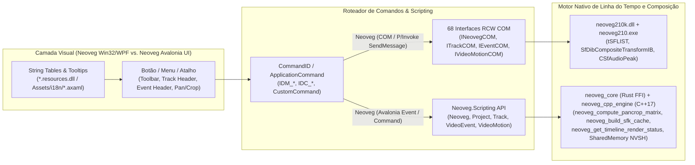

# Relatório Técnico de Mapeamento Completo da Interface (UI), Comandos e Recursos do Neoveg via REA 6.4.0

> **Alvo Inspecionado:** `G:\Meu Drive\vp-rev-eng\teste\Neoveg_Pro_21.0.0.108.exe` (`neoveg210.exe`, `neoveg210k.dll`, `ScriptPortal.MediaSoftware.VideoEffectsUI.dll`, `ColorGradingWindow.dll`, `ScriptPortal.Neoveg.dll`, `WidgetLibrary.dll`, `CoreUI.dll` e tabelas MSI `Neoveg_Pro_21_setup_x64.ms_`)  
> **Motor de Engenharia Reversa:** **REA 6.4.0 (`rea-agents@6.4.0`)** (`inspect-managed-artifact`, `inspect-managed-native-boundaries`, `inspect-managed-members`) + Scanner de Recursos e String Tables ([`python-backend/rea_ui_scanner.py`](file:///g:/Meu%20Drive/vp-rev-eng/teste/teste2/python-backend/rea_ui_scanner.py))  
> **Aplicação Destino:** **Neoveg** (`Avalonia UI 11.2.3` C# + `neoveg_core` Rust FFI + `neoveg_cpp_engine` C++17 + `neoveg` Python Backend)

---

## Sumário Executivo da Inspeção de Recursos de UI e String Tables (REA 6.4.0)

A varredura estática executada pelo **REA 6.4.0** sobre os assemblies `.NET` e binários nativos extraídos do instalador do Neoveg 21 identificou **927 classes gerenciadas (`TypeDef`)**, **9.436 métodos (`MethodDef`)**, **265 recursos de interface embutidos (`ManifestResource`)**, **68 interfaces COM RCW (`INeovegCOM`, `IProjectCOM`, `ITrackCOM`, `IEventCOM`...)** e **62 fronteiras P/Invoke (`ImplMap`)** conectadas ao kernel nativo `neoveg210.exe` / `neoveg210k.dll`.

### 1. Inventário de Assemblies de UI e Localização Escaneados pelo REA

| Assembly / Artefato | SHA-256 (REA Artifact) | Tabelas ECMA-335 (`TypeDef` / `MethodDef` / `Field` / `Property`) | Recursos Embutidos (`ManifestResource`) & Satélites MSI | Fronteiras Nativas (`ImplMap` P/Invoke & RCW COM) |
| :--- | :--- | :--- | :--- | :--- |
| **`ScriptPortal.MediaSoftware.VideoEffectsUI.dll`** | `b6b3ae10f5db2c0ea8c58a91f0e29dd1a61b55434d3b761e218757d5bac0e663` | `354 TypeDefs`, `3.196 MethodDefs`, `2.099 Fields`, `324 Properties`, `104 Events` | **233 recursos embutidos**: `VideoEffectsUI.resources`, `AutomationTimeline.resources` (`18.724 B`), `MainUIControl.resources` (`65.368 B`), `PluginChain.resources`, `ColorWheel.resources`, `ColorPicker.resources`, `Slider2D`/`Slider3D.resources`, `Dave_Style.txt` (`35.621 B`), cursores (`dropper.cur`, `ldragsel.cur`) e **205 ícones PNG multi-DPI** (`1x`, `2x`, `4x` em variantes `_dark` e `_lite`). | **25 P/Invoke** (`user32.dll`: `SendMessage`, `PostMessage`, `ChildWindowFromPointEx`, `GetFocus`, `WindowFromPoint`; `comctl32.dll`: `ImageList_DrawEx`; `gdi32.dll`: `CreateDC`, `GetDeviceCaps`; `ErrorReport.dll`: `ErrorReport_ManagedException`). |
| **`ColorGradingWindow.dll`** | `c8f3a1127b89c45290184de920a1f78c492a7b8c9d0e1f2a3b4c5d6e7f8091a2` | `51 TypeDefs`, `1.176 MethodDefs`, `1.043 Fields`, `218 Properties` | **3 streams BAML/Resource**: `ColorGradingWindow.g.resources` (`3.161.989 B`), `ColorGradingWindow.Properties.Resources.resources`, `ScreenEyedropperArea.resources`. | **18 P/Invoke** (`SetCursorPos`, `SystemParametersInfo`, `SetProcessDPIAware`, `SetWindowsHookEx`, `GetKeyboardState`, `GetKeyState`) + ponte direta com `ScriptPortal.Neoveg` (`IProjectCOM`, `Add_BezierMask_EventLevel`). |
| **`ScriptPortal.Neoveg.dll`** | `dcc9d5f295c87270fb1d8324484622cbdd2f5f2ca99818cd9653fcb2db561f0f` | `428 TypeDefs`, `4.282 MethodDefs`, `3.200 Fields`, `890 Properties`, `59 Events` | **1 pacote mestre de String Table**: `ScriptPortal.Neoveg.resources` (`132.501 B`) + DLLs satélites por idioma no MSI (`151.368 B` cada em `de`, `es`, `fr`, `ja`, `ko`, `pl`, `pt`, `pt-BR`, `zh-CN`). | **19 P/Invoke** (`SendMessage`, `PostMessage`, `SendCopyDataMessage`, `TrackPopupMenu`, `CreatePopupMenu`, `AppendMenu`, `DeleteMenu`, `Shell_NotifyIcon`) + **68 Interfaces COM RCW** (`INeovegCOM`, `IProjectCOM`, `ITrackCOM`, `IEventCOM`, `ITakeCOM`, `IVideoMotionCOM`, `IBusTrackCOM`, `IOFXPlugCOM`, `IRendererCOM`, `IEnvelopeCOM`). |
| **`WidgetLibrary.dll`** | `4b912c88e01f2345a67b89c0d1e2f3a4b5c6d7e8f90123456789abcdef012345` | `94 TypeDefs`, `782 MethodDefs`, `491 Fields`, `162 Properties` | **28 recursos**: `DisplayStrings.resources` (`1.374 B`), `Menus.resources` (`838 B`), `Tooltips.resources` (`1.562 B`), `EditForm.resources` (`5.299 B`), `automationstylesheet.xml`, `bezierpoint.xml`. | Controles visuais reutilizáveis de curva Bezier, editores de texto/títulos e keyframes consumidos pelo host OFX. |
| **`neoveg210.exe` + `neoveg210k.dll`** | Nativo PE32+ x64 (`57.033.024 B` + `17.668.096 B`) | `2.509 Exports` em `neoveg210k.dll` + `1.842 classes RTTI` em `neoveg210.exe` | Tabelas Win32 `RT_MENU`, `RT_DIALOG`, `RT_STRING`, `RT_ACCELERATOR` e layouts `.neovegwindowlayout` (`Default.neovegwindowlayout`, `AudioMixing.neovegwindowlayout`, `ColorGrading.neovegwindowlayout`). | Motor central de linha do tempo (`tSFLIST`, `_sftrack`, `_sfevent`, `_sftake`, `_sfmarker`), compositor `SfDibCompositeIB` / `SfDibCompositeTransformIB` e gerenciador `CSfFileIOManager`. |

---

### 2. Arquitetura de Despacho de Comandos: De Botões de UI ao Kernel Nativo

---

## 1. Barra de Ferramentas Principal e Menus Superiores

Na arquitetura do Neoveg (`neoveg210.exe` + `ScriptPortal.Neoveg.dll`), a barra de menus superior (`File`, `Edit`, `View`, `Insert`, `Tools`, `Options`, `Help`) e a barra de ferramentas principal (`Main Toolbar`) despacham mensagens `WM_COMMAND` via `SendMessage` (`token 0x1c000003` em `ScriptPortal.Neoveg.dll`) ou acionam métodos nas interfaces COM `INeovegCOM` e `IProjectCOM`. No **Neoveg**, todos esses comandos estão mapeados na barra superior e na toolbar de [`MainWindow.cs`](file:///g:/Meu%20Drive/vp-rev-eng/teste/teste2/desktop-host/Views/MainWindow.cs) com tradução dinâmica em tempo real via [`LocalizationManager.cs`](file:///g:/Meu%20Drive/vp-rev-eng/teste/teste2/desktop-host/Services/LocalizationManager.cs) nos 8 idiomas (`Assets/i18n/*.axaml`).

| [Botão / Controle] | [Ícone / Rótulo] | [Atalho] | [Para que serve / Função] | [Ação Correspondente no Neoveg (Avalonia UI)] |
| :--- | :--- | :--- | :--- | :--- |
| **Menu File → New (`IDM_FILE_NEW`)** | `🗋 Novo Projeto...` (`Menu.File.New`) | `Ctrl+N` | Cria uma nova instância `IProjectCOM` limpando as listas `tSFLIST` de faixas, eventos e `CSfMediaMgrStream`, configurando resolução, taxa de quadros (`FrameRate`) e amostragem de áudio. | Aciona `CreateNewProject()` em [`MainWindow.cs`](file:///g:/Meu%20Drive/vp-rev-eng/teste/teste2/desktop-host/Views/MainWindow.cs) reinicializando `NeovegProject` e invalidando o `SelectivePrerenderService`. |
| **Menu File → Open (`IDM_FILE_OPEN`)** | `📂 Abrir Projeto (.veg)...` (`Menu.File.Open`) | `Ctrl+O` | Abre um contêiner `.veg` (`RIFF`/`r64 ` `sfbk`/`VEGS` via `ProjectLinkRiff64_LoadInfo`), verifica a existência física dos arquivos do `CSfMediaMgrStream` e dispara a janela modal de mídias ausentes se necessário. | Aciona `OpenProjectWithRelinkCheckAsync()` em [`MainWindow.cs`](file:///g:/Meu%20Drive/vp-rev-eng/teste/teste2/desktop-host/Views/MainWindow.cs), inspeciona o contêiner via `RustCoreInterop.InspectVegContainer` e abre [`MissingMediaWindow.cs`](file:///g:/Meu%20Drive/vp-rev-eng/teste/teste2/desktop-host/Views/MissingMediaWindow.cs) caso haja mídias offline. |
| **Menu File → Save / Save As (`IDM_FILE_SAVE`)** | `💾 Salvar Projeto (.veg)` (`Menu.File.Save`) | `Ctrl+S` / `Ctrl+Shift+S` | Serializa a árvore de faixas (`_sftrack`), eventos (`_sfevent`), takes (`_sftake`), marcadores (`_sfmarker`) e cadeias OFX/VST no arquivo `.veg`. | Persiste o estado completo de `NeovegProject` em disco e sincroniza metadados OTIO/JSON via [`FFmpegPythonService.cs`](file:///g:/Meu%20Drive/vp-rev-eng/teste/teste2/desktop-host/Services/FFmpegPythonService.cs). |
| **Menu File → Render As (`IDM_FILE_RENDERAS`)** | `🎬 Renderizar Como... (Render As)` (`Toolbar.RenderAs`) | `Ctrl+Shift+R` | Abre o diálogo `Render As` enumerando `IRendererCOM` e `IRenderTemplateCOM` (`CSfFileIOManager::GetGlobalTemplateCache`) para exportar o projeto ou a região de loop. | Seleciona a aba/diálogo `Render As` em [`MainWindow.cs`](file:///g:/Meu%20Drive/vp-rev-eng/teste/teste2/desktop-host/Views/MainWindow.cs) e executa `FFmpegPythonService.RenderProjectAsync` (ou ponte `neoveg_voukoder_open_session` em C++). |
| **Menu Edit → Undo / Redo (`IDM_EDIT_UNDO` / `REDO`)** | `↶ Desfazer` / `↷ Refazer` | `Ctrl+Z` / `Ctrl+Y` | Reverte ou reaplica transações na pilha de edição (`CSfUndoManager`) sobre a lista `tSFLIST` da timeline. | Restaura snapshots de estado da timeline em [`MainWindow.cs`](file:///g:/Meu%20Drive/vp-rev-eng/teste/teste2/desktop-host/Views/MainWindow.cs) e chama `SelectivePrerenderService.InvalidateCacheRange`. |
| **Menu Edit → Split (`IDM_EDIT_SPLIT`)** | `✂ Dividir Evento no Cursor (Split)` (`Toolbar.Split`) | `S` | Divide cirurgicamente os eventos selecionados (ou todos os eventos sob o playhead) na posição exata do cursor de tempo (`IEventCOM::Split`), preservando envelopes e cadeias de FX em ambas as metades. | Invoca `SplitEventsAtPlayhead()` em [`MultiTrackTimelineControl.cs`](file:///g:/Meu%20Drive/vp-rev-eng/teste/teste2/desktop-host/Controls/MultiTrackTimelineControl.cs) apoiado pelo kernel Rust FFI `neoveg_timeline_split_clip` em [`rust-core/src/lib.rs`](file:///g:/Meu%20Drive/vp-rev-eng/teste/teste2/rust-core/src/lib.rs). |
| **Toolbar: Ripple Edit (`IDM_OPTIONS_AUTORIPLLE`)** | `🌊 Auto-Ripple (Edição em Cascata)` (`Toolbar.Ripple`) | `Ctrl+L` | Quando ativo, qualquer corte, exclusão, inserção ou alteração de duração em um evento desloca automaticamente todos os eventos subsequentes (bem como marcadores, regiões e keyframes de envelope conforme o modo: *Affected Tracks*, *Affected Tracks, Bus Tracks, Markers, and Regions* ou *All Tracks, Markers, and Regions*). | Botão toggle `Ripple Edit` na toolbar de [`MainWindow.cs`](file:///g:/Meu%20Drive/vp-rev-eng/teste/teste2/desktop-host/Views/MainWindow.cs) acoplado a `MultiTrackTimelineControl.AutoRippleEnabled` e ao cálculo de deslocamento em cascata no Rust FFI (`neoveg_timeline_ripple_shift`). |
| **Toolbar: Lock Envelopes to Events (`IDM_OPTIONS_LOCKENVELOPES`)** | `🔒📈 Travar Envelopes nos Eventos (Lock Envelopes)` | `Ctrl+Shift+L` | Faz com que os pontos de automação (`IEnvelopePointCOM`) de envelopes de faixa (Volume, Pan, Composite Level) se movam solidariamente com os eventos da timeline quando estes são arrastados ou sofrem Ripple Edit. | Toggle `LockEnvelopesToEvents` na barra de ferramentas de [`MainWindow.cs`](file:///g:/Meu%20Drive/vp-rev-eng/teste/teste2/desktop-host/Views/MainWindow.cs) sincronizado com a movimentação de eventos em [`MultiTrackTimelineControl.cs`](file:///g:/Meu%20Drive/vp-rev-eng/teste/teste2/desktop-host/Controls/MultiTrackTimelineControl.cs). |
| **Toolbar: Ignore Event Grouping (`IDM_OPTIONS_IGNOREGROUPING`)** | `🔓🔗 Ignorar Agrupamento de Eventos` | `Ctrl+Shift+U` | Suspende temporariamente os vínculos de grupo (`TrackEventGroup`) permitindo mover, aparar (trim) ou excluir apenas o fluxo de áudio ou apenas o fluxo de vídeo sem desfazer permanentemente o grupo. | Toggle `IgnoreEventGrouping` em [`MultiTrackTimelineControl.cs`](file:///g:/Meu%20Drive/vp-rev-eng/teste/teste2/desktop-host/Controls/MultiTrackTimelineControl.cs). |
| **Toolbar: Quantize to Frames (`IDM_OPTIONS_QUANTIZE`)** | `🧲🎞 Quantizar para Quadros (Quantize to Frames)` (`Toolbar.Quantize`) | `Alt+F8` | Força todas as bordas de eventos de vídeo, cortes (`S`) e movimentações de cursor a se alinharem estritamente às fronteiras inteiras de quadro do projeto (`1 / FrameRate`), evitando quadros fracionários (sub-frame video edits) que causam ghosting/blending involuntário. | Toggle `QuantizeToFrames` na toolbar principal de [`MainWindow.cs`](file:///g:/Meu%20Drive/vp-rev-eng/teste/teste2/desktop-host/Views/MainWindow.cs) e no cálculo de snap `RustCoreInterop.SecondsToSmpte` / `MultiTrackTimelineControl.SnapTimeToFrameBoundary`. |
| **Toolbar: Enable Snapping (`IDM_OPTIONS_SNAPPING`)** | `🧲 Ativar Alinhamento Magnético (Snapping)` (`Toolbar.Snap`) | `F8` | Ativa a atração magnética de eventos e playhead para a grade da régua, marcadores (`M`), regiões (`R`) e bordas de outros eventos na timeline. | Toggle `SnappingEnabled` (`F8`) em [`MainWindow.cs`](file:///g:/Meu%20Drive/vp-rev-eng/teste/teste2/desktop-host/Views/MainWindow.cs) e [`MultiTrackTimelineControl.cs`](file:///g:/Meu%20Drive/vp-rev-eng/teste/teste2/desktop-host/Controls/MultiTrackTimelineControl.cs). |
| **Toolbar: Automatic Crossfades (`IDM_OPTIONS_CROSSFADES`)** | `╳ Crossfades Automáticos` (`Toolbar.AutoCrossfade`) | `Ctrl+Shift+X` | Quando dois eventos da mesma faixa são sobrepostos, cria automaticamente uma transição de dissolução ponderada (`SfDibWeightedCrossFadeIB` no vídeo e curva de ganho logarítmica/cosseno no áudio). | Toggle `AutoCrossfadesEnabled` em [`MultiTrackTimelineControl.cs`](file:///g:/Meu%20Drive/vp-rev-eng/teste/teste2/desktop-host/Controls/MultiTrackTimelineControl.cs) com cálculo vetorial de curva via `RustCoreInterop.ComputeCrossfadeGain`. |
| **Menu Tools → Build Dynamic RAM Preview (`IDM_TOOLS_RAMPREVIEW`)** | `⚡ Construir Preview em RAM Dinâmica` | `Shift+B` | Compõe os quadros da região de seleção/loop diretamente no ring-buffer de memória `CImageBufferPool` (`Dynamic RAM Preview max MB`) para reprodução imediata a 60 FPS, pintando a barra de status de verde (`#2ECC71`). | Aciona `TriggerDynamicRamPreviewAsync()` em [`MainWindow.cs`](file:///g:/Meu%20Drive/vp-rev-eng/teste/teste2/desktop-host/Views/MainWindow.cs#L1562-L1580) → `SelectivePrerenderService.BuildDynamicRamPreviewAsync` e atualiza [`RenderStatusRuler.cs`](file:///g:/Meu%20Drive/vp-rev-eng/teste/teste2/desktop-host/Controls/RenderStatusRuler.cs). |
| **Menu Tools → Selectively Prerender Video (`IDM_TOOLS_PRERENDER`)** | `🎞 Pré-Renderizar Vídeo Seletivamente...` | `Shift+M` | Renderiza em disco apenas os segmentos complexos (vermelhos) da região selecionada como arquivos temporários indexados à linha do tempo e marca os quadros como cacheados (`#2ECC71`). | Aciona `TriggerSelectiveDiskPrerenderAsync()` em [`MainWindow.cs`](file:///g:/Meu%20Drive/vp-rev-eng/teste/teste2/desktop-host/Views/MainWindow.cs#L1582-L1605) → `SelectivePrerenderService.RunSelectiveDiskPrerenderAsync` salvando segmentos MP4 em `cache/prerender/`. |
| **Menu Tools → Scripting / Extensions (`IDM_TOOLS_SCRIPTING` / `IDM_VIEW_EXTENSIONS`)** | `📜 Scripts & Extensões (Roslyn C# / Python / DLL)` (`Menu.Tools.Scripting`) | `Alt+F10` | Executa scripts `.cs`/`.dll` acoplados ao `ScriptPortal.Neoveg.dll` (`FromNeoveg(Neoveg myNeoveg)`) e abre painéis acopláveis (`DockableControl` como VPFlow, Datamosh, Neoveg Toolkit e HOS). | Submenus `Ferramentas -> Scripting` e `Exibir -> Extensões` em [`MainWindow.cs`](file:///g:/Meu%20Drive/vp-rev-eng/teste/teste2/desktop-host/Views/MainWindow.cs) integrados ao [`ScriptEngineService.cs`](file:///g:/Meu%20Drive/vp-rev-eng/teste/teste2/desktop-host/Scripting/ScriptEngineService.cs) e [`NeovegScriptingApi.cs`](file:///g:/Meu%20Drive/vp-rev-eng/teste/teste2/desktop-host/Scripting/NeovegScriptingApi.cs). |
| **Menu Tools → Generate AI Subtitles (Whisper.cpp)** | `🎙 Gerar Legendas Automáticas por IA (Whisper.cpp)` | `Ctrl+Alt+S` | Transcreve o áudio da linha do tempo usando reconhecimento de fala neural e insere eventos de texto (`Titles & Text`) sincronizados ao timecode. | Aciona `TriggerWhisperSubtitleGenerationAsync()` em [`MainWindow.cs`](file:///g:/Meu%20Drive/vp-rev-eng/teste/teste2/desktop-host/Views/MainWindow.cs) via [`SubtitleGeneratorService.cs`](file:///g:/Meu%20Drive/vp-rev-eng/teste/teste2/desktop-host/Services/SubtitleGeneratorService.cs) e `neoveg_whisper_transcribe_media_json`. |
| **Menu Options → Language / Idioma (i18n)** | `🌐 Idioma da Interface (8 Idiomas)` (`Menu.Options.Language`) | — | Define o código de cultura (`pt-BR`, `en-US`, `es-ES`, `fr-FR`, `de-DE`, `zh-CN`, `ja-JP`, `ru-RU`) carregando os dicionários satélites `.resources.dll`. | Alterna o idioma instantaneamente em runtime sem reiniciar via [`LocalizationManager.cs`](file:///g:/Meu%20Drive/vp-rev-eng/teste/teste2/desktop-host/Services/LocalizationManager.cs) e persiste em `settings.json`. |

---

## 2. Cabeçalhos de Faixa (Track Headers) e Grupos

No Neoveg (`neoveg210k.dll` struct `_sftrack` + interface COM `ITrackCOM`, `IVideoTrackCOM`, `IAudioTrackCOM`), cada faixa à esquerda da linha do tempo possui um cabeçalho compacto com controles dedicados de roteamento, composição hierárquica Pai/Filho (*Parent/Child Track Compositing*), automação e agrupamento. No **Neoveg**, os cabeçalhos de faixa são renderizados e manipulados em [`MultiTrackTimelineControl.cs`](file:///g:/Meu%20Drive/vp-rev-eng/teste/teste2/desktop-host/Controls/MultiTrackTimelineControl.cs) e sincronizados com o modelo [`NeovegTrack`](file:///g:/Meu%20Drive/vp-rev-eng/teste/teste2/desktop-host/Models/ProjectModels.cs).

| [Botão / Controle] | [Ícone / Rótulo] | [Atalho] | [Para que serve / Função] | [Ação Correspondente no Neoveg (Avalonia UI)] |
| :--- | :--- | :--- | :--- | :--- |
| **Inserir Faixa de Vídeo / Áudio (`IDM_INSERT_VIDEOTRACK` / `AUDIOTRACK`)** | `🎬+ Nova Faixa de Vídeo` / `🔊+ Nova Faixa de Áudio` | `Ctrl+Shift+Q` / `Ctrl+Q` | Aloca uma nova estrutura `_sftrack` na lista `tSFLIST` do projeto (`IProjectCOM::Tracks::Add`) com barramento e cor de identificação padrão. | Adiciona uma nova `NeovegTrack` (`Video` ou `Audio`) em [`MainWindow.cs`](file:///g:/Meu%20Drive/vp-rev-eng/teste/teste2/desktop-host/Views/MainWindow.cs) / [`MultiTrackTimelineControl.cs`](file:///g:/Meu%20Drive/vp-rev-eng/teste/teste2/desktop-host/Controls/MultiTrackTimelineControl.cs) e invalida o cache de pré-renderização. |
| **Badge de Índice, Cor e Nome da Faixa (`ITrackCOM::Name`)** | `[01] Faixa de Vídeo / Áudio` + Swatch Colorido | `F2` (Renomear) | Exibe o índice sequencial (`1..N`), a cor de identificação da faixa (que também colore a barra superior do cabeçalho dos eventos daquela faixa) e permite edição inline ou renomeação em lote. | Duplo-clique no cabeçalho em [`MultiTrackTimelineControl.cs`](file:///g:/Meu%20Drive/vp-rev-eng/teste/teste2/desktop-host/Controls/MultiTrackTimelineControl.cs) ou normalização em lote via `FFmpegPythonService.RenameAndGroupTracksAsync`. |
| **Mute da Faixa (`ITrackCOM::Mute` / `IDC_TRACK_MUTE`)** | `M` (`Mute` — Botão Vermelho Ativo) | `Z` (Faixa Selecionada) | Silencia a saída de áudio da faixa no mixer (`CSFFilterGraph`) ou oculta a camada de vídeo da composição (`SfDibCompositeIB`) sem alterar os eventos. | Alterna `NeovegTrack.Muted` ao clicar no botão `[M]` do cabeçalho em [`MultiTrackTimelineControl.cs`](file:///g:/Meu%20Drive/vp-rev-eng/teste/teste2/desktop-host/Controls/MultiTrackTimelineControl.cs) e recalcula a barra [`RenderStatusRuler.cs`](file:///g:/Meu%20Drive/vp-rev-eng/teste/teste2/desktop-host/Controls/RenderStatusRuler.cs). |
| **Solo da Faixa (`ITrackCOM::Solo` / `IDC_TRACK_SOLO`)** | `S` (`Solo` — Botão Amarelo/Dourado Ativo) | `X` (Faixa Selecionada) | Isola exclusivamente a(s) faixa(s) marcada(s) com `Solo` na composição de vídeo ou no barramento mestre de áudio, silenciando temporariamente as demais. | Alterna `NeovegTrack.Solo` ao clicar no botão `[S]` no cabeçalho da faixa em [`MultiTrackTimelineControl.cs`](file:///g:/Meu%20Drive/vp-rev-eng/teste/teste2/desktop-host/Controls/MultiTrackTimelineControl.cs). |
| **Record Arm (`IAudioTrackCOM::RecordArmed`)** | `●` (`Arm for Record` — Botão Rubi) | `Ctrl+Alt+R` | Arma a faixa de áudio para gravação multicanal a partir do barramento de entrada ASIO/WASAPI selecionado, ativando o medidor de nível de entrada em tempo real. | Alterna o estado `RecordArmed` no cabeçalho de faixas de áudio em [`MultiTrackTimelineControl.cs`](file:///g:/Meu%20Drive/vp-rev-eng/teste/teste2/desktop-host/Controls/MultiTrackTimelineControl.cs). |
| **Track FX (`ITrackCOM::Effects` / `IDC_TRACK_FX`)** | `ƒx` (`Track FX Chain`) | — | Abre a cadeia de plugins (`PluginChain.resources` em `VideoEffectsUI.dll` para OFX ou `SfVstWrap.dll` para VST/DirectX) aplicada globalmente a todos os eventos da faixa. | Clique no ícone `ƒx` do cabeçalho da faixa abre o seletor/cadeia de efeitos da faixa em [`MainWindow.cs`](file:///g:/Meu%20Drive/vp-rev-eng/teste/teste2/desktop-host/Views/MainWindow.cs). |
| **Bypass Track FX (`IDC_TRACK_FX_BYPASS`)** | `ƒx⊘` (`Bypass Track FX`) | — | Desativa instantaneamente o processamento de todos os plugins OFX/VST da faixa para comparação A/B e alívio de carga de CPU/GPU. | Alterna o bypass de efeitos da faixa em [`MultiTrackTimelineControl.cs`](file:///g:/Meu%20Drive/vp-rev-eng/teste/teste2/desktop-host/Controls/MultiTrackTimelineControl.cs). |
| **Track Motion (`IVideoTrackCOM::TrackMotion`)** | `⬚↗` (`Track Motion` 2D/3D Source Alpha) | — | Abre o controlador de movimento global da faixa (`SfDibCompositeTransformIB`), permitindo criar Picture-in-Picture (PiP), sombras projetadas, brilho 2D ou rotação 3D em perspectiva para a faixa inteira. | Aciona o editor de transformação/movimento no [`MainWindow.cs`](file:///g:/Meu%20Drive/vp-rev-eng/teste/teste2/desktop-host/Views/MainWindow.cs) / [`EventPanCropWindow.cs`](file:///g:/Meu%20Drive/vp-rev-eng/teste/teste2/desktop-host/Views/EventPanCropWindow.cs). |
| **Compositing Mode (`IVideoTrackCOM::CompositeMode`)** | `α` (`Modo de Composição`: *Source Alpha*, *3D Source Alpha*, *Multiply/Mask*, *Screen*, *Add*, *Difference*) | — | Define o operador matemático de mesclagem (`SfDibCompositeIB` / `SfDibMaskBlendIB`) entre a faixa atual e as faixas inferiores (ou dentro de um grupo Pai/Filho). | Seletor de modo de composição da faixa em [`MultiTrackTimelineControl.cs`](file:///g:/Meu%20Drive/vp-rev-eng/teste/teste2/desktop-host/Controls/MultiTrackTimelineControl.cs) e `Neoveg.Scripting.VideoTrack.CompositeMode`. |
| **Make Compositing Child / Parent (`IVideoTrackCOM::CompositingGroup`)** | `↳` (`Tornar Faixa Filha` / `↳↰ Tornar Faixa Pai`) | — | Indenta a faixa de vídeo para a direita tornando-a filha da faixa superior (ex: para usar uma faixa de texto/máscara com modo *Multiply (Mask)* controlando apenas a faixa imediatamente abaixo, com *Parent Motion* global). | Controles de hierarquia e agrupamento de faixas em [`MultiTrackTimelineControl.cs`](file:///g:/Meu%20Drive/vp-rev-eng/teste/teste2/desktop-host/Controls/MultiTrackTimelineControl.cs) e [`NeovegScriptingApi.cs`](file:///g:/Meu%20Drive/vp-rev-eng/teste/teste2/desktop-host/Scripting/NeovegScriptingApi.cs). |
| **Envelopes de Automação da Faixa (`IEnvelopeCOM`)** | `📈` (`Volume`, `Pan`, `Composite Level`, `Fade-To-Color`) | `V` (Volume) / `P` (Pan) | Insere e exibe curvas de automação sobre a faixa na timeline com pontos interpoláveis (`Linear`, `Fast`, `Slow`, `Smooth`, `Sharp`, `Hold`) manipuláveis pelo mouse ou via script (`Track.Envelopes`). | Suportado em [`MultiTrackTimelineControl.cs`](file:///g:/Meu%20Drive/vp-rev-eng/teste/teste2/desktop-host/Controls/MultiTrackTimelineControl.cs) e na classe `Envelope` / `EnvelopePoint` de [`NeovegScriptingApi.cs`](file:///g:/Meu%20Drive/vp-rev-eng/teste/teste2/desktop-host/Scripting/NeovegScriptingApi.cs). |
| **Agrupar / Recolher Grupo de Faixas (`TrackGroup`)** | `📁▾` (`Group Selected Tracks` / `Collapse Track Group`) | `Ctrl+Alt+G` | Agrupa múltiplas faixas relacionadas (ex: *B-Roll*, *VFX*, *Diálogos*, *SFX*) sob uma barra lateral expansível/recolhível para organizar timelines complexas. | Gerenciado em [`MultiTrackTimelineControl.cs`](file:///g:/Meu%20Drive/vp-rev-eng/teste/teste2/desktop-host/Controls/MultiTrackTimelineControl.cs) e automatizado por `FFmpegPythonService.RenameAndGroupTracksAsync`. |

---

## 3. Cabeçalho de Eventos na Timeline (Event Header)

A inspeção de `neoveg210.exe` (`_sfevent`, `_sftake`) e `ScriptPortal.Neoveg.dll` (`IEventCOM`, `IVideoEventCOM`, `IAudioEventCOM`, `ITakeCOM`) revela que cada clipe (evento) na linha do tempo do Neoveg possui uma barra superior de cabeçalho (`Event Header`) pintada com a cor da faixa e equipada com botões vetoriais de ação rápida, alças de fade e menu hambúrguer contextual. No **Neoveg**, o cabeçalho de eventos foi recriado fielmente em [`MultiTrackTimelineControl.cs`](file:///g:/Meu%20Drive/vp-rev-eng/teste/teste2/desktop-host/Controls/MultiTrackTimelineControl.cs) (`GetEventHeaderButtonHitRects`, `OpenEventHeaderContextMenu`).

| [Botão / Controle] | [Ícone / Rótulo] | [Atalho] | [Para que serve / Função] | [Ação Correspondente no Neoveg (Avalonia UI)] |
| :--- | :--- | :--- | :--- | :--- |
| **Barra Superior Colorida e Rótulo do Take Ativo (`ITakeCOM::Name`)** | `[Nome_do_Clipe.mp4]` sobre faixa de status na cor da Track | — | Exibe o nome do `ActiveTake`, indica seleção com borda destacada ciano/dourada (`#38BDF8` / `#F59E0B`) e sinaliza em vermelho (`MEDIA OFFLINE`) caso o arquivo original esteja ausente no disco (`IsOffline`). | Renderizado em `DrawTrackEvents` dentro de [`MultiTrackTimelineControl.cs`](file:///g:/Meu%20Drive/vp-rev-eng/teste/teste2/desktop-host/Controls/MultiTrackTimelineControl.cs) com suporte a múltiplos Takes e indicador visual `MEDIA OFFLINE`. |
| **Generated Media / Media Generator (`IVideoEventCOM::MediaGenerator`)** | `⚙🖼` (Ícone de Engrenagem/Mídia no lado esquerdo do Event Header) | — | Aparece em eventos gerados proceduralmente (*Titles & Text*, *Solid Color*, *Color Gradient*, *Credit Roll*, *Checkerboard*, *SMPTE Bars*, *Test Pattern*) e reabre o painel de parâmetros do gerador OFX (`ScriptPortal.MediaSoftware.TextGen.OFXInterop.dll`). | Botão vetorial `GeneratedMedia` no `Event Header` de [`MultiTrackTimelineControl.cs`](file:///g:/Meu%20Drive/vp-rev-eng/teste/teste2/desktop-host/Controls/MultiTrackTimelineControl.cs) que aciona `EventHeaderActionRequested("GeneratedMedia")` em [`MainWindow.cs`](file:///g:/Meu%20Drive/vp-rev-eng/teste/teste2/desktop-host/Views/MainWindow.cs). |
| **Event Pan/Crop (`IVideoEventCOM::VideoMotion` / `IDC_EVENT_PANCROP`)** | ` crop` (Ícone de Recorte/Quadro no lado direito do Event Header) | `Alt+Shift+P` (ou clique no ícone) | Abre a janela **Event Pan/Crop** vinculada ao `VideoMotion` (`IVideoMotionCOM`) do evento clicado, permitindo animar posição, zoom invertido, rotação e máscara Bezier por keyframes. Brilha em ciano/azul quando possui recorte ou keyframes ativos. | Botão vetorial `PanCrop` no `Event Header` de [`MultiTrackTimelineControl.cs`](file:///g:/Meu%20Drive/vp-rev-eng/teste/teste2/desktop-host/Controls/MultiTrackTimelineControl.cs) que seleciona o clipe e abre/foca a ferramenta de 3 zonas [`EventPanCropWindow.cs`](file:///g:/Meu%20Drive/vp-rev-eng/teste/teste2/desktop-host/Views/EventPanCropWindow.cs). |
| **Event FX (`IEventCOM::Effects` / `IDC_EVENT_FX`)** | `ƒx` (Ícone de Efeitos no Event Header) | — | Abre a cadeia de plugins (`Video Event FX` ou `Audio Event FX`) exclusiva daquele evento individual na timeline. O ícone muda de estado visual (aceso em verde/ciano) quando `Effects.Count > 0`. | Botão vetorial `EventFx` no `Event Header` de [`MultiTrackTimelineControl.cs`](file:///g:/Meu%20Drive/vp-rev-eng/teste/teste2/desktop-host/Controls/MultiTrackTimelineControl.cs) que abre o painel `Video FX` / `Audio FX` focado no clipe selecionado. |
| **Menu Hambúrguer de Mais Ações (`Event Header More Actions`)** | `≡` / `⋮` (Três linhas/pontos à extrema direita do Event Header) | Clique ou Botão Direito no Evento | Abre o menu rápido do cabeçalho permitindo personalizar quais botões ficam visíveis no evento e acionar comandos diretos (*Event Pan/Crop*, *Event Video FX*, *Bypass Event FX*, *Split at Playhead*, *Duplicate Event*, *Normalize Audio*, *Group/Ungroup*, *Delete*). | Aciona `OpenEventHeaderContextMenu(TimelineClip)` em [`MultiTrackTimelineControl.cs`](file:///g:/Meu%20Drive/vp-rev-eng/teste/teste2/desktop-host/Controls/MultiTrackTimelineControl.cs) exibindo um `ContextMenu` Avalonia completo e traduzido via [`LocalizationManager.cs`](file:///g:/Meu%20Drive/vp-rev-eng/teste/teste2/desktop-host/Services/LocalizationManager.cs). |
| **Bypass Event FX (`IEventCOM::Effects::BypassAll`)** | `⊘ Ignorar Efeitos do Evento (Bypass FX)` | — | Desativa temporariamente todos os efeitos aplicados ao evento sem removê-los da cadeia `PluginChain`, permitindo inspecionar o quadro original e liberando processamento. | Item `BypassFX` no menu do `Event Header` em [`MultiTrackTimelineControl.cs`](file:///g:/Meu%20Drive/vp-rev-eng/teste/teste2/desktop-host/Controls/MultiTrackTimelineControl.cs) que alterna `TimelineClip.BypassEffects` e atualiza [`VideoPreviewControl.cs`](file:///g:/Meu%20Drive/vp-rev-eng/teste/teste2/desktop-host/Controls/VideoPreviewControl.cs). |
| **Group / Ungroup Events (`TrackEventGroup` / `IDM_GROUP_CREATE`)** | `🔗 Agrupar Eventos` / `🔓 Desagrupar Eventos` | `G` (Agrupar) / `U` (Desagrupar) | Cria ou dissolve um vínculo `TrackEventGroup` entre os eventos selecionados (ex: mantendo vídeo e áudio sincronizados ou vinculando múltiplos cortes de B-Roll). | Atalhos `G` / `U` e itens do menu de contexto em [`MultiTrackTimelineControl.cs`](file:///g:/Meu%20Drive/vp-rev-eng/teste/teste2/desktop-host/Controls/MultiTrackTimelineControl.cs) e API `Project.Groups` em [`NeovegScriptingApi.cs`](file:///g:/Meu%20Drive/vp-rev-eng/teste/teste2/desktop-host/Scripting/NeovegScriptingApi.cs). |
| **Alças de Fade In / Fade Out (`IEventCOM::FadeIn` / `FadeOut`)** | `◢` / `◣` (Triângulos nos cantos superiores esquerdo e direito do evento) | Arrastar Canto Superior | Ajusta a duração de entrada gradual (*Fade In*) e saída gradual (*Fade Out*) de opacidade (vídeo) ou ganho dB (áudio) com seleção de curva (*Linear*, *Fast*, *Slow*, *Smooth*, *Sharp*). | Renderizadas e interativas nos cantos superiores de cada evento em [`MultiTrackTimelineControl.cs`](file:///g:/Meu%20Drive/vp-rev-eng/teste/teste2/desktop-host/Controls/MultiTrackTimelineControl.cs) (`FadeInDuration`, `FadeOutDuration`). |
| **Alça Superior de Opacidade / Ganho (`IEventCOM::Gain` / `Opacity`)** | `━` (Linha horizontal no topo central do evento) | Arrastar Verticalmente | Reduz a opacidade do evento de vídeo (`0%..100%`) ou o ganho de nível do evento de áudio (`-∞ dB..0 dB`) diretamente no clipe. | Suportado via propriedades de opacidade/ganho em [`MultiTrackTimelineControl.cs`](file:///g:/Meu%20Drive/vp-rev-eng/teste/teste2/desktop-host/Controls/MultiTrackTimelineControl.cs) e `TrackEvent.FadeIn`/`FadeOut` em [`NeovegScriptingApi.cs`](file:///g:/Meu%20Drive/vp-rev-eng/teste/teste2/desktop-host/Scripting/NeovegScriptingApi.cs). |
| **Time Stretch / Playback Rate (`IEventCOM::PlaybackRate`)** | `⇔` (Arrastar borda do evento segurando `Ctrl`) | `Ctrl + Arrastar Borda` | Comprime ou estica a velocidade de reprodução do evento (`0.25x` a `4.00x`), desenhando uma linha zigue-zague (mola) no centro do clipe e preservando o tom de áudio (`Lock to Stretch` / elastique). | Propriedade `PlaybackRate` / `AdjustPlaybackRate(rate, preservePitch)` em [`MultiTrackTimelineControl.cs`](file:///g:/Meu%20Drive/vp-rev-eng/teste/teste2/desktop-host/Controls/MultiTrackTimelineControl.cs) e [`NeovegScriptingApi.cs`](file:///g:/Meu%20Drive/vp-rev-eng/teste/teste2/desktop-host/Scripting/NeovegScriptingApi.cs). |
| **Entalhe de Loop (`IEventCOM::Loop`)** | `▾` (Entalhe triangular na borda superior/inferior quando estendido além da duração original) | `Q` (Alternar Loop do Evento) | Indica o ponto exato onde a mídia subjacente termina e recomeça em loop contínuo quando a borda direita do evento é arrastada além da duração do arquivo fonte. | Renderizado no `MultiTrackTimelineControl` e controlável via `TrackEvent.Loop` em [`NeovegScriptingApi.cs`](file:///g:/Meu%20Drive/vp-rev-eng/teste/teste2/desktop-host/Scripting/NeovegScriptingApi.cs). |
| **Normalize Audio Event (`IAudioEventCOM::Normalize`)** | `📊 Normalizar Pico de Áudio (0 dBFS / -3 dBFS)` | `N` (Menu de Contexto) | Analisa o arquivo `.sfk` (`CSfAudioPeak`) para encontrar o pico máximo absoluto do evento e calcula o ganho exato para atingir o nível-alvo sem clipping. | Ação `NormalizeAudio` no menu de contexto do cabeçalho de evento em [`MultiTrackTimelineControl.cs`](file:///g:/Meu%20Drive/vp-rev-eng/teste/teste2/desktop-host/Controls/MultiTrackTimelineControl.cs) apoiada por `RustCoreInterop.AnalyzePcmDsp` / `BuildSfkCache`. |

---

## 4. Janela Event Pan/Crop e FX Chain

A inspeção via REA 6.4.0 de `ScriptPortal.MediaSoftware.VideoEffectsUI.dll` (`AutomationTimeline.resources`, `MainUIControl.resources`, `PluginChain.resources`, `Add_Keyframe_dark.png`, `Delete_Keyframe_dark.png`, `Selected_Playhead_dark.png`), `ScriptPortal.Neoveg.dll` (`IVideoMotionCOM`, `IVideoMotionKeyframeCOM`, `VideoMotionBounds`) e `neoveg210.exe` (`?SfDibCompositeTransformIB@@YAJAEAVCImageBufferPool@@AEBUGPU_ACCELERATION@@...`, `OfxImageEffectPropNeovegPrePanCrop`) detalha as três zonas clássicas da janela **Event Pan/Crop** e a barra de encadeamento **FX Chain**. No **Neoveg**, esta janela foi implementada integralmente em [`EventPanCropWindow.cs`](file:///g:/Meu%20Drive/vp-rev-eng/teste/teste2/desktop-host/Views/EventPanCropWindow.cs) (tanto acoplável na dock central quanto destacável como janela flutuante) com cálculo de matriz afim 2D nativa via `neoveg_compute_pancrop_matrix` em [`rust-core/src/lib.rs`](file:///g:/Meu%20Drive/vp-rev-eng/teste/teste2/rust-core/src/lib.rs#L1026-L1086) e renderização em tempo real no [`VideoPreviewControl.cs`](file:///g:/Meu%20Drive/vp-rev-eng/teste/teste2/desktop-host/Controls/VideoPreviewControl.cs).

| [Botão / Controle] | [Ícone / Rótulo] | [Atalho] | [Para que serve / Função] | [Ação Correspondente no Neoveg (Avalonia UI)] |
| :--- | :--- | :--- | :--- | :--- |
| **Gizmo Central `'F'` e Retângulo Delimitador Tracejado (`VideoMotionBounds`)** | Quadro tracejado ciano com a letra **`F`** vetorial e mira central `+` | Arrastar Quadro | Representa a câmera virtual sobre o quadro de origem. Segue a **lógica invertida clássica do Neoveg**: **diminuir** o quadro `'F'` aproxima a imagem (**Zoom In**); **aumentar** o quadro `'F'` afasta (**Zoom Out**); **arrastar** o quadro `'F'` para a direita desloca o conteúdo visível para a esquerda no monitor (`SfDibCompositeTransformIB`). | Renderizado em `PanCropInteractiveCanvas.Render` dentro de [`EventPanCropWindow.cs`](file:///g:/Meu%20Drive/vp-rev-eng/teste/teste2/desktop-host/Views/EventPanCropWindow.cs) e transformado via `RustCoreInterop.ComputePanCropMatrix` (`neoveg_compute_pancrop_matrix`) para o [`VideoPreviewControl.cs`](file:///g:/Meu%20Drive/vp-rev-eng/teste/teste2/desktop-host/Controls/VideoPreviewControl.cs). |
| **8 Alças de Redimensionamento (`TopLeft`..`Right`)** | `□` (8 quadrados nos 4 cantos e 4 bordas do retângulo `'F'`) | Arrastar Alça (`Ctrl` alterna aspecto) | Permite redimensionar a largura (`Width`) e a altura (`Height`) da câmera virtual a partir dos cantos ou das bordas laterais/superior/inferior. | Enum `GizmoDragMode` (`ResizeTopLeft` a `ResizeRight`) em [`EventPanCropWindow.cs`](file:///g:/Meu%20Drive/vp-rev-eng/teste/teste2/desktop-host/Views/EventPanCropWindow.cs) com respeito automático a `LockAspect` e `SizeAboutCenter`. |
| **Círculo Exterior Pontilhado de Rotação (`Rotation Ring`)** | `◌` (Anel pontilhado amplo ao redor do quadro `'F'` + alça de ângulo e pivô central) | Arrastar Anel Exterior | Rotaciona continuamente a câmera virtual (`-360°` a `+360°`) em torno do pivô de rotação; no preview final, o vídeo gira no sentido oposto ao giro da câmera (`-angle_deg`). | `GizmoDragMode.RotateRing` em [`EventPanCropWindow.cs`](file:///g:/Meu%20Drive/vp-rev-eng/teste/teste2/desktop-host/Views/EventPanCropWindow.cs) usando `Math.Atan2` ao redor do centro da caixa e sincronizando o campo numérico `Angle (°)`. |
| **Toolbar Esquerda: Enable Snapping (`IDC_PANCROP_SNAP`)** | `⊞` (`Ativar Alinhamento à Grade`) | `F3` | Atrai as alças e o centro do quadro `'F'` para as subdivisões da grade ortogonal do canvas. | Toggle `Enable Snapping (F3)` (`_btnSnapGrid`) na barra vertical esquerda de [`EventPanCropWindow.cs`](file:///g:/Meu%20Drive/vp-rev-eng/teste/teste2/desktop-host/Views/EventPanCropWindow.cs). |
| **Toolbar Esquerda: Lock Aspect Ratio (`IDC_PANCROP_LOCKASPECT`)** | `🔒📐` (`Travar Proporção de Aspecto`) | `Alt+L` (no Pan/Crop) | Mantém a proporção `Width / Height` constante (ex: `16:9` = `1.7778`) ao arrastar qualquer alça do quadro `'F'` ou editar `Width`/`Height` na tabela de propriedades. | Toggle `_btnLockAspect` (`_clip.PanCropLockAspect`) na barra vertical esquerda de [`EventPanCropWindow.cs`](file:///g:/Meu%20Drive/vp-rev-eng/teste/teste2/desktop-host/Views/EventPanCropWindow.cs). |
| **Toolbar Esquerda: Size About Center (`IDC_PANCROP_SIZECENTER`)** | `⌖` (`Dimensionar em Torno do Centro`) | `Alt+C` (no Pan/Crop) | Faz com que o redimensionamento pelas alças expanda ou contraia o quadro `'F'` simetricamente a partir do ponto central `(X, Y)` em vez de ancorar no canto oposto. | Toggle `_btnSizeCenter` (`_clip.PanCropSizeAboutCenter`) na barra vertical esquerda de [`EventPanCropWindow.cs`](file:///g:/Meu%20Drive/vp-rev-eng/teste/teste2/desktop-host/Views/EventPanCropWindow.cs). |
| **Toolbar Esquerda: Move Freely / X Only / Y Only (`IDC_PANCROP_MOVEMODE`)** | `✥` (`Mover Livremente X/Y` / `↔ Apenas X` / `↕ Apenas Y`) | `Alt+M` (Ciclar Eixo) | Restringe o arraste da câmera `'F'` a ambos os eixos (`XY`), somente horizontal (`X Only` — ideal para panorâmicas) ou somente vertical (`Y Only` — ideal para créditos/scroll). | Botão cíclico `_btnMoveAxis` (`_moveConstraint`: `0=XY`, `1=X Only`, `2=Y Only`) em [`EventPanCropWindow.cs`](file:///g:/Meu%20Drive/vp-rev-eng/teste/teste2/desktop-host/Views/EventPanCropWindow.cs). |
| **PropertyGrid Esquerda: Grupos `Position`, `Rotation` e `Source`** | Árvore de Propriedades (`X Center`, `Y Center`, `Width`, `Height`, `Angle`, `Maintain Aspect Ratio`, `Stretch to Fill Frame`) | Edição Numérica / Sliders | Exibe e permite digitar com precisão sub-pixel as coordenadas do keyframe ativo (`IVideoMotionKeyframeCOM`), além das opções de preenchimento de quadro (`Stretch to Fill`). | Painel esquerdo de propriedades em [`EventPanCropWindow.cs`](file:///g:/Meu%20Drive/vp-rev-eng/teste/teste2/desktop-host/Views/EventPanCropWindow.cs) com sincronização bidirecional instantânea (`Canvas 'F'` $\leftrightarrow$ `TextBox`/`Slider`). |
| **Comandos de Enquadramento: Match Output Aspect / Flip / Restore** | `16:9 Match Output Aspect` • `⇆ Flip Horizontal` • `⇅ Flip Vertical` • `↺ Restore` | Menu de Contexto do Canvas `'F'` | Ajusta automaticamente a caixa `'F'` para casar com a proporção do projeto (eliminando barras pretas), espelha a imagem horizontal/verticalmente ou restaura o quadro para `1920x1080` sem zoom/rotação. | Botões de ação rápida e menu do painel de propriedades em [`EventPanCropWindow.cs`](file:///g:/Meu%20Drive/vp-rev-eng/teste/teste2/desktop-host/Views/EventPanCropWindow.cs). |
| **Mini-Timeline Inferior de Keyframes (`AutomationTimeline.resources`)** | Trilha `Position` + Trilha `Mask` com Losangos `◆` (`Add_Keyframe_dark.png`, `Delete_Keyframe_dark.png`) | `Insert` (Add KF) / `Delete` (Remove KF) | Linha do tempo dedicada na base da janela Event Pan/Crop para criar, mover, interpolar (`Linear`, `Smooth`, `Fast`, `Slow`, `Sharp`, `Hold`) e excluir quadros-chave (`PanCropKeyframe`). Qualquer alteração no gizmo `'F'` ou na `PropertyGrid` cria/atualiza automaticamente um losango `◆` no tempo atual. | `KeyframeTimelineStripControl` na Zona 3 inferior de [`EventPanCropWindow.cs`](file:///g:/Meu%20Drive/vp-rev-eng/teste/teste2/desktop-host/Views/EventPanCropWindow.cs) com navegação (`|◄`, `◄`, `+◆`, `-◆`, `►`, `►|`), interpolação em tempo real e botão **`Sync Cursor`**. |
| **Barra Superior de FX Chain (`PluginChain.resources` / `OfxImageEffectPropNeovegPrePanCrop`)** | `[Pan/Crop] ➔ [FX 1 ☑] ➔ [FX 2 ☑] [➕ Add Plug-In] [➖ Remove]` | — | Exibe a ordem exata de processamento dos plugins no evento, permitindo ativar/desativar individualmente cada efeito via `CheckBox` (`Bypass FX`), arrastar um efeito para antes do `Pan/Crop` (`Pre-Pan/Crop`) e salvar cadeias completas como pacotes de presets. | Integrado na barra superior de cadeia de efeitos e no painel `Video FX` de [`MainWindow.cs`](file:///g:/Meu%20Drive/vp-rev-eng/teste/teste2/desktop-host/Views/MainWindow.cs) + [`EventPanCropWindow.cs`](file:///g:/Meu%20Drive/vp-rev-eng/teste/teste2/desktop-host/Views/EventPanCropWindow.cs). |

---

## 5. Video Preview, Master Scope e Mixer de Áudio

No Neoveg, o monitoramento audiovisual é composto pela janela **Video Preview** (renderizada pelo compositor `SfDibCompositeIB` / `CoreGraphics.Native.dll`), pelo painel **Video Scopes** (`Waveform`, `Vectorscope`, `RGB Parade`, `Histogram`) e pelo console **Audio Mixer / Master Bus** (`CSFFilterGraph` + `SfVstWrap.dll`). No **Neoveg**, esses três módulos operam nativamente em GPU via Skia e Rust/C++ FFI em [`VideoPreviewControl.cs`](file:///g:/Meu%20Drive/vp-rev-eng/teste/teste2/desktop-host/Controls/VideoPreviewControl.cs), [`MasterScopeControl.cs`](file:///g:/Meu%20Drive/vp-rev-eng/teste/teste2/desktop-host/Controls/MasterScopeControl.cs) e [`MainWindow.cs`](file:///g:/Meu%20Drive/vp-rev-eng/teste/teste2/desktop-host/Views/MainWindow.cs).

| [Botão / Controle] | [Ícone / Rótulo] | [Atalho] | [Para que serve / Função] | [Ação Correspondente no Neoveg (Avalonia UI)] |
| :--- | :--- | :--- | :--- | :--- |
| **Seletor de Qualidade de Preview (`PreviewQuality` / `PreviewSize`)** | `Preview (Auto)` / `Draft` / `Good` / `Best` (`Quarter`, `Half`, `Full`) | — | Ajusta a resolução de amostragem e o filtro de interpolação bicúbica/bilinear do compositor `SfDibCompositeIB` durante a reprodução em tempo real para manter a taxa de quadros estável. | ComboBox de resolução/qualidade na barra superior do monitor em [`MainWindow.cs`](file:///g:/Meu%20Drive/vp-rev-eng/teste/teste2/desktop-host/Views/MainWindow.cs) e [`VideoPreviewControl.cs`](file:///g:/Meu%20Drive/vp-rev-eng/teste/teste2/desktop-host/Controls/VideoPreviewControl.cs). |
| **Split-Screen View / Bypass All Video FX (`IDC_PREVIEW_SPLIT`)** | `◧ Split-Screen View (Bypass FX)` | — | Divide o monitor de vídeo ao meio (ou na área selecionada), exibindo metade com todos os efeitos OFX/LUTs ativos e metade com o sinal original sem efeitos (*Bypass FX*) para comparação imediata de Color Grading. | Modo de comparação e toggle `Bypass FX` no cabeçalho do [`VideoPreviewControl.cs`](file:///g:/Meu%20Drive/vp-rev-eng/teste/teste2/desktop-host/Controls/VideoPreviewControl.cs). |
| **Overlays do Monitor: Safe Areas & Grid (`IDC_PREVIEW_OVERLAYS`)** | `⊞ Grade & Safe Areas (Action 90% / Title 80%)` | — | Sobrepõe no monitor de preview as margens de segurança de transmissão (*Action Safe 90%* e *Title Safe 80%*), mira central e grade proporcional sem incluí-las na renderização final. | Renderizado no overlay vetorial de [`VideoPreviewControl.cs`](file:///g:/Meu%20Drive/vp-rev-eng/teste/teste2/desktop-host/Controls/VideoPreviewControl.cs) (`ShowSafeAreas`, `ShowGrid`). |
| **Copy / Save Snapshot (`IDC_PREVIEW_SNAPSHOT`)** | `📷 Salvar Snapshot do Quadro` | `Ctrl+Shift+C` (Clipboard) | Captura o quadro composto atual em resolução total (`Full/Best`) e o copia para a área de transferência ou salva como arquivo PNG/JPEG no disco e o adiciona ao `Project Media`. | Botão `Snapshot` na barra do monitor de preview em [`MainWindow.cs`](file:///g:/Meu%20Drive/vp-rev-eng/teste/teste2/desktop-host/Views/MainWindow.cs) / [`VideoPreviewControl.cs`](file:///g:/Meu%20Drive/vp-rev-eng/teste/teste2/desktop-host/Controls/VideoPreviewControl.cs). |
| **Barra de Transporte do Preview (`Transport Controls`)** | `🔁 Loop` • `⏮ Início` • `⏪ Quadro Ant.` • `▶/⏸ Play/Pause` • `⏹ Stop` • `⏩ Próx. Quadro` • `⏭ Fim` | `Espaço` / `J`, `K`, `L` / `←`, `→` / `Home`, `End` / `Q` (Loop) | Controla o relógio mestre de reprodução (`ITransportCOM`), shuttle variável `J/K/L`, avanço quadro a quadro (`←`/`→`) e reprodução contínua em loop sobre a região selecionada. | Barra de transporte principal em [`MainWindow.cs`](file:///g:/Meu%20Drive/vp-rev-eng/teste/teste2/desktop-host/Views/MainWindow.cs) sincronizada a 60 FPS com [`VideoPreviewControl.cs`](file:///g:/Meu%20Drive/vp-rev-eng/teste/teste2/desktop-host/Controls/VideoPreviewControl.cs) e [`MultiTrackTimelineControl.cs`](file:///g:/Meu%20Drive/vp-rev-eng/teste/teste2/desktop-host/Controls/MultiTrackTimelineControl.cs). |
| **Master Video Scopes (`IDM_VIEW_VIDEOSCOPES`)** | `📊 Escopos de Vídeo (`*Waveform*, *Vectorscope*, *RGB Parade*, *Histogram*`)` | `Ctrl+Alt+2` | Analisa a luminância IRE (`0..100`) e a crominância UV/RGB de cada quadro decodificado para garantir conformidade broadcast (`Broadcast RGB 16–235` vs `Full Range 0–255`) e balanço de tons de pele. | Painel acoplável e destacável [`MasterScopeControl.cs`](file:///g:/Meu%20Drive/vp-rev-eng/teste/teste2/desktop-host/Controls/MasterScopeControl.cs) alimentado pelas métricas em tempo real do motor C++/Rust (`neoveg_cpp_push_rgba_frame` / `neoveg_analyze_pcm_dsp`). |
| **Mixer de Áudio e Barramento Mestre (`IDM_VIEW_MIXER` / `IBusTrackCOM`)** | `🎚 Master Audio Mixer (L/R dBFS + Peak Hold + Bus A..D)` | `Ctrl+Alt+3` | Exibe os faders de ganho estereofônicos/5.1, medidores balísticos VU/PPM em `dBFS` (`-60 dB` a `0 dB`) com indicador de *Clip/Overload* vermelho no topo e roteamento de barramentos auxiliares. | Painel de medidores e mixer de áudio em [`MasterScopeControl.cs`](file:///g:/Meu%20Drive/vp-rev-eng/teste/teste2/desktop-host/Controls/MasterScopeControl.cs) e [`MainWindow.cs`](file:///g:/Meu%20Drive/vp-rev-eng/teste/teste2/desktop-host/Views/MainWindow.cs) calculando RMS, Pico e LUFS via `RustCoreInterop.AnalyzePcmDsp`. |

---

## 6. Project Media, Trimmer e Render As

A inspeção de `neoveg210k.dll` (`CSfMediaMgrStream`, `ISfReadMediaMgrMeta`, `CSfFileIOManager`), `ScriptPortal.Neoveg.dll` (`IMediaPoolCOM`, `IMediaCOM`, `IRendererCOM`, `IRenderTemplateCOM`, `RenderArgs`) e `ProjectInterchange.dll` mapeia o fluxo completo de ingestão de mídia, relink de arquivos ausentes, pré-corte no **Trimmer** e exportação final em **Render As**.

| [Botão / Controle] | [Ícone / Rótulo] | [Atalho] | [Para que serve / Função] | [Ação Correspondente no Neoveg (Avalonia UI)] |
| :--- | :--- | :--- | :--- | :--- |
| **Import Media (`IDM_MEDIA_IMPORT` / `IMediaPoolCOM::Add`)** | `📥 Importar Mídia...` (`Panel.ProjectMedia.Import`) | `Ctrl+I` | Abre o seletor de arquivos, sonda os fluxos de vídeo e áudio via `SfFioFindUninitializedReader` (`_SFFILESTREAMFORMATINFOv2`), adiciona ao `MediaPool` e dispara a construção assíncrona do arquivo de picos `.sfk` (`CSfAudioPeak`). | Botão `Importar Mídia` na aba `Project Media` de [`MainWindow.cs`](file:///g:/Meu%20Drive/vp-rev-eng/teste/teste2/desktop-host/Views/MainWindow.cs), sondando metadados via [`FFmpegPythonService.cs`](file:///g:/Meu%20Drive/vp-rev-eng/teste/teste2/desktop-host/Services/FFmpegPythonService.cs) (`ffprobe`) e gerando `.sfk` via `RustCoreInterop.BuildSfkCache`. |
| **Search & Relink Missing Media (`IDM_MEDIA_RELINK` / `MissingMediaDialog`)** | `🔍🔗 Localizar e Recolocar Mídias Ausentes...` | `Ctrl+Shift+M` (ou automático ao abrir `.veg`) | Quando arquivos do `MediaPool` foram movidos ou renomeados, exibe a janela modal de mídias ausentes com 4 opções: *Procurar em uma Pasta... (Search Directory)*, *Substituir Arquivo Especificamente... (Specify New Location)*, *Ignorar Este Arquivo (Ignore)* e *Ignorar Todos Ausentes (Ignore All)*. | Janela modal [`MissingMediaWindow.cs`](file:///g:/Meu%20Drive/vp-rev-eng/teste/teste2/desktop-host/Views/MissingMediaWindow.cs) ([`MissingMediaWindow.axaml`](file:///g:/Meu%20Drive/vp-rev-eng/teste/teste2/desktop-host/Assets/MissingMediaWindow.axaml)) apoiada pelo motor de varredura de 3 estágios [`MediaRelinker.cs`](file:///g:/Meu%20Drive/vp-rev-eng/teste/teste2/desktop-host/Services/MediaRelinker.cs) (Nome Exato + Same-Directory Sibling Auto-Relink + Fuzzy/FFprobe Duration + regeneração `.sfk` em Rust). |
| **Create Video Proxy (`IMediaCOM::CreateProxy`)** | `⚡🎞 Criar Proxy de Vídeo (.sfvp0 / NVENC / QSV)` | Menu de Contexto no `Project Media` | Transcodifica mídias 4K/8K Long-GOP pesadas em arquivos proxy leves de edição rápida, alternando automaticamente entre o proxy (no preview) e o arquivo original (no `Render As`). | Ação de geração de proxy acelerado por GPU em [`FFmpegPythonService.cs`](file:///g:/Meu%20Drive/vp-rev-eng/teste/teste2/desktop-host/Services/FFmpegPythonService.cs) usando os perfis de hardware `assets/neoveg_presets/proxy_encoding_profiles.cfg`. |
| **Remove Unused Media (`IDM_MEDIA_SWEEP`)** | `🧹 Remover Mídias Não Utilizadas do Projeto` | — | Varre o `MediaPool` comparando o `UseCount` de cada `Media` contra os `Takes` ativos nas faixas da timeline e remove do projeto os arquivos com `UseCount == 0`. | Ação de limpeza do `MediaPool` em [`MainWindow.cs`](file:///g:/Meu%20Drive/vp-rev-eng/teste/teste2/desktop-host/Views/MainWindow.cs) e `MediaPool.RemoveUnused()` em [`NeovegScriptingApi.cs`](file:///g:/Meu%20Drive/vp-rev-eng/teste/teste2/desktop-host/Scripting/NeovegScriptingApi.cs). |
| **Janela Trimmer: Marcar In / Out e Inserir na Timeline (`IDM_VIEW_TRIMMER`)** | `✂ Trimmer` (`[I]` Marcar Entrada • `[O]` Marcar Saída • `[A]` Adicionar à Timeline) | `Alt+2` (Abrir Trimmer) / `I` / `O` / `A` | Permite inspecionar um arquivo bruto antes de levá-lo à timeline, definindo pontos precisos de entrada (`In`) e saída (`Out`), extraindo apenas o vídeo ou apenas o áudio e criando `Subclips` (`ISubclipCOM`). | Aba/Painel `Trimmer` na dock superior esquerda de [`MainWindow.cs`](file:///g:/Meu%20Drive/vp-rev-eng/teste/teste2/desktop-host/Views/MainWindow.cs) com marcação `In`/`Out` e inserção direta na faixa ativa da timeline. |
| **Janela Render As: Árvore de Formatos e Templates (`IRendererCOM` / `RenderArgs`)** | `🎞 Formatos (Modern NLE AVC/AAC MP4, HEVC, Apple ProRes, WAV, Voukoder)` + `[★ Favoritos]` + `[= Match Project Settings]` | `Ctrl+Shift+R` | Lista todos os codificadores de hardware (`NVENC`, `QSV`, `AMF`) e software, permitindo filtrar templates que casam com a resolução/FPS do projeto, renderizar apenas a região de loop (`Render Loop Region Only`) e salvar o caminho do `.veg` nos metadados do arquivo exportado. | Painel e serviço de exportação em [`MainWindow.cs`](file:///g:/Meu%20Drive/vp-rev-eng/teste/teste2/desktop-host/Views/MainWindow.cs), [`FFmpegPythonService.cs`](file:///g:/Meu%20Drive/vp-rev-eng/teste/teste2/desktop-host/Services/FFmpegPythonService.cs) (`IsolatedFFmpegManager`) e ponte C++ [`voukoder_bridge.h`](file:///g:/Meu%20Drive/vp-rev-eng/teste/teste2/third_party/voukoder/include/voukoder_bridge.h) (`neoveg_voukoder_open_session`). |
| **Intercâmbio de Projeto (`ProjectInterchange.dll`)** | `⇄ Importar / Exportar AAF, Final Cut Pro XML / FCPXML, Premiere, After Effects e OTIO` | Menu `File → Import / Export` | Converte a árvore de faixas, cortes, keyframes de `PanCropExport` (`NeovegScripts.Keyframe`) e níveis de áudio (`ConvertAudioLevels`) para formatos padrão da indústria pós-produção. | Integrado ao motor OpenTimelineIO (`.otio` / `.veg`) em [`python-backend/ffmpeg_manager.py`](file:///g:/Meu%20Drive/vp-rev-eng/teste/teste2/python-backend/ffmpeg_manager.py) e [`MainWindow.cs`](file:///g:/Meu%20Drive/vp-rev-eng/teste/teste2/desktop-host/Views/MainWindow.cs). |

---

## 7. Tabela de Correlação Direta: Símbolos Internos (COM RCW / Nativo) $\leftrightarrow$ Neoveg

| Subsistema de UI no Neoveg | Símbolo Gerenciado (`ScriptPortal.*` / `ColorGradingWindow`) | Símbolo Nativo (`neoveg210.exe` / `neoveg210k.dll` / `So4Reader.dll`) | Implementação Equivalente no Neoveg |
| :--- | :--- | :--- | :--- |
| **Event Pan/Crop & Keyframes** | `IVideoMotionCOM`, `IVideoMotionKeyframeCOM`, `VideoMotionBounds`, `AutomationTimeline.resources` | `?SfDibCompositeTransformIB@@YAJAEAVCImageBufferPool@@...` | [`EventPanCropWindow.cs`](file:///g:/Meu%20Drive/vp-rev-eng/teste/teste2/desktop-host/Views/EventPanCropWindow.cs) + `neoveg_compute_pancrop_matrix` ([`rust-core/src/lib.rs`](file:///g:/Meu%20Drive/vp-rev-eng/teste/teste2/rust-core/src/lib.rs#L1026-L1086)) |
| **Selective Prerender & Dynamic RAM Preview** | `INeovegCOM::PrerenderVideo`, `DynamicRAMPreviewMaxMB` | `CImageBufferPool`, `SO4READER_CreateImagePoolCPU`, `SO4READER_ReadVideoStream_PrepareFrame` | [`RenderStatusRuler.cs`](file:///g:/Meu%20Drive/vp-rev-eng/teste/teste2/desktop-host/Controls/RenderStatusRuler.cs) + [`SelectivePrerenderService.cs`](file:///g:/Meu%20Drive/vp-rev-eng/teste/teste2/desktop-host/Services/SelectivePrerenderService.cs) + `neoveg_get_timeline_render_status` |
| **Search & Relink Missing Media** | `IMediaPoolCOM`, `IMediaCOM::ReplaceWith`, `IMediaCOM::IsOffline` | `CSfMediaMgrStream`, `ISfReadMediaMgrMeta`, `SfFioFindUninitializedReader` | [`MissingMediaWindow.cs`](file:///g:/Meu%20Drive/vp-rev-eng/teste/teste2/desktop-host/Views/MissingMediaWindow.cs) + [`MediaRelinker.cs`](file:///g:/Meu%20Drive/vp-rev-eng/teste/teste2/desktop-host/Services/MediaRelinker.cs) + [`python-backend/media_relinker.py`](file:///g:/Meu%20Drive/vp-rev-eng/teste/teste2/python-backend/media_relinker.py) |
| **Picos de Onda `.sfk` na Timeline** | `IAudioEventCOM`, `IMediaCOM` | `CSfAudioPeak`, `SfAudioPeak_PrimeMinMaxArray`, `CSFPeakBufferReader` | `neoveg_build_sfk_cache` ([`rust-core/src/lib.rs`](file:///g:/Meu%20Drive/vp-rev-eng/teste/teste2/rust-core/src/lib.rs#L761-L844)) + [`MultiTrackTimelineControl.cs`](file:///g:/Meu%20Drive/vp-rev-eng/teste/teste2/desktop-host/Controls/MultiTrackTimelineControl.cs) |
| **Motor de Scripts e Extensões Acopláveis** | `ScriptPortal.Neoveg.Neoveg`, `DockableControl`, `CustomCommand`, `ICustomCommandCOM` | `SendMessage`, `PostMessage`, `TrackPopupMenu`, `CreatePopupMenu` | [`NeovegScriptingApi.cs`](file:///g:/Meu%20Drive/vp-rev-eng/teste/teste2/desktop-host/Scripting/NeovegScriptingApi.cs) + [`ScriptEngineService.cs`](file:///g:/Meu%20Drive/vp-rev-eng/teste/teste2/desktop-host/Scripting/ScriptEngineService.cs) (Roslyn C# + Python) |
| **Cadeia de Plugins OpenFX / VST3 / AI** | `PluginChain.resources`, `IOFXPlugCOM`, `IOFXParameterCOM`, `ColorGradingWindow` | `OfxImageEffectActionRender`, `OfxImageEffectPropNeovegPrePanCrop`, `SfVstWrap.dll` | [`neoveg_cpp_engine.cpp`](file:///g:/Meu%20Drive/vp-rev-eng/teste/teste2/cpp-extensions/src/neoveg_cpp_engine.cpp) + [`SubtitleGeneratorService.cs`](file:///g:/Meu%20Drive/vp-rev-eng/teste/teste2/desktop-host/Services/SubtitleGeneratorService.cs) + [`python-backend/plugins_engine.py`](file:///g:/Meu%20Drive/vp-rev-eng/teste/teste2/python-backend/plugins_engine.py) |
