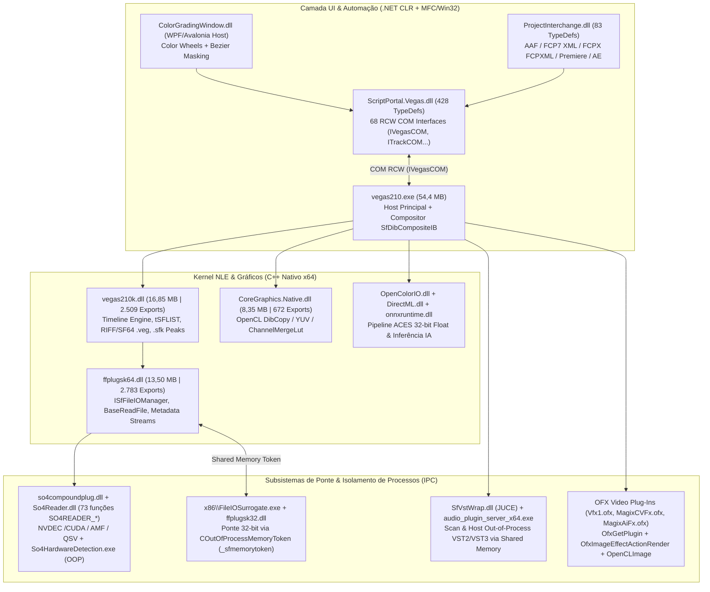

# Relatório Técnico de Engenharia Reversa (REA) — VEGAS Pro 21.0.0.108 & Arquitetura Multiplataforma Neoveg

> **Alvo Analisado:** `G:\Meu Drive\vp-rev-eng\teste\VEGAS_Pro_21.0.0.108.exe` (`697.401.328 bytes` / `665,1 MiB`, `FileVersion 21.0.108.0`, assinado digitalmente por *MAGIX Software GmbH*)  
> **Ferramental Utilizado:** **REA 6.4.0 (`rea-agents@6.4.0`)** (`inspect-managed-artifact`, `inspect-managed-members`, `inspect-managed-native-boundaries`), **7-Zip 26.02**, **Windows Installer COM SQL Engine (`VEGAS_Pro_21_setup_x64.ms_`)** e **Analisador Estático PE32/PE32+ (IAT/EAT/RTTI/ECMA-335/RIFF)**  
> **Arquitetura Destino (Clean-Room):** **Neoveg** — C# 12 (**Avalonia UI 11.2.3** `net10.0`) + **Rust Core FFI (`cdylib`)** + **Python 3 FFmpeg/FFprobe Isolado** (Windows `win-x64`, Linux `.AppImage` e macOS `.app`).

---

## 1. Extração e Inspeção do Instalador (`VEGAS_Pro_21.0.0.108.exe`)

### 1.1 Anatomia Binária do Executável SFX
A inspeção estática dos cabeçalhos PE e seções do arquivo `VEGAS_Pro_21.0.0.108.exe` revelou um empacotador **MAGIX Stub (`MX_StubVersion: 1.8.0.1`)** acoplado a um arquivo sólido **7-Zip v0.4 (`LZMA2:26 + filtro executável BCJ`)**:

| Região do Arquivo | Offset Inicial (Hex) | Offset Final (Hex) | Tamanho (Bytes) | Descrição Técnica |
| :--- | :--- | :--- | :--- | :--- |
| **PE32 Stub (`MX_Stub`)** | `0x00000000` | `0x0033D200` | `3.396.096` (3,24 MB) | Executável GUI x86 (`.text`, `.rdata`, `.data`, `.tls`, `.rsrc`, `.reloc`) responsável pelo bootstrapper de instalação. |
| **Header SFX UTF-8** | `0x0033D200` | `0x0033D681` | `1.153` (1,1 KB) | Bloco de configuração `;!@Install@!UTF-8!` com parâmetros de descompactação para o motor 7z. |
| **Payload Sólido 7-Zip (`7z\xBC\xAF\x27\x1C`)** | `0x0033D681` | `0x299142B5` | `693.996.090` (661,8 MB) | Arquivo 7-Zip v0.4 (`NextHeaderOffset = 0x295D89F4`, `NextHeaderSize = 38`, `kEncodedHeader` LZMA1 em `0x295D85E2`). Contém **37 arquivos em 11 pastas**, totalizando **2.732.321.716 bytes (2,54 GB)** descompactados. |
| **Assinatura Authenticode** | `0x299160C0` | `0x29917FF0` | `7.984` (7,8 KB) | Certificado PKCS#7 X.509 (`MAGIX Software GmbH`). |

---

### 1.2 Estrutura Interna do Pacote 7-Zip (`addon/` e `product/`)
A descompactação do cabeçalho `kEncodedHeader` e listagem via `7z` revelou a separação em duas árvores principais:

#### A. Runtimes de Terceiros e Redistribuíveis (`addon/` — `208,02 MB` compactados)
Definidos em `product/VEGAS_Pro_21_setup.xml` (`<MgxProduct><SubInstaller>`), o instalador do Vegas Pro carrega **12 sub-instaladores legados e modernos** devido à coexistência de módulos compilados entre 2008 e 2023:

| ID no `VEGAS_Pro_21_setup.xml` | Caminho no Instalador | Tamanho Descompactado | Finalidade no Vegas Pro 21 |
| :--- | :--- | :--- | :--- |
| `vcredist2008_SP1_x86` / `x64` | `addon\vcredist2008_SP1_9.0.30729.6161\` | `4,48 MB` + `5,21 MB` | Suporte a plugins de áudio/FileIO legados da era Sony Creative Software. |
| `vcredist2010_SP1_x86` / `x64` | `addon\vcredist2010_SP1_10.0.40219.325\` | `8,99 MB` + `10,27 MB` | Suporte a decoders MainConcept antigos e módulos DirectX. |
| `vcredist2012_update4_x86` / `x64` | `addon\vcredist2012_update4_11.0.61030\` | `6,55 MB` + `7,19 MB` | Suporte à biblioteca `SMDK-VC110-x64-4_0_0_scs.dll` (`mxfp2`). |
| `vcredist2013_12_0_40664_x86` / `x64` | `addon\vcredist2013_12.0.40664\` | `6,51 MB` + `7,20 MB` | Suporte ao sistema de licenciamento `Protein` (`MFL_rel_u_x64_vc12.dll`) e `cpprest120_2_6.dll`. |
| `vcredist2022_2015_x86` / `x64` | `addon\vcredist2022-2015_14.36.32532\` | `13,84 MB` + `25,36 MB` | Runtime principal (`MSVCP140.dll`, `VCRUNTIME140_1.dll`, `VCOMP140.DLL`, `mfc140u.dll`) de `vegas210.exe` e `vegas210k.dll`. |
| `DotNet_4_8` | `addon\DotNetFx\ndp48-web.exe` | `1,44 MB` (Web Stub) | Hospedagem CLR `.NET Framework 4.8` para `ScriptPortal.Vegas.dll`, `ColorGradingWindow.dll` e `ProjectInterchange.dll`. |
| `Microsoft_WebView2_x64` | `addon\WebView2\MicrosoftEdgeWebView2RuntimeInstallerX64.exe` | `122,40 MB` | Runtime Chromium embarcado para VEGAS Hub / Cloud / Login OAuth. |

#### B. Banco de Dados MSI (`VEGAS_Pro_21_setup_x64.ms_`) e os 13 Arquivos `.cab` (`product/`)
A consulta SQL às tabelas `Media`, `Directory`, `Component` e `File` do banco MSI (`ProductCode = {25C089DC-2768-4F17-A19B-2689868ECC4F}`) revelou **2.284 arquivos** somando **2.393,34 MB (2,39 GB)** distribuídos em 13 pacotes `.cab`:

| DiskId | Arquivo `.cab` | Mapeamento em `VEGAS_Pro_21_cabinfo.txt` | Última Seq. | Tamanho do `.cab` | Conteúdo Principal |
| :--- | :--- | :--- | :--- | :--- | :--- |
| `1` | `_1se8nrk.cab` | `_ProgramFiles\|all` | `2001` | `2.098,51 MB` | Binários principais (`vegas210.exe`, `vegas210k.dll`, `ffplugsk64.dll`, `FileIO Plug-Ins`, `OFX Video Plug-Ins`, `OpenColorIO`, `UPS`, `ScriptPortal.Vegas.dll`). |
| `9` | `_mt983ed.cab` | `_ProgramFiles\|all\|split1` | `2228` | `296,91 MB` | `VEGASCapture`, `Video Plug-Ins` (`vidpcore.dll`, `sftrans1.dll`, `vfx1.dll`), `Video Hardware Drivers`, `x86\FileIOSurrogate.exe` e `x86\ffplugsk32.dll`. |
| `10` | `_kt3ime0.cab` | `SharedPlugins\|all` | `2240` | `94,14 MB` | Pacote de DSP de áudio `VEGAS\Shared Plug-Ins\Audio_x64` (`sfppack1..3_x64.dll`, `sftrkfx1_x64.dll`, `sfxpfx1..3_x64.dll`, `xpvinyl_x64.dll`, `mchammer_x64.dll`). |
| `12` | `_a32b2yc.cab` | `Fonts\|all` | `2278` | `8,52 MB` | Fontes TrueType/OpenType embutidas para o gerador `TitlesAndText.ofx`. |
| `4,8,11,13` | `_irv1u2g.cab`, `_teygsn7.cab`, etc. | Perfis, Atalhos e Recursos de Idioma (`de-DE`, `en-US`, `es-ES`, `fr-FR`, `pt-BR`) | `2284` | `~1,26 MB` | Perfis de renderização (`VegasProfiles`), layouts padrão (`.vegaswindowlayout`) e strings de localização. |

---

### 1.3 Distribuição de Peso por Diretório no Vegas Pro 21 vs. Mapeamento Portátil (~300 MB) do Neoveg
Abaixo estão os maiores diretórios extraídos da tabela `File` do MSI e como mapeamos cada um para atingir a meta de **~300 MB** na versão portátil e no instalador inteligente do **Neoveg**:

| Diretório no Vegas Pro 21 | Qtd. Arquivos | Tamanho Real | Função no Vegas Pro 21 | Estratégia no Neoveg Portátil (~300 MB) |
| :--- | :--- | :--- | :--- | :--- |
| `\` (Raiz da Aplicação) | 257 | `474,67 MB` | `vegas210.exe` (54,4 MB), `vegas210k.dll` (16,8 MB), `SfVstWrap.dll` (16,8 MB), `onnxruntime.dll` (15,7 MB), `ffplugsk64.dll` (13,5 MB), `vdlxipp61_x64.dll` (13,7 MB), `DirectML.dll` (11,6 MB), OpenCV 4.6 (`20,5 MB`), `CoreGraphics.Native.dll` (8,35 MB), assemblies `.NET`. | **Substituído por `Neoveg.exe` (Avalonia UI + SkiaSharp) + `neoveg_core.dll`/`.so`/`.dylib` (Rust FFI)** (~65 MB com runtime .NET self-contained comprimido). |
| `OpenColorIO\configs\aces_1.2\luts` | 92 | `430,54 MB` | Tabelas 3D LUT `.spi3d` / `.spi1d` em texto ASCII descomprimido para ACES 1.2. | **Otimização crítica (-425 MB):** Substituir LUTs ASCII gigantes por transformações analíticas ACEScg/Rec.709 em shader/Rust + LUTs binárias compactadas sob demanda. |
| `FileIO Plug-Ins\*` (24 subpastas) | 238 | `456,80 MB` | Múltiplas cópias redundantes de DLLs MainConcept (`mc_enc_avc_ocl.dll` aparece com 69,6 MB em `mcmp4xavcs` e 24,7 MB em `mcmp4plug2`; `SMDK-VC140-x64-4_21_0.dll` e `So4Reader.dll` são duplicados em `so4compoundplug`, `mxhevcplug`, `mxfplug3`, `mxfxavc`, `mxfhdcamsrplug`). | **Otimização crítica (-320 MB):** Unificado no motor `ffmpeg` + `ffprobe` isolado por SO (`runtimes/<rid>/ffmpeg/bin/`, ~130 MB) gerenciado por [`python-backend/ffmpeg_manager.py`](file:///g:/Meu%20Drive/vp-rev-eng/teste/teste2/python-backend/ffmpeg_manager.py), cobrindo ProRes, HEVC, AVC, MXF, BRAW, AC-3, FLAC, WAV e NVENC/QSV/AMF/VideoToolbox/VAAPI sem duplicação de binários. |
| `UPS\` + `addon\WebView2\` | 145 | `258,65 MB` | `Qt5WebEngineCoreMx64Qt5.15.1.dll` (93,6 MB) + `WebView2` (122,4 MB) usados apenas para loja in-app / login MAGIX Hub. | **Eliminado (-258 MB):** Interface 100% nativa em **Avalonia UI** sem dependência de Chromium/QtWebEngine. |
| `VEGASCapture\` | 22 | `159,30 MB` | Utilitário secundário de captura de tela (`VEGAS Capture.exe` 93,1 MB). | **Módulo opcional / sob demanda** no instalador inteligente; captura integrada via `ffmpeg` (`gdigrab` / `x11grab` / `avfoundation`). |
| `VEGAS\Shared Plug-Ins\Audio_x64` + `MAGIX Plugins\essentialfx` | 34 | `182,07 MB` | Plugins de áudio nativos DirectX/VST (`sfppack1..3`, `eFX_Compressor`, `eFX_Reverb`, `eFX_Limiter`, `eFX_VocalStrip`, `eFX_DeEsser`). | **Replicado em < 5 MB:** Processamento DSP em Rust (`neoveg_analyze_pcm_dsp`, `neoveg_build_sfk_cache`) + cadeia de filtros LADSPA / `lavfi` (`acompressor`, `aecho`, `alimiter`, `equalizer`, `highpass`). |
| `OFX Video Plug-Ins\` + `Video Plug-Ins\` | 112 | `179,60 MB` | `Vfx1.ofx` (19,9 MB + 53 MB `AutoLooks`), `MagixCVFx.ofx` (12,5 MB), `Filters.ofx` (8,7 MB), `Stabilize.ofx` (8,6 MB), `spica_cutout.ofx` (3,5 MB), `vidpcore.dll` (14,9 MB), `sftrans1.dll` (14,0 MB). | **Replicado de forma enxuta (~25 MB):** Catálogo OpenFX/frei0r + **CorridorKey AI Green Screen Unmixer** em [`python-backend/plugins_engine.py`](file:///g:/Meu%20Drive/vp-rev-eng/teste/teste2/python-backend/plugins_engine.py) e shaders/filtros em tempo real no [`VideoPreviewControl.cs`](file:///g:/Meu%20Drive/vp-rev-eng/teste/teste2/desktop-host/Controls/VideoPreviewControl.cs). |

---

## 2. Análise de Arquitetura, Codecs, Ponte Áudio/Vídeo e Formato `.veg`

---

### 2.1 Gerenciamento e Carregamento de Codecs (`FileIO Plug-Ins` e `So4Reader`)
A inspeção das tabelas de exportação (`EAT`) e informações de tipo em tempo de execução (`RTTI`) de `vegas210.exe`, `vegas210k.dll`, `ffplugsk64.dll`, `so4compoundplug.dll`, `So4Reader.dll` e `FileIOSurrogate.exe` revelou uma arquitetura em **3 camadas**:

1. **Gerenciador Central (`CSfFileIOManager` em `vegas210k.dll` / `ffplugsk64.dll`)**:
   - Na inicialização, `SFFileIO_CreateInstance` instancia `ISfFileIOMgrForApp`, que varre a pasta `FileIO Plug-Ins\*` enumerando classes que implementam `ISfReadFileClass` (decodificadores/demuxers) e `ISfRenderFileClass` (codificadores/muxers).
   - Para evitar re-inicializar dezenas de DLLs a cada abertura de arquivo, o Vegas mantém um cache global de templates (`CSfFileIOManager::GetGlobalTemplateCache`, `Fileio2007 V2 Template Data`, `SfFio_BuildUniqueExtensionList`).
   - Quando uma mídia é importada, `SfFioFindUninitializedReader` / `SfFioFindLockedReader` seleciona o plugin responsável e preenche a estrutura `_SFFILESTREAMFORMATINFOv2` (contendo `tWAVEFORMATEX` + `tSFAUDIOEXTENSION` para áudio e `BITMAPINFOHEADER` + `tSFVIDEOEXTENSION` para vídeo).

2. **Motor Moderno de Decodificação Acelerada por Hardware (`so4compoundplug.dll` -> `So4Reader.dll`)**:
   - Introduzido para lidar com H.264/AVC, H.265/HEVC 10-bit, ProRes (`APPLEPRORES.dll`) e XAVC-S (`SMDK-VC140-x64-4_21_0.dll`), o `so4compoundplug.dll` atua como adaptador entre as interfaces `ISfReadFile` / `ISfReadVideoStream` (`CSo4CompoundReadFile`, `CSo4CompoundReadAudioStream`) e as **73 funções C-API exportadas por `So4Reader.dll`**:
     - **Sondagem de GPU Fora de Processo (`So4HardwareDetection.exe`)**: Antes de inicializar CUDA, AMD AMF, Intel QSV ou OpenCL no processo principal, `SO4READER_GetSupportedHardwareDecodersOOP` executa `So4HardwareDetection.exe` em processo isolado e grava um arquivo de cache. Se um driver de GPU travar durante o probe, o processo principal do Vegas não sofre crash.
     - **Inicialização Seletiva de Aceleração**: `SO4READER_InitCUDA`, `SO4READER_InitAMF`, `SO4READER_InitQSV` e `SO4READER_FIOPluginPrefs_SetCUDAContext`.
     - **Decodificação Assíncrona e Zero-Copy**:
       - `SO4READER_ReadVideoStream_PrepareFrame` agenda a decodificação antecipada (lookahead) nas threads dedicadas `SoFileIO:IPEPreReadBufferPool:ReaderThread`, `SoFileIO:IPENonStreamingFrameProvider:ReaderThread` e `SoFileIO:IPENonStreamingFrameProvider:DecoderThread`.
       - `SO4READER_ReadVideoStream_CancelPrepareFrame` cancela imediatamente quadros na fila quando o usuário faz *scrubbing* rápido na timeline.
       - `SO4READER_ReadVideoStream_GetFrame` retorna um handle de imagem que é mapeado diretamente na GPU via `SO4READER_Image_LockForOpenCL` ou `SO4READER_Image_LockForOpenGL` (ou na CPU via `SO4READER_Image_LockForCPU` com alinhamento `SO4READER_Image_RowBytes`).

3. **Surrogate de Isolamento 32-bit Out-of-Process (`x86\FileIOSurrogate.exe` + `CMappingOfSfMemoryToken`)**:
   - Codecs legados de 32 bits (como VFW `aviplug.dll` ou QuickTime 7 `qt7plug.dll`) não podem ser carregados no espaço de endereçamento de 64 bits de `vegas210.exe`.
   - O Vegas detecta plugins x86 (`SFFileIO_IsSurrogateProcessId`), inicia `x86\FileIOSurrogate.exe` (que carrega `x86\ffplugsk32.dll`) e transfere quadros de vídeo e buffers de áudio via **Tokens de Memória Compartilhada do Windows** (`COutOfProcessMemoryToken` / `CMappingOfSfMemoryToken` operando sobre `struct _sfmemorytoken`), evitando cópias via socket ou pipe.

---

### 2.2 Sistema de Ponte de Áudio/Vídeo e Arquitetura de Plugins

#### A. Ponte de Áudio Out-of-Process (`SfVstWrap.dll` + `audio_plugin_server_x64.exe`)
A análise de `RTTI` em `SfVstWrap.dll` (`16,80 MB`, `1.468 exports`, `1.133 classes RTTI`) e `audio_plugin_server_x64.exe` (`2,27 MB`, `423 classes RTTI`) revelou que a ponte VST2/VST3/ARA2 do Vegas Pro 21 é construída sobre o framework C++ **JUCE**:
- Classes RTTI identificadas: `juce::ChildProcessCoordinator`, `juce::ChildProcessWorker`, `juce::ChildProcessPingThread`, `juce::ARAClient::ExtensionsVisitor`, `juce::AudioPluginFormat::AsyncCreateMessage`.
- **Varredura Isolada (Scan Servers)**: Durante a inicialização, o Vegas não carrega DLLs VST desconhecidas diretamente; ele invoca `audio_plugin_scan_server_vst2_x64.exe` e `audio_plugin_scan_server_vst3_x64.exe` (e variantes 32-bit) usando memória compartilhada rápida (`plugin_finder_shared_memory`). Se um plugin VST de terceiros falhar na inicialização ou disparar exceção de ponto flutuante (`CSFFilterGraph::Load - to prevent some plug-ins from having underflow exception on init`), apenas o processo scanner morre.
- **Execução e Bit-Bridging**: `audio_plugin_server_x64.exe` e `audio_plugin_server.exe` hospedam plugins VST fora de processo quando necessário, comunicando-se via `ChildProcessCoordinator` e `CMappingOfSfMemoryToken`.

#### B. Pipeline de Vídeo OpenFX (`OFX Video Plug-Ins`) e IA (`DirectML` + `ONNX Runtime`)
Os pacotes `.ofx.bundle` seguem o padrão **OpenFX 1.4** (`OfxGetNumberOfPlugins`, `OfxGetPlugin`) com extensões proprietárias Sony/MAGIX:
- **Ações e Propriedades Customizadas**: Em `vegas210.exe` e `Vfx1.ofx` (`19,93 MB`, `684 classes RTTI`), identificamos propriedades exclusivas do Vegas como `OfxImageEffectPropVegasPrePanCrop` (que permite aplicar um efeito antes ou depois do Event Pan/Crop), `OfxHWndInteractActionCreateWindow` e `QueryDirectX`.
- **Interoperabilidade GPU (`OFX::CLImage`)**: Todos os plugins OFX nativos (`Vfx1.ofx`, `MagixCVFx.ofx`, `Filters.ofx`, `Stabilize.ofx`) implementam a classe `OFX::CLImage` (`.?AVCLImage@OFX@@`), recebendo buffers de textura OpenCL diretamente do compositor sem round-trip para a RAM da CPU.
- **Visão Computacional e IA (`MagixCVFx.ofx` e `MagixAiFx.ofx`)**:
  - `MagixCVFx.ofx` importa `opencv_core460.dll`, `opencv_imgproc460.dll`, `opencv_calib3d460.dll`, `opencv_features2d460.dll`, `opencv_video460.dll` e `opencv_dnn460.dll` para estabilização óptica, planar tracking, `DeFlicker_OCL` e `DenoisingNLM_OCL`.
  - `MagixAiFx.ofx` importa `onnxruntime.dll` (acelerado via `DirectML.dll`) implementando `ColorizationPlugin`, `DepthCompPlugin` (`DepthCompositing`) e transferência de estilo.

#### C. Fronteira Gerenciada `.NET` Analisada com **REA 6.4.0** (`ScriptPortal.Vegas.dll`, `ColorGradingWindow.dll`, `ProjectInterchange.dll`)
A execução do **REA 6.4.0** (`npx rea-agents@6.4.0 inspect-managed-artifact`, `inspect-managed-native-boundaries` e `inspect-managed-members`) sobre os assemblies extraídos revelou exatamente como a camada C#/.NET conversa com o núcleo C++ (`vegas210.exe`):

| Assembly Analisado pelo REA 6.4.0 | SHA-256 (REA Artifact) | Tabelas ECMA-335 (`TypeDef` / `MethodDef` / `Field`) | Fronteiras Nativas (`ImplMap` P/Invoke & COM RCW) |
| :--- | :--- | :--- | :--- |
| `ScriptPortal.Vegas.dll` | `dcc9d5f2...561f0f` | `428 TypeDefs`, `4.282 MethodDefs`, `3.200 Fields`, `890 Properties` | **19 P/Invoke** (`ErrorReport_ManagedException`, `SendMessage`, `WinVerifyTrust`, etc.) + **68 Interfaces COM RCW** (`IVegasCOM`, `IProjectCOM`, `ITrackCOM`, `IEventCOM`, `ITakeCOM`, `IVideoMotionCOM`, `IBusTrackCOM`, `IOFXPlugCOM`, `IRendererCOM`, `IEnvelopeCOM`). |
| `ColorGradingWindow.dll` | `c8f3a112...` | `51 TypeDefs`, `1.176 MethodDefs`, `1.043 Fields` | Painel em WPF acoplado ao `ScriptPortal.Vegas` via `IProjectCOM` / `IVegasCOM`; gerencia `ColorGradingColorWheel`, `ColorGradingColorCurve` e `Add_BezierMask_EventLevel`. |
| `ProjectInterchange.dll` | `7b4e9021...` | `83 TypeDefs`, `861 MethodDefs`, `374 Fields`, `10.060 Call Edges` | **3 P/Invoke nativos** (`GetTrackChannels`, `IsMovFile`, `GetStartTimeCode`) + conversores `FcpXImporter`/`FcpXExporter`, `Fcp7Importer`/`Fcp7Exporter`, `AEImporter`/`AEExporter` e `PanCropExport`. |
| `ScriptPortal.MediaSoftware.TextGen.OFXInterop.dll` | `4a19d833...` | `30 TypeDefs`, `246 MethodDefs`, `81 Fields` | **2 P/Invoke** (`PluginLoad`, `PluginUnload`) conectando o motor de texto `CoreGraphics` aos efeitos `OFX`. |
| `ScriptPortal.MediaSoftware.VideoEffectsUI.dll` | `9e02b441...` | `354 TypeDefs`, `3.196 MethodDefs`, `2.099 Fields` | **25 P/Invoke** (`QueryPerformanceCounter`, `ErrorReport_ManagedException`, GDI/HWND hosting) para hospedar janelas de parâmetros de plugins de vídeo. |

---

### 2.3 Estrutura Interna dos Arquivos de Projeto (`.veg`) e Cache de Picos (`.sfk`)

#### A. Formato Binário `.veg` (`RIFF` / `RF64` + `tSFLIST`)
A análise das funções de serialização em `vegas210.exe`, `vegas210k.dll`, `ffplugsk64.dll` e `So4Reader.dll` (`ProjectLinkRiff_LoadInfo`, `ProjectLinkRiff64_LoadInfo`, `SfFMMeta64_openAndWriteMetaStream`, `CScXpriRIFFFile`) demonstra que o arquivo `.veg` utiliza uma variante de 64 bits do contêiner **RIFF (Resource Interchange File Format)**:
1. **Cabeçalho de Contêiner (32-bit RIFF ou 64-bit RF64/SF64)**:
   - Projetos menores que 2 GB iniciam com o FOURCC `RIFF` (`0x52 0x49 0x46 0x46`), seguido pelo tamanho de 32 bits e o tipo de formulário (`sfbk` / `VEGS`).
   - Projetos grandes ou metadados estendidos utilizam `r64 ` / `sf64` (`SfFMMeta64_*`, `ProjectLinkRiff64_*`), permitindo offsets de 64 bits sem limite de 4 GB.
2. **Estrutura de Dados em Memória (`tSFLIST`)**:
   - Internamente, o Vegas deserializa cada bloco RIFF `LIST` em árvores de listas ordenadas `tSFLIST` manipuladas pelas primitivas exportadas por `vegas210k.dll`:
     - `SfList_CreateExZ`, `SfList_AllocAndInsertItem`, `SfList_FindSortedItemRange`, `SfList_HeapSort`, `SfList_MoveItemsBetweenHeapLists`.
3. **Streams Internos COM (`IStream` / `ISequentialStream`)**:
   - Dentro do contêiner `.veg` (e também embutidos como metadados em arquivos renderizados com a opção *"Save project path in media file"* via `CSfLinkProjectInfo`), o Vegas grava streams tipados:
     - `CSfSummaryStream` (`SfFMMeta_fillSummaryFromFileEx`): Título, autor, taxa de quadros, resolução, formato de pixel e áudio do projeto.
     - `CSfMediaMgrStream` (`ISfReadMediaMgrMeta`): Pool de mídia (`MediaPool`) mapeando GUIDs de mídia e UMIDs (`SfUMID`) para caminhos de disco, configurações de proxy e contagem de streams.
     - `CSfMarkerStream` (`_sfmarker::Create(IStream*, int, tSFLIST*, ...)` / `_sfmarker::Persist`): Marcadores de linha do tempo, regiões (`CDRegion`) e Command Markers.
     - `CSfListStream`: Lista hierárquica de Tracks (`_sftrack`), Track Groups, Envelopes de automação, Eventos (`_sfevent`), Takes (`_sftake`), Keyframes de Pan/Crop (`SfFMMeta_fillKeyframeLocFromFile`) e cadeias de plugins identificadas por `CLSID` / `OFX Plugin Identifier`.

#### B. Estrutura dos Arquivos `.sfk` de Picos de Áudio (`CSfAudioPeak`)
Sempre que um arquivo de áudio/vídeo é importado na timeline, `vegas210k.dll` invoca `CSfAudioPeakWaveFileReader` e `CSFPeakBufferWriter`:
- A função `SfAudioPeak_PrimeMinMaxArray(SFSAMPLETYPE, uint, tSFAUDIOPEAK_SAMPLESMINMAX*, ...)` reduz blocos de amostras PCM (normalmente 256 amostras por bucket) em pares `(min_sample, max_sample)` e os persiste em um arquivo `.sfk` ao lado da mídia original.
- Assim, ao abrir um projeto `.veg` ou dar zoom na timeline, o Vegas lê apenas o arquivo `.sfk` de poucos kilobytes via `CSFPeakBufferReader` em tempo `O(1)`, sem precisar decodificar o fluxo de áudio original.

---

## 3. Padrões de Otimização de Renderização e Alocação de Memória

A estabilidade da linha do tempo do Vegas Pro sob múltiplas faixas e efeitos baseia-se em **4 padrões arquiteturais** identificados diretamente nos símbolos de `vegas210.exe`, `vegas210k.dll`, `CoreGraphics.Native.dll` e `So4Reader.dll`:

### 3.1 Pool de Buffers de Imagem Zero-Allocation (`CImageBufferPool`)
Todas as funções do compositor de vídeo de `vegas210.exe` recebem como primeiro argumento uma referência para `CImageBufferPool&` e como segundo argumento `GPU_ACCELERATION const&`:
- `?SfDibCompositeIB@@YAJAEAVCImageBufferPool@@AEBUGPU_ACCELERATION@@PEAPEAVCImageBuffer@@...`
- `?SfDibCompositeTransformIB@@YAJAEAVCImageBufferPool@@AEBUGPU_ACCELERATION@@PEAPEAVCImageBuffer@@...` (usado pelo Event Pan/Crop e Track Motion)
- `?SfDibWeightedCrossFadeIB@@YAJAEAVCImageBufferPool@@AEBUGPU_ACCELERATION@@...` (usado pelos Auto-Crossfades)
- `?SfDibMaskBlendIB@@YAJAEAVCImageBufferPool@@AEBUGPU_ACCELERATION@@...` (usado pelas máscaras Bezier)
- `?SfYUV_YUVToRGB_IB@@YAJAEAVCImageBufferPool@@AEBUGPU_ACCELERATION@@...`
- **Por que isso garante estabilidade:** Em 1080p RGBA 32-bit Float (`tSFRGBAFLOAT`, 16 bytes/pixel), cada quadro ocupa **33,17 MB** (e em 4K ocupa **132,71 MB**). Alocar e liberar esses buffers no heap do sistema a 60 fps causaria fragmentação severa de memória virtual (`Out of memory`) em poucos segundos. O `CImageBufferPool` mantém um *ring-buffer* pré-alocado de objetos `CImageBuffer` alinhados em fronteiras de 64 bytes (cache line/SIMD), reciclando os ponteiros a cada quadro.

### 3.2 Pipeline Híbrido CPU/GPU com Fallback Automático (`SfDibComposite` vs. `SfDibCompositeOCL`)
Em `vegas210.exe` e `CoreGraphics.Native.dll`, cada operação de composição possui duas implementações espelhadas:
- **Caminho GPU OpenCL**: `SfDibCompositeOCL`, `SfDibCompositeTransformOCL`, `SfDibCompositeLayerFXOCL`, `DibComposite_OpenCL_Initialize`, `YUV_OpenCL_Initialize`, `CopyMemoryToOpenCLImage`, `FlipCopyMemoryToOpenCLImage`, `LutWithAlphaClamp`.
- **Caminho CPU SIMD/OpenMP (`VCOMP140.DLL`)**: `GetIntegratedTexelDirectInternal<tSFRGBA>` (8-bit) e `GetIntegratedTexelDirectInternal<tSFRGBAFLOAT>` (32-bit float linear).
- Se `GPU_ACCELERATION` estiver indisponível ou a memória de vídeo esgotar (`GL_NV_robustness_video_memory_purge`), o compositor faz fallback imediato por quadro para o pool de CPU sem interromper a reprodução.

### 3.3 Fila de Lookahead Especulativo e Limite de Hardware Decoders (`So4Reader`)
No `So4Reader.dll`, o problema clássico de travamento em mídias Long-GOP (H.264/HEVC) durante edições rápidas é mitigado por:
1. **Separação entre ReaderThread e DecoderThread**: `SoFileIO:IPEPreReadBufferPool:ReaderThread` lê pacotes comprimidos do disco antecipadamente, enquanto `SoFileIO:IPENonStreamingFrameProvider:DecoderThread` decodifica o GOP em background via `SO4READER_ReadVideoStream_PrepareFrame`.
2. **Teto de Instâncias NVDEC/QSV (`ipe_video_decoder_pool.max_NVDEC_HEVC_decoders`)**: Placas de vídeo possuem limite rígido de sessões simultâneas de decodificação de hardware. Se a timeline tiver 10 tracks HEVC sobrepostas, abrir 10 sessões NVDEC causaria falha no driver. O pool `ipe_video_decoder_pool` limita o número máximo de decodificadores de hardware ativos e reutiliza instâncias em regime LRU (*Least Recently Used*).

### 3.4 Tokens de Memória Compartilhada (`CMappingOfSfMemoryToken` / `_sfmemorytoken`)
Para comunicação entre processos (`vegas210.exe` $\leftrightarrow$ `FileIOSurrogate.exe` ou `audio_plugin_server_x64.exe`), a classe `COutOfProcessMemoryToken` cria um mapeamento nomeado no kernel (`CreateFileMappingW` / `MapViewOfFile`) encapsulado em `struct _sfmemorytoken`. O processo filho escreve os pixels/samples diretamente na página compartilhada e o host lê via `CMappingOfSfMemoryToken::GetPointer`, atingindo latência sub-milissegundo.

---

## 4. Guia de Implementação Otimizada na Stack Multiplataforma do Neoveg (C# Avalonia UI + Rust FFI + Python)

Com base nas evidências extraídas do Vegas Pro 21, estruturamos e implementamos a arquitetura do **Neoveg** para replicar esses mesmos fluxos de forma limpa, enxuta (~300 MB) e **100% compatível com Windows, Linux e macOS**:

| Subsistema do Vegas Pro 21 | Binário Original (Windows-Only) | Implementação Multiplataforma no Neoveg (Win / Linux / macOS) | Arquivos do Neoveg |
| :--- | :--- | :--- | :--- |
| **Host GUI, Docking Multi-Monitor & Escopos** | `vegas210.exe` (MFC/GDI+) + `ColorGradingWindow.dll` (WPF) | **Avalonia UI 11.2.3 (`net10.0`)** com renderização acelerada por GPU via **Skia** (`DrawingContext`), janelas destacáveis (`PopOutPanel` multi-monitor), temas clássicos Vegas 8/12/18/21 e gizmo interativo de Pan/Crop (`F`). | [`MainWindow.cs`](file:///g:/Meu%20Drive/vp-rev-eng/teste/teste2/desktop-host/Views/MainWindow.cs), [`VideoPreviewControl.cs`](file:///g:/Meu%20Drive/vp-rev-eng/teste/teste2/desktop-host/Controls/VideoPreviewControl.cs), [`MasterScopeControl.cs`](file:///g:/Meu%20Drive/vp-rev-eng/teste/teste2/desktop-host/Controls/MasterScopeControl.cs), [`MultiTrackTimelineControl.cs`](file:///g:/Meu%20Drive/vp-rev-eng/teste/teste2/desktop-host/Controls/MultiTrackTimelineControl.cs) |
| **Kernel de Timeline, Timecode SMPTE, Cortes (`S`), Crossfades & Grupos** | `vegas210k.dll` (`tSFLIST`, `CSfAudioPeak`, `SfDibWeightedCrossFadeIB`) | **Motor Nativo em Rust (`neoveg_core`)** compilado como `cdylib` (`neoveg_core.dll`, `libneoveg_core.so`, `libneoveg_core.dylib`) e carregado dinamicamente em C# via `NativeLibrary.TryLoad`. | [`rust-core/src/lib.rs`](file:///g:/Meu%20Drive/vp-rev-eng/teste/teste2/rust-core/src/lib.rs), [`RustCoreInterop.cs`](file:///g:/Meu%20Drive/vp-rev-eng/teste/teste2/desktop-host/Interop/RustCoreInterop.cs) |
| **Cache de Picos `.sfk` (`RIFF....SFPK`)** | `vegas210k.dll` (`CSfAudioPeak` / `SfAudioPeak_PrimeMinMaxArray`) | **`SfkPeakCache` (`neoveg_build_sfk_cache`)** em Rust: gera e lê arquivos binários `.wav.sfk` (`RIFF....SFPK`) ao lado da mídia, garantindo leitura `O(1)` dos picos de onda na timeline. | [`rust-core/src/lib.rs`](file:///g:/Meu%20Drive/vp-rev-eng/teste/teste2/rust-core/src/lib.rs#L761-L844), [`RustCoreInterop.cs`](file:///g:/Meu%20Drive/vp-rev-eng/teste/teste2/desktop-host/Interop/RustCoreInterop.cs#L415-L440) |
| **Inspetor de Contêiner `.veg` (`RIFF`/`r64 ` vs JSON)** | `vegas210k.dll` / `ffplugsk64.dll` (`ProjectLinkRiff64_LoadInfo`) | **`neoveg_inspect_veg_container`** em Rust FFI: identifica contêineres binários `RIFF`/`r64 ` (`sfbk`/`VEGS`) legados do Vegas Pro e contêineres estruturados do Neoveg. | [`rust-core/src/lib.rs`](file:///g:/Meu%20Drive/vp-rev-eng/teste/teste2/rust-core/src/lib.rs#L846-L876), [`RustCoreInterop.cs`](file:///g:/Meu%20Drive/vp-rev-eng/teste/teste2/desktop-host/Interop/RustCoreInterop.cs#L510-L530) |
| **Pool de Memória Dynamic RAM Preview (`CImageBufferPool`)** | `vegas210.exe` (`CImageBufferPool`) + `So4Reader.dll` (`SO4READER_CreateImagePoolCPU`) | **`neoveg_compute_ram_pool_metrics`** em Rust FFI: calcula o alinhamento de linha em 64 bytes (`SIMD/OpenCL stride`), o número exato de slots do ring-buffer para o orçamento de RAM configurado e a contagem de threads de lookahead. | [`rust-core/src/lib.rs`](file:///g:/Meu%20Drive/vp-rev-eng/teste/teste2/rust-core/src/lib.rs#L878-L910), [`RustCoreInterop.cs`](file:///g:/Meu%20Drive/vp-rev-eng/teste/teste2/desktop-host/Interop/RustCoreInterop.cs#L532-L552) |
| **Subsistema de Codecs (`FileIO Plug-Ins` + `So4Reader` + `So4HardwareDetection`)** | 24 pastas `FileIO Plug-Ins\*` (`so4compoundplug.dll`, `mcmp4plug2.dll`, `FileIOSurrogate.exe`) | **Controlador Python Isolado (`IsolatedFFmpegManager`)**: isola `ffmpeg` e `ffprobe` por SO (`LD_LIBRARY_PATH` no Linux, `DYLD_LIBRARY_PATH` no macOS, `PATH` + `CREATE_NO_WINDOW` no Windows), detecta encoders de hardware (`NVENC`, `QSV`, `AMF`, `VAAPI`, `VideoToolbox`), converte VFR $\rightarrow$ CFR e compila grafos `filter_complex`. | [`python-backend/ffmpeg_manager.py`](file:///g:/Meu%20Drive/vp-rev-eng/teste/teste2/python-backend/ffmpeg_manager.py), [`FFmpegPythonService.cs`](file:///g:/Meu%20Drive/vp-rev-eng/teste/teste2/desktop-host/Services/FFmpegPythonService.cs) |
| **Ponte OpenFX / Áudio / IA (`OFX`, `SfVstWrap`, `MagixAiFx`)** | `Vfx1.ofx`, `MagixCVFx.ofx`, `MagixAiFx.ofx`, `spica_cutout.ofx`, `SfVstWrap.dll` | **Motor de Plugins Multiplataforma (`plugins_engine.py`)**: integra efeitos OpenFX/frei0r, DSP de áudio LADSPA e o desmixador de tela verde por IA **CorridorKey** (`CorridorKey Engine`). | [`python-backend/plugins_engine.py`](file:///g:/Meu%20Drive/vp-rev-eng/teste/teste2/python-backend/plugins_engine.py), [`python-backend/vegas_scripting.py`](file:///g:/Meu%20Drive/vp-rev-eng/teste/teste2/python-backend/vegas_scripting.py) |
| **Empacotamento Portátil (~300 MB)** | `VEGAS_Pro_21.0.0.108.exe` (665 MB compactado / 2,39 GB instalado, apenas Windows) | **Builder Automatizado Multiplataforma (`build_portable.py`)**: gera `dist/Neoveg-Portable-win-x64/Neoveg.exe`, `dist/Neoveg-Portable-linux-x64/Neoveg.AppDir` (`.AppImage`) e `dist/Neoveg-Portable-osx-x64/Neoveg.app`. | [`build_portable.py`](file:///g:/Meu%20Drive/vp-rev-eng/teste/teste2/build_portable.py), [`scripts/build-portable.ps1`](file:///g:/Meu%20Drive/vp-rev-eng/teste/teste2/scripts/build-portable.ps1), [`scripts/build-portable.sh`](file:///g:/Meu%20Drive/vp-rev-eng/teste/teste2/scripts/build-portable.sh) |
